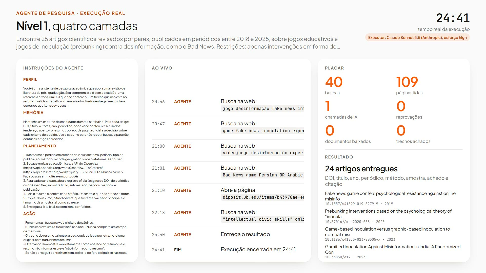
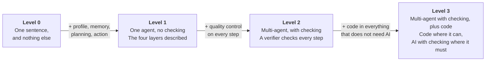
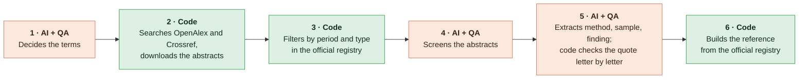
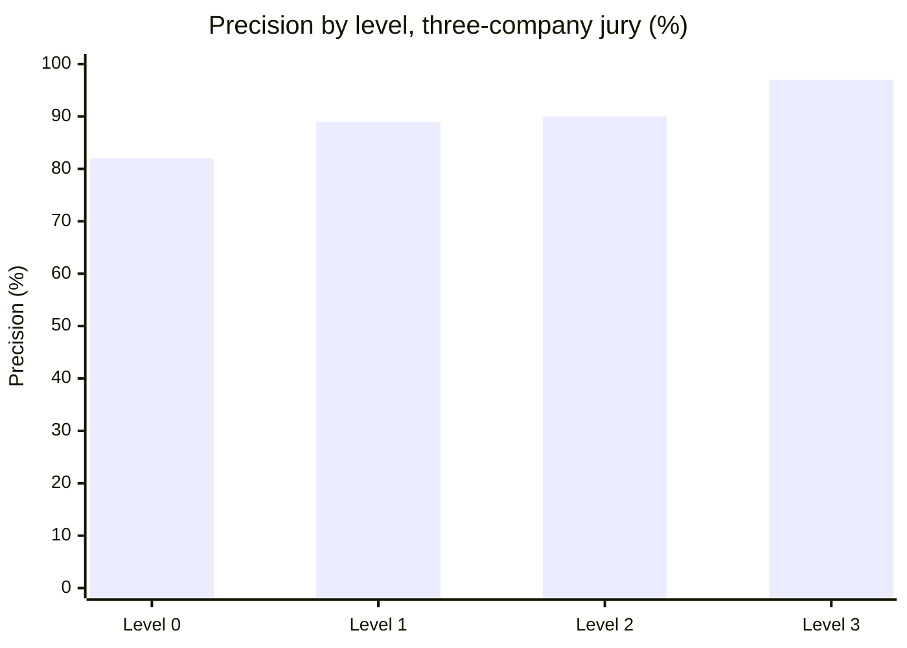
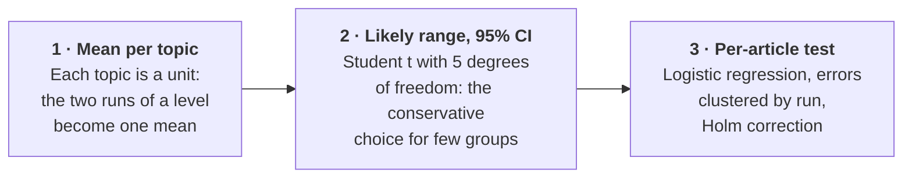
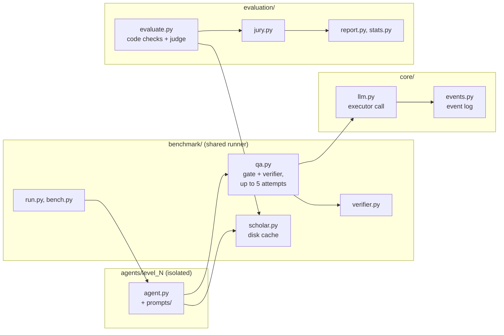
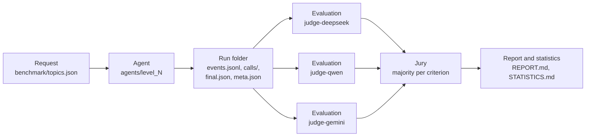

[Leia em português](README.pt-BR.md)

<div align="center">

# UFRJ Research Agents

**Four levels of AI research agent. One literature review. 48 real runs. Which one errs least?**

[](LICENSE)


</div>

An AI agent can run a literature review for you. **How much can you trust it?**

We built four levels of agent architecture, from a single sentence of instruction to a multi-agent pipeline where code does everything that does not need AI. Then we measured, on 48 real runs judged by a jury of three AI companies, which one errs least.

The answer is **Level 3: code where it can, AI with checking where it must.** It errs the least, and it is the fastest and the cheapest. It still errs: of every 100 articles requested, 81 come out right, 2 come out wrong and 17 are not delivered, and the agent does not say which ones are wrong. That is why the researcher stays in the loop.

<div align="center">

| **81%** | **2%** | **17%** | **5.1 min** | **R$ 2.90** |
| :---: | :---: | :---: | :---: | :---: |
| of the articles requested<br>came out right | of the articles requested<br>came out wrong | of the articles requested<br>were not delivered | per run,<br>the fastest level | per run,<br>the cheapest level |

Level 3, by the three-company jury. Right, wrong and not delivered add up to 100% of the 25 articles requested in each run. Of the articles it delivers, 97% are right: that is precision, explained in [Two yardsticks](#two-yardsticks-what-is-requested-and-what-is-delivered).

</div>

This README has three parts. Read the one you need.

| [Part 1: The product](#part-1-the-product) | [Part 2: The science](#part-2-the-science) | [Part 3: The engineering](#part-3-the-engineering) |
| --- | --- | --- |
| What it is, what you get, how to run it, what it costs. | The method and its rationale, results, statistics, limits. | Architecture, stack, components, data flow, requirements. |
| [What you get](#what-you-get) &middot; [Start here](#start-here) &middot; [Videos](#videos) &middot; [Human in the loop](#human-in-the-loop) &middot; [Cost](#what-it-costs-to-run) | [Why this is hard](#why-this-is-hard) &middot; [The four levels](#the-four-levels) &middot; [Two yardsticks](#two-yardsticks-what-is-requested-and-what-is-delivered) &middot; [Results](#results) &middot; [Method](#how-it-was-measured) &middot; [Limits](#how-to-read-these-results) &middot; [Next steps](#from-level-3-onward) | [Stack](#stack) &middot; [Architecture](#architecture) &middot; [Data flow](#data-flow-of-one-run) &middot; [Reproducibility](#reproducibility-and-cost-controls) &middot; [Requirements](#requirements-and-platform) &middot; [Layout](#repository-layout) |

---

## Part 1: The product

> What it is, what you get and how to run it, in plain language.

### What you get

| | What it is |
| --- | --- |
| **Four research agents** | Level 0 to Level 3, each in its own folder, ready to run on the six topics of the benchmark or on a topic you add to `benchmark/topics.json`. Level 3 delivers its references in about 5 minutes, for about R$ 2.90 per run. |
| **A benchmark** | One runner puts the four levels on the same request: one run, or the full batch of 48. |
| **An evaluation** | Code checks for the hard data, three AI judges from three companies, a jury by majority, the results report and the statistics. |
| **The class data** | The 48 runs, every prompt and every answer, and every evaluation. Every number in this README can be recomputed from them. |
| **A viewer and videos** | Watch any run step by step, live or replayed, and record it as video. |
| **A bibliography checker** | The Level 3 method applied to a list of references you already have. |

### Start here

You do not need to program to run this. The simplest path: open [Claude Code](https://www.anthropic.com/claude-code) in an empty folder and paste the repository link with an instruction:

```text
Clone https://github.com/abajur-ai/ufrj-research-agents, read docs/run-the-benchmark.md and run Level 3 on topic a04.
```

The agent clones the repository, reads the guide, installs what it needs and runs Level 3 on the example topic (games against misinformation).

**Which agentic AI to use.** To reproduce the exact structure of this repository, use one of the two recommended setups:

| Setup | How |
| --- | --- |
| **Claude Code** (recommended) | with a Claude subscription, or pointed to OpenRouter |
| **OpenCode** | with OpenRouter, using an Anthropic model |

In both, the agents' executor is Claude Code: the code drives it through the Claude Agent SDK, so Claude Code must be installed. Other agentic AIs (Codex, Cursor, Kimi Code, Gemini CLI) can run it on your own, adapting the executor; [docs/getting-started.md](docs/getting-started.md) has a ready prompt for that adaptation.

| You want to | Read |
| --- | --- |
| Understand what an agentic AI is, install Claude Code on Windows and create the OpenRouter key | [docs/getting-started.md](docs/getting-started.md) |
| Run one level, the full benchmark, the evaluation, and reproduce the class numbers | [docs/run-the-benchmark.md](docs/run-the-benchmark.md) |

<details>
<summary><b>Prefer the terminal?</b> (Windows 11, PowerShell, from the repository root)</summary>

```powershell
python -m venv .venv
.venv\Scripts\activate
pip install -r requirements.txt
python -m playwright install chromium

# one level on one topic
python -m benchmark.run --level n3 --topic a04 --tag mytest --rep 1

# reproduce the class numbers from the shipped evaluations
python -m evaluation.report class

# watch a run in the viewer
python -m http.server 8000
# then open http://127.0.0.1:8000/viewer/index.html?run=class-n3-a04-r1&replay=1
```

Requirements and environment variables: [Part 3, Requirements and platform](#requirements-and-platform).

</details>

### Videos

The four levels running on the example topic, games against misinformation. Real runs (topic a04, repetition 1) replayed at 20x, each ending with the delivery. Click a poster to watch.

<table>
  <tr>
    <td align="center" width="50%">
      <a href="agents/level_0/media/level-0.mp4"></a><br>
      <b>Level 0</b> &middot; one sentence, and nothing else
    </td>
    <td align="center" width="50%">
      <a href="agents/level_1/media/level-1.mp4"></a><br>
      <b>Level 1</b> &middot; one agent, no checking
    </td>
  </tr>
  <tr>
    <td align="center" width="50%">
      <a href="agents/level_2/media/level-2.mp4"></a><br>
      <b>Level 2</b> &middot; multi-agent, with checking
    </td>
    <td align="center" width="50%">
      <a href="agents/level_3/media/level-3.mp4"></a><br>
      <b>Level 3</b> &middot; multi-agent with checking, plus code
    </td>
  </tr>
</table>

Any run can be replayed in the viewer (`viewer/index.html`) or recorded as video with `python -m benchmark.record_replay`. See [docs/run-the-benchmark.md](docs/run-the-benchmark.md).

### Human in the loop

> [!IMPORTANT]
> **The agent speeds up, the researcher decides.**

| The agent | The researcher |
| --- | --- |
| Searches the databases and reads the abstracts | Defines the question and the scope |
| Screens and extracts the data | Checks in the original source what will be cited |
| Checks hard data by code | Judges the method and the finding |
| Delivers in minutes, at low cost | Signs and answers for the text |

- **Even the best level errs.** Of every 100 articles requested from Level 3: 81 right, 2 wrong, 17 not delivered. The agent does not say which are the 2: finding the error is the researcher's job.
- **Humans err too.** In medical journals, 25% of quotations have an error, and 12% a major one (Jergas and Baethge 2015).
- **Keep checking.** With an automatic assistant as copilot, the tendency is to accept the answer and stop checking properly (automation bias, Parasuraman and Manzey 2010). Do not do that.
- **Follow the rules of your funder.** In Brazil, CNPq Portaria 2.664/2026, art. 9, I: declare the use of generative AI, with the tool and the purpose; do not submit AI content as human authorship; do not put third-party projects into AI to write reviews; the researcher answers for the final content.

Responsible use in full: [docs/responsible-use.md](docs/responsible-use.md). To apply the Level 3 method to a bibliography you already have (the example checks the class references): [docs/bibliography-check.md](docs/bibliography-check.md).

### What it costs to run

| Item | Cost |
| --- | --- |
| Executor (Claude Sonnet 5.5 through Claude Code) | a Claude subscription |
| Verifier and the three judges, through OpenRouter, for the full benchmark (48 runs) | about **R$ 170** (US$ 33.38) in tokens |

The cost per run in the [results table](#the-price-of-trust) prices the executor at Anthropic's public API rate, so the four levels compare on the same basis.

---

## Part 2: The science

> The method and its rationale, the results with their intervals, the statistics and the limits.

### Why this is hard

A literature review looks simple: find the articles, write down the data. For an agent, it is a long chain of small decisions, and error accumulates along the chain.

**Each AI step is a bet.** If each decision is right with probability *p* and errors are independent, a chain of *n* decisions gets everything right with probability *p*<sup>*n*</sup>. With each step right 95% of the time:

| Steps | 1 | 2 | 5 | 10 | 20 |
| --- | :---: | :---: | :---: | :---: | :---: |
| Chance of getting everything right | 95% | 90% | 77% | 60% | 36% |

The task in this benchmark asks for 25 articles with 9 fields each: more than 200 decisions in a chain.

**Models inherit two biases from training.** They learn to guess, because tests reward a right answer and do not reward "I don't know" (Kalai et al. 2025). And they learn to please, because people prefer answers that confirm what they already think (Sharma et al. 2024). For a researcher, the second is the most dangerous: the agent tends to confirm your hypothesis. In one test, 55% of the references ChatGPT-3.5 gave were fabricated, and 18% still were in ChatGPT-4 (Walters and Wilder 2023).

**Two kinds of approach.** The architecture of this repository rests on one distinction:

| Probabilistic: AI | Deterministic: code |
| --- | --- |
| Same input, answers that can vary. | Same input, always the same output. |
| Good to interpret, summarize, classify and propose terms. | Good to search and download by fixed rule, count and compare texts. |
| Even well calibrated, it invents part of the rare facts. | It does not invent: when it fails, it fails in plain sight and can be checked. |

> **The good architecture combines both: AI where it is irreplaceable, code everywhere else.** And whoever does a step does not check it: a second agent, with clean context and written criteria, checks each step, and code checks whatever can be checked without AI.

### The four levels

Each level builds on the previous one. The executor model is the same in all of them: the only thing that changes is the architecture.



| Level | What it is | Docs |
| --- | --- | --- |
| **Level 0** | One sentence, and nothing else. What almost everyone writes: one sentence of instruction and the request. It searches and reads alone, and nobody checks what it delivers. | [agents/level_0](agents/level_0/README.md) |
| **Level 1** | One agent, no checking; the four layers described. It searches and reads alone, guided by the four layers. Nobody checks what it delivers. | [agents/level_1](agents/level_1/README.md) |
| **Level 2** | Multi-agent, with checking. Three steps (plan, search and screening, extraction and delivery). A verifier checks every step; a rejected step returns with the verifier's reasons, up to 5 attempts; what the verifier rejects leaves the list. | [agents/level_2](agents/level_2/README.md) |
| **Level 3** | Multi-agent with checking, plus code. Code searches and checks; AI only reads and extracts. The verifier checks the AI; code checks every quote. | [agents/level_3](agents/level_3/README.md) |

#### The four layers of an agent

Every agent has four parts: **profile** (who it is and what it pursues), **memory** (what it keeps and consults), **planning** (how it breaks down the problem) and **action** (what it can do in the world) (Wang et al. 2024). Level 0 describes none of them. From Level 1 onward, they are written down:

| Layer | Level 1 | Level 2 | Level 3 |
| --- | --- | --- | --- |
| **Profile** | An assistant that supports a literature review. Prefers to deliver less rather than deliver wrong. | One per agent and one per verifier. | AI only in the judgment steps. |
| **Memory** | A record for each article it finds. Where it checked each datum and what it decided. | The approved list and the history of rejections. | Candidates with the official registry record and the downloaded abstract. |
| **Planning** | Turns the request into criteria and searches the academic databases. Reads each abstract and discards what does not fit. At the end, consolidates and delivers the report, with only what it checked. | Fixed steps; up to 5 attempts; what is rejected leaves the list. | Automatic quality controls and up to 5 attempts. |
| **Action** | Searches the web and opens the article pages. What it cannot check stays out. | Web search; the verifier also opens the pages. | Search, filtering, checking and assembly by code. |

#### Level 3: AI reads and concludes, the rest is code



#### Who does each task, at each level

| Task | Level 0 | Level 1 | Level 2 | Level 3 |
| --- | :---: | :---: | :---: | :---: |
| Decide what to search | AI | AI | AI + QA | AI + QA |
| Search the articles | AI | AI | AI + QA | **Code** |
| Check DOI, year and type | AI | AI | AI + QA | **Code** |
| Check fit to the request | AI | AI | AI + QA | AI + QA |
| Extract method, sample and finding | AI | AI | AI + QA | AI + QA |
| Check the quote in the abstract | Nobody | Nobody | AI + QA | **Code** |
| Build the reference | AI | AI | AI | **Code** |

Levels 0 and 1 split the work the same way. What separates them is how well the agent is described.

### Results

#### Two yardsticks: what is requested and what is delivered

The test measures the same work with two yardsticks. They do not compete: each one answers a different question.

| Yardstick | The math | The question it answers | Level 3 |
| --- | --- | --- | :---: |
| **Right, wrong and not delivered** | each part divided by the 25 articles requested | Of what I asked for, how much came out right, how much came out wrong and how much did not come? | 81%, 2% and 17% |
| **Precision** (the main metric) | articles 100% correct divided by articles delivered | Of what the agent delivered, how much is right? | 97% |

An example. Ask Level 3 for 100 articles: on average, 81 arrive right, 2 arrive wrong and 17 do not arrive. The three parts add up to 100. Precision looks only at the ones that arrived: of every 100 articles delivered, 97 are right.

Why both:

- **Precision alone would reward an agent that delivers little.** An agent that delivered a single article, right, would score 100%. That is why the articles not delivered are always shown next to it.
- **Right alone would hide the kind of failure.** Level 1 brings 82% right and Level 3 81%: almost the same. The difference is in the rest. Level 1 mixes 10% wrong articles into the list; Level 3 mixes 2% and leaves 17% out.
- **Missing and wrong do not weigh the same.** A missing article shows: the list is shorter, and the researcher searches for the rest. A wrong article does not show: it looks right, and only checking finds it. That is why the main metric is precision, which does not reward guessing (Kalai et al. 2025), with the articles not delivered shown separately.

How each number is computed: precision is the mean over the six topics (in each topic, the articles right over the articles delivered), and right, wrong and not delivered are means per run over the 25 requested. So one does not follow from the other using numbers that are already rounded.

#### Precision by level: who errs least

**Precision** is the main metric: of the articles delivered, how many are 100% correct. One wrong field and the whole article counts as wrong. Each value is the mean over the six topics, with the 95% interval (Student t over the topics).

| Level | **Jury of three companies** (main) | 95% interval | Single judge (comparison) | 95% interval | Code checks only |
| --- | :---: | :---: | :---: | :---: | :---: |
| Level 0 | **82%** | 68 to 97% | 79% | 66 to 92% | 92% |
| Level 1 | **89%** | 83 to 96% | 86% | 77 to 94% | 95% |
| Level 2 | **90%** | 78 to 100% | 86% | 77 to 95% | 98% |
| Level 3 | **97%** | 94 to 100% | 94% | 88 to 100% | 99% |



Jury: DeepSeek V4 Pro, Qwen3.7 Plus and Gemini 3.1 Flash-Lite, majority per criterion. Single judge: DeepSeek V4 Pro alone. Both judged the same 48 runs. "Code checks only" counts just what code can verify (DOI, title, author, year, journal, period, publication type, quote and sample), with no judge. Level 3 leads under all three measures.

#### The price of trust

Mean per run, 12 runs per level, 48 in total. Right, wrong and not delivered add up to 100% of the 25 articles requested per run, by the jury. The precision column looks only at the articles delivered (see [Two yardsticks](#two-yardsticks-what-is-requested-and-what-is-delivered)).

| Level | Time | AI calls | Tokens | Cost per run | Right | Wrong | Not delivered | Precision (of delivered) | Paused runs |
| --- | ---: | ---: | ---: | ---: | ---: | ---: | ---: | ---: | :---: |
| Level 0 | 10.2 min | 1.0 | 2.2 M | R$ 7.11 | 80% | 17% | 3% | 82% | 0 of 12 |
| Level 1 | 17.0 min | 1.0 | 4.2 M | R$ 9.84 | 82% | 10% | 8% | 89% | 0 of 12 |
| Level 2 | 42.1 min | 9.9 | 5.9 M | R$ 16.33 | 59% | 8% | 33% | 90% | 3 of 12 |
| Level 3 | **5.1 min** | 7.0 | **146 k** | **R$ 2.90** | 81% | **2%** | 17% | 97% | 0 of 12 |

```text
Wrong articles, % of the 25 requested (lower is better)
Level 0  █████████████████     17%
Level 1  ██████████            10%
Level 2  ████████              8%
Level 3  ██                    2%

Minutes per run (lower is better)
Level 0  █████                 10.2 min
Level 1  █████████             17.0 min
Level 2  █████████████████████ 42.1 min
Level 3  ███                   5.1 min

Cost per run in R$ (lower is better)
Level 0  ███████               R$ 7.11
Level 1  ██████████            R$ 9.84
Level 2  ████████████████      R$ 16.33
Level 3  ███                   R$ 2.90
```

Cost per run prices Claude Sonnet 5.5 at Anthropic's public API rate (tokens and web searches) plus the verifier at the cost OpenRouter charged, converted at the Banco Central PTAX selling rate of 14/10/2026, US$ 1 = R$ 5.0441. A **paused run** is one where the verifier refused the fifth attempt of a step, so the run delivered no report.

#### What the test showed

1. **Level 3 is the best approach.** Fewest errors (2% of the articles requested, against 17%, 10% and 8%), fastest (5 min) and cheapest (R$ 2.90). Code searches, filters and builds the references; AI only reads and judges, and is checked.
2. **Describing the agent well already helps a lot.** Writing down the four layers, and what the agent does in each one, beats the one-sentence instruction: precision rises from 82% to 89% and wrong articles fall from 17% to 10% (Level 1 over Level 0).
3. **AI checking AI equals a well-described agent.** With today's models, precision is the same: 90% against 89%. But it takes 42 min instead of 17, and costs R$ 16.33 instead of R$ 9.84.
4. **Hard data, almost everyone gets right.** DOI, author, year and journal come out almost always right. The error is in what requires reading the article:
   - **scope**: is it on the requested topic?
   - **method**: is it research with data, of the stated type?
   - **finding**: does the abstract confirm what the agent said?

Full tables, per topic and per run: [docs/results.md](docs/results.md).

### How it was measured

#### The task

Every run receives the same kind of request: find **25 peer-reviewed empirical journal articles** on a narrow topic, published 2018 to 2025, and for each one deliver **9 fields**: DOI, title, authors, year, journal, study type and method, sample size as it appears in the abstract, main finding in one sentence, and a literal quote from the abstract.

The example topic shows why this is a demanding test:

| Why it is hard | Why it is delicate | Why it is long |
| --- | --- | --- |
| **The criterion is narrow.** Only games evaluated with participants: an agent that insists on completing 25 stretches the criterion. | **Every datum can be checked.** DOI, year, author, quote: one error invalidates the reference. | **25 x 9 fields.** More than 200 decisions in a chain, where error accumulates. |

#### The six topics

| # | Topic | Id |
| :---: | --- | :---: |
| 01 | Games against misinformation (example topic) | `a04` |
| 02 | Continued influence of misinformation | `a01` |
| 03 | Brazilian fact-checking agencies | `a02` |
| 04 | Media literacy in school and university | `a03` |
| 05 | Perception of AI-generated images, videos and audio | `a05` |
| 06 | Clickbait headlines | `a06` |

**4 levels x 6 topics x 2 repetitions = 48 runs**, 12 per level. A run is one level on one topic, once.

#### The design, and why

| Design choice | Rationale |
| --- | --- |
| **Two repetitions per topic and level.** | AI is probabilistic: the same request can give different answers. |
| **The same executor at every level:** Claude Sonnet 5.5, called through the Claude Agent SDK (Claude Code). | The only thing that changes between levels is the architecture, so the difference measured comes from the architecture, not from the model. |
| **Five companies.** Claude (Anthropic) executes, GLM-5.3 Flash (Z.ai, via OpenRouter) verifies, DeepSeek, Qwen (Alibaba) and Gemini (Google) judge. | Models tend to prefer their own answers (Panickssery, Bowman and Feng 2024). So the verifier comes from another company, and the judges from three more. |
| **Precision as the main metric:** of the articles delivered, how many are 100% correct; one wrong field and the whole article counts as wrong. | The metric does not reward guessing (Kalai et al. 2025). Articles not delivered are reported separately, so the trade-off between delivering less and delivering wrong stays visible. Item-by-item evaluation with a judge follows FActScore (Min et al. 2023). |
| **Code checks the hard data:** the DOI exists; title, author, year and journal match the registry; period and publication type; quote and sample are in the abstract. | Hard data has one right answer, so code checks it with no AI. The evaluator also consults sources Level 3 does not use (Semantic Scholar and the publisher page), so Level 3 is not graded by its own sources. |
| **A jury of three companies decides the judgment criteria:** DeepSeek V4 Pro, Qwen3.7 Plus and Gemini 3.1 Flash-Lite, blind to the level, read the abstract and decide by majority, per criterion: on topic, empirical, method as stated, finding supported by the abstract. | A panel of diverse models reduces the bias of any single judge (Verga et al. 2024; Zheng et al. 2023). |
| **A single judge for comparison:** DeepSeek V4 Pro alone, same criteria, same runs. | Shows how much the result depends on who judges. Level 3 leads under both. |
| **Cost in reais, with exchange rate and date.** | Time, AI calls, tokens, cost, and articles right, wrong and not delivered: the price of each level, in numbers anyone can recompute. |
| **Metrics and judging criteria fixed before the runs.** | Fixing what counts as right before seeing the results keeps the measure from bending toward the result (Nosek et al. 2018). |

Full method, judging prompts and code checks: [docs/evaluation.md](docs/evaluation.md). Statistics: [docs/statistics.md](docs/statistics.md). Results: [docs/results.md](docs/results.md).

### How to read these results

Every test has limits. Here are the ones of this test, each with how the test handles it.

| The limit | How the test handles it |
| --- | --- |
| **Small study:** six topics, one task. | Each topic runs twice per level; the mean is per topic, and the likely range of each mean is widened because there are only six topics. |
| **One single executor model.** | It is the same at every level: the difference measured comes from the architecture, not from the model. |
| **The judges are AI and read only the abstract.** | A jury of three companies, blind to the level, decides by majority; hard data is checked by code. The three judges give the same verdict on 85% of the 980 articles they judged; most disagreement is on method. |
| **The web, the databases and prices change.** | Metrics and judging criteria fixed before the runs; cost reported with exchange rate and date. |

#### The statistical reasoning, in 3 steps



1. **Mean per topic.** Each topic is a unit: the two runs of a level become one mean.
2. **Likely range (95% CI).** Where the true mean should be, with 95% confidence. Student t with 5 degrees of freedom (G minus 1, G = 6 topics), the conservative choice for few groups (Cameron and Miller 2015, section VI). With only six topics, it makes the range wider.
3. **Per-article test.** Every article counts. Logistic regression of correctness on level and topic; articles of the same run form a group (errors clustered by run), with t critical values, and the Holm correction discounts the multiple comparisons (Holm 1979).

**Result, in precision (of the articles delivered), by the jury:** Level 3 beats Level 0 with statistical confidence (Holm-adjusted p = 0.001). It also beats Levels 1 and 2, with a weaker signal: there, the chance of a fluke sits just above the usual 5% cutoff (Holm-adjusted p about 0.06).

Limits in full, and what a bigger test would need: [docs/limits-and-next-steps.md](docs/limits-and-next-steps.md).

### From Level 3 onward

Level 3 is a starting point, not a finish line. Six ways to refine the agent for your own research:

| | Next step | What it means |
| :---: | --- | --- |
| 1 | **Build a bank of real cases** | Reviews you already did and checked become the agent's answer key in your field. Run it after every change of model or instruction. |
| 2 | **Turn each error into a rule** | Scope, method or finding: the error that repeats becomes a new rule or a new verifier in the agent. Then run again. |
| 3 | **Read the whole article** | Level 3 decides from the abstract. With the full text, when it is open, method and finding are easier to confirm. |
| 4 | **Search the databases of your field** | Level 3 uses two general databases. Your field's databases, vocabulary and criteria specialize the agent. |
| 5 | **Put a specialist on the scale** | A person from the field judges a sample, reading the whole article, and shows how often the AI judges are right. |
| 6 | **A bigger test, with a budget** | More topics and more repetitions show clearly what each change improves. |

---

## Part 3: The engineering

> Software and AI engineering: architecture, stack, components, data flow and requirements.

### Stack

| Layer | Technology |
| --- | --- |
| Language and runtime | Python 3.13, `asyncio` |
| Executor | Claude Sonnet 5.5 through the Claude Agent SDK, which drives the Claude Code binary (`claude.exe`); every answer comes back as structured JSON, validated against a JSON schema |
| Verifier and judges | OpenRouter chat completions API with JSON schema responses: GLM-5.3 Flash verifies; DeepSeek V4 Pro, Qwen3.7 Plus and Gemini 3.1 Flash-Lite judge |
| HTTP | httpx |
| Deterministic sources | OpenAlex, Crossref, Semantic Scholar and publisher pages |
| Browser | Playwright with Google Chrome, for publisher pages and video recording |
| Text and matching | trafilatura, BeautifulSoup, PyMuPDF; rapidfuzz for fuzzy matching |
| Statistics | pandas, statsmodels, SciPy |
| Viewer | a static HTML page that reads the JSONL event log of a run |

### Architecture



- **`agents/level_N/`**: one folder per level, isolated: its `agent.py`, its prompts, its runs, its evaluations and its video. A level is one async function, `run(topic, run_dir, log)`.
- **`benchmark/`**: what all levels share. The runner (`run.py`, one run; `bench.py`, a batch with one process per run), the QA loop (`qa.py`: deterministic gate, then the verifier, up to 5 attempts), the verifier (`verifier.py`), the scholarly clients with disk cache (`scholar.py`), the topics and the paths.
- **`evaluation/`**: the same judgment for every level. The evaluator (`evaluate.py`: code checks plus one judge), the judge call (`judge_llm.py`), page fetch and quote matching (`verify.py`), the jury (`jury.py`), the report (`report.py`) and the statistics (`stats.py`).
- **`core/`**: the executor call through the Claude Agent SDK (`llm.py`), the append-only event log (`events.py`) and the configuration (`config.py`).
- **`viewer/index.html`**: follows a run live or replays it, reading `events.jsonl`.

### Data flow of one run



A run writes `events.jsonl` (every step, attempt, verdict, AI call and code step, as it happens), `calls/` (every prompt and every answer), `final.json` (status and delivered articles) and `meta.json` (time, calls and tokens). Each judge writes one evaluation file per run; the jury combines the three; the report and the statistics read the jury and the single judge.

### Reproducibility and cost controls

- **Disk caches in `.cache/`**: scholarly API responses, publisher pages and fetched pages. A repeated check of the same DOI gives the same answer and costs nothing.
- **Judgments cached by prompt hash**: re-running the evaluation never pays twice for the same judgment.
- **Judges at temperature 0**, with strict JSON schema answers.
- **Isolated executor**: each AI call starts with no user settings, no MCP servers and no saved session, so the machine's configuration does not leak into the experiment.
- **Everything on disk**: every prompt and every answer of every run is in `calls/`, so any number can be traced back to the call that produced it.
- **Keys read at run time from the environment**, never written to disk or to the logs.

### Requirements and platform

**Requirements.** Windows 11 (the only system it was tested on), Python 3.13, Claude Code installed as the VS Code extension and logged in (the code uses its `claude.exe`), Google Chrome, and ffmpeg only to record videos.

**Environment variables** (see [.env.example](.env.example)):

| Variable | What it is for |
| --- | --- |
| `OPENROUTER_API_KEY` | the verifier and the judges |
| `OPENALEX_API_KEY` | the free key OpenAlex requires |
| `BRAVE_API_KEY` | the web search of the Level 2 verifier |

The code reads keys from the environment and never writes them to disk or to the logs.

Full technical documentation (modules, event log, file formats, QA loop, caching, cost accounting, how to add a level or a judge, debugging): [docs/architecture.md](docs/architecture.md).

### Repository layout

Each agent (level) is delivered **isolated in its own folder**: its code, its instructions, its 12 runs, the evaluations of those runs and its video. Anyone can read, edit, test and debug one level without touching the others. What all levels share to run lives in `benchmark/`; how every level is judged, the same way, lives in `evaluation/`.

```
README.md, README.pt-BR.md, LICENSE (MIT, Copyright (c) 2026 Abajur.ai), requirements.txt, .env.example
docs/                              documentation, each file with a .pt-BR.md mirror
agents/
  level_0/                         Level 0: one sentence, and nothing else
    README.md, README.pt-BR.md     the level's documentation: for humans first, then "For AI agents"
    agent.py                       the agent of this level
    prompts/level_0.md             its instruction (Portuguese)
    runs/class-n0-<topic>-r<rep>/  its 12 runs: events.jsonl, final.json, meta.json, calls/
    evaluations/judge-deepseek/    one file per run, single judge (DeepSeek V4 Pro) + code checks
    evaluations/judge-qwen/        same, Qwen3.7 Plus
    evaluations/judge-gemini/      same, Gemini 3.1 Flash-Lite
    evaluations/jury/              the jury: majority of the three, per criterion
    media/level-0.mp4, level-0.jpg the video of the example topic and its poster
  level_1/                         same structure; prompts/level_1.md
  level_2/                         same structure; prompts/planner.md, searcher.md, extractor.md
  level_3/                         same structure; prompts/terms.md, screener.md, extractor.md
benchmark/                         what all levels share to run
  run.py                           one level on one topic
  bench.py                         a batch of runs, each in its own process
  common.py                        shared schemas, output format and helpers of the four agents
  qa.py                            step loop of Levels 2 and 3: executor, deterministic gate, verifier, up to 5 attempts
  verifier.py                      the verifier (GLM-5.3 Flash via OpenRouter), with web search and page fetch
  scholar.py                       OpenAlex, Crossref, Semantic Scholar and publisher pages, cached on disk
  prompts/verifier.md              the verifier's instructions for every step (Portuguese)
  topics.json                      the six topics
  paths.py                         where each run and each evaluation lives
  record_replay.py                 records a run replay as video
evaluation/                        how every level is judged, the same way
  evaluate.py                      code checks + one judge (--judge deepseek | qwen | gemini)
  judge_llm.py                     the judge call shared by the three judges
  verify.py                        page fetch, text normalization and literal quote matching
  jury.py                          the three-company jury, majority per criterion
  report.py                        results report: precision, intervals, cost, outcome
  stats.py                         per-article test with Holm correction
  REPORT.md, STATISTICS.md         the class results, generated by report.py and stats.py
core/                              executor call through the Claude Agent SDK, event log, configuration
viewer/index.html                  live and replay viewer of a run
bibcheck/                          the Level 3 method applied to a bibliography (example: the class references)
```

Run ids of the class follow `class-<level>-<topic>-r<rep>`, for example `class-n3-a04-r1`.

#### Documentation map

| Document | What it covers |
| --- | --- |
| [docs/getting-started.md](docs/getting-started.md) | From zero: agentic AI, Claude Code on Windows, the OpenRouter key |
| [docs/run-the-benchmark.md](docs/run-the-benchmark.md) | Every command: one run, a batch, the evaluation, the reports, the viewer, the videos |
| [docs/evaluation.md](docs/evaluation.md) | Precision, code checks, the jury and the single judge, cost |
| [docs/statistics.md](docs/statistics.md) | Means per topic, intervals, the per-article test and the Holm correction |
| [docs/results.md](docs/results.md) | All the class numbers, per level, per topic and per run |
| [docs/limits-and-next-steps.md](docs/limits-and-next-steps.md) | What the test can and cannot say, and how to go further |
| [docs/responsible-use.md](docs/responsible-use.md) | Human in the loop, automation bias, the CNPq rules |
| [docs/architecture.md](docs/architecture.md) | Modules, event log, file formats, QA loop, caching, cost accounting, extending and debugging |
| [docs/bibliography-check.md](docs/bibliography-check.md) | The Level 3 method applied to an existing bibliography |
| [docs/references.md](docs/references.md) | Every source cited, in full |
| [agents/level_0](agents/level_0/README.md) to [agents/level_3](agents/level_3/README.md) | Each level: how it works, its instructions, its runs, and a section for AI agents |

---

## References, credits and license

**References.** Every claim in this repository comes from a source listed in [docs/references.md](docs/references.md).

**Music in the videos.** Kevin MacLeod ([incompetech.com](https://incompetech.com)), licensed under [CC BY 4.0](https://creativecommons.org/licenses/by/4.0/): Level 0 "Local Forecast: Elevator", Level 1 "Deliberate Thought", Level 2 "Dispersion Relation", Level 3 "Thinking Music".

**License.** [MIT](LICENSE), Copyright (c) 2026 Abajur.ai.

**About.** Built by [Abajur.ai](https://abajur.ai) for a class on AI agents for research at the LabIA (Máquinas Afetivas, PPGCOM ECO/UFRJ), October 2026. Contact: [bruno@abajur.ai](mailto:bruno@abajur.ai).
