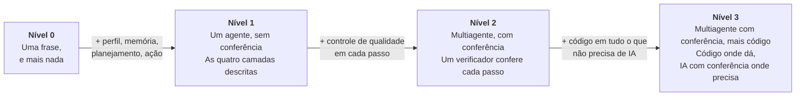
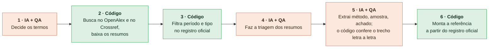
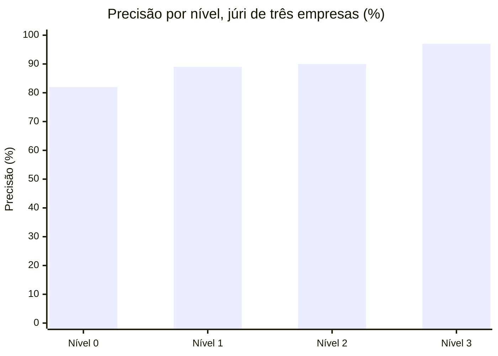
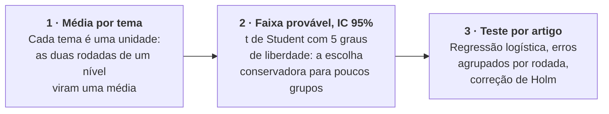
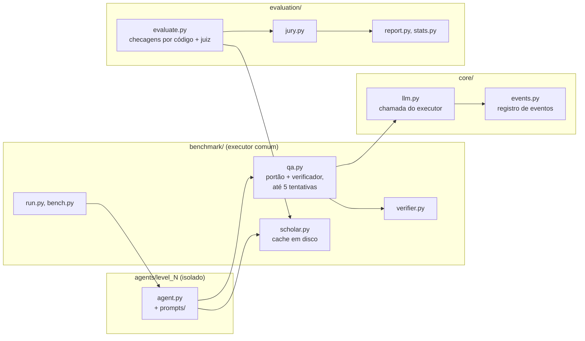
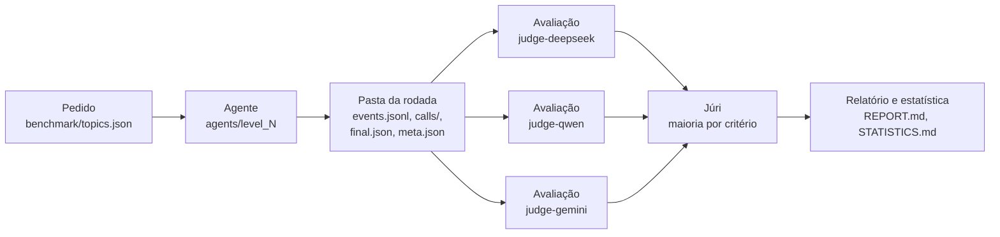

[Read in English](README.md)

<div align="center">

# UFRJ Research Agents

**Quatro níveis de agente de pesquisa com IA. Uma revisão bibliográfica. 48 rodadas reais. Qual erra menos?**

[](LICENSE)


</div>

Um agente de IA pode fazer uma revisão bibliográfica por você. **Quanto dá para confiar nele?**

Construímos quatro níveis de arquitetura de agente, de uma única frase de instrução a um fluxo multiagente em que o código faz tudo o que não precisa de IA. Depois medimos, em 48 rodadas reais julgadas por um júri de três empresas de IA, qual erra menos.

A resposta é o **Nível 3: código onde dá, IA com conferência onde precisa.** Ele é o mais preciso, o mais rápido e o mais barato. E ainda erra: 2 de cada 100 artigos pedidos saem errados, e o agente não diz quais. Por isso quem pesquisa continua no circuito.

<div align="center">

| **97%** | **5,1 min** | **R$ 2,90** | **2%** |
| :---: | :---: | :---: | :---: |
| precisão do Nível 3,<br>pelo júri de três empresas | por rodada,<br>o nível mais rápido | por rodada,<br>o nível mais barato | dos artigos pedidos<br>saíram errados |

</div>

Este README tem três partes. Leia a que você precisa.

| [Parte 1: O produto](#parte-1-o-produto) | [Parte 2: A ciência](#parte-2-a-ciência) | [Parte 3: A engenharia](#parte-3-a-engenharia) |
| --- | --- | --- |
| O que é, o que você recebe, como rodar, quanto custa. | O método e o racional, resultados, estatística, limites. | Arquitetura, stack, componentes, fluxo de dados, requisitos. |
| [O que você recebe](#o-que-você-recebe) &middot; [Comece aqui](#comece-aqui) &middot; [Vídeos](#vídeos) &middot; [Human in the loop](#human-in-the-loop) &middot; [Custo](#quanto-custa-rodar) | [Por que é difícil](#por-que-isso-é-difícil) &middot; [Os quatro níveis](#os-quatro-níveis) &middot; [Resultados](#resultados) &middot; [Método](#como-foi-medido) &middot; [Limites](#como-ler-estes-resultados) &middot; [Próximos passos](#do-nível-3-em-diante) | [Stack](#stack) &middot; [Arquitetura](#arquitetura) &middot; [Fluxo de dados](#fluxo-de-dados-de-uma-rodada) &middot; [Reprodutibilidade](#reprodutibilidade-e-controle-de-custo) &middot; [Requisitos](#requisitos-e-plataforma) &middot; [Estrutura](#estrutura-do-repositório) |

---

## Parte 1: O produto

> O que é, o que você recebe e como rodar, em linguagem simples.

### O que você recebe

| | O que é |
| --- | --- |
| **Quatro agentes de pesquisa** | Do Nível 0 ao Nível 3, cada um na própria pasta, prontos para rodar nos seis temas do benchmark ou num tema que você acrescentar em `benchmark/topics.json`. O Nível 3 entrega as referências em cerca de 5 minutos, por cerca de R$ 2,90 por rodada. |
| **Um benchmark** | Um executor de rodadas coloca os quatro níveis diante do mesmo pedido: uma rodada, ou o lote completo de 48. |
| **Uma avaliação** | Checagens por código para o dado duro, três juízes de IA de três empresas, um júri por maioria, o relatório de resultados e a estatística. |
| **Os dados da aula** | As 48 rodadas, cada instrução e cada resposta, e cada avaliação. Todo número deste README pode ser recalculado a partir deles. |
| **Um visualizador e vídeos** | Acompanhe qualquer rodada passo a passo, ao vivo ou em reprodução, e grave em vídeo. |
| **Um conferidor de bibliografia** | O método do Nível 3 aplicado a uma lista de referências que você já tem. |

### Comece aqui

Você não precisa programar para rodar isto. O caminho mais simples: abra o [Claude Code](https://www.anthropic.com/claude-code) numa pasta vazia e cole o link do repositório com uma instrução:

```text
Clone https://github.com/abajur-ai/ufrj-research-agents, read docs/run-the-benchmark.md and run Level 3 on topic a04.
```

O agente clona o repositório, lê o guia, instala o que precisa e roda o Nível 3 no tema de exemplo (jogos contra a desinformação).

**Qual IA agêntica usar.** Para reproduzir exatamente a estrutura deste repositório, use uma das duas configurações recomendadas:

| Configuração | Como |
| --- | --- |
| **Claude Code** (recomendado) | com uma assinatura do Claude, ou apontado para a OpenRouter |
| **OpenCode** | com a OpenRouter, usando um modelo da Anthropic |

Nas duas, o executor dos agentes é o Claude Code: o código o conduz pelo Claude Agent SDK, e por isso o Claude Code precisa estar instalado. Outras IAs agênticas (Codex, Cursor, Kimi Code, Gemini CLI) podem rodar o projeto por sua conta, adaptando o executor; o [docs/getting-started.pt-BR.md](docs/getting-started.pt-BR.md) tem um prompt pronto para essa adaptação.

| Você quer | Leia |
| --- | --- |
| Entender o que é uma IA agêntica, instalar o Claude Code no Windows e criar a chave da OpenRouter | [docs/getting-started.pt-BR.md](docs/getting-started.pt-BR.md) |
| Rodar um nível, o benchmark completo, a avaliação, e reproduzir os números da aula | [docs/run-the-benchmark.pt-BR.md](docs/run-the-benchmark.pt-BR.md) |

<details>
<summary><b>Prefere o terminal?</b> (Windows 11, PowerShell, a partir da raiz do repositório)</summary>

```powershell
python -m venv .venv
.venv\Scripts\activate
pip install -r requirements.txt
python -m playwright install chromium

# um nível em um tema
python -m benchmark.run --level n3 --topic a04 --tag mytest --rep 1

# reproduz os números da aula a partir das avaliações que vêm no repositório
python -m evaluation.report class

# assiste a uma rodada no visualizador
python -m http.server 8000
# depois abra http://127.0.0.1:8000/viewer/index.html?run=class-n3-a04-r1&replay=1
```

Requisitos e variáveis de ambiente: [Parte 3, Requisitos e plataforma](#requisitos-e-plataforma).

</details>

### Vídeos

Os quatro níveis rodando no tema de exemplo, jogos contra a desinformação. Rodadas reais (tema a04, repetição 1) reproduzidas em 20x, cada uma terminando na entrega. Clique numa capa para assistir.

<table>
  <tr>
    <td align="center" width="50%">
      <a href="agents/level_0/media/level-0.mp4"></a><br>
      <b>Nível 0</b> &middot; uma frase, e mais nada
    </td>
    <td align="center" width="50%">
      <a href="agents/level_1/media/level-1.mp4"></a><br>
      <b>Nível 1</b> &middot; um agente, sem conferência
    </td>
  </tr>
  <tr>
    <td align="center" width="50%">
      <a href="agents/level_2/media/level-2.mp4"></a><br>
      <b>Nível 2</b> &middot; multiagente, com conferência
    </td>
    <td align="center" width="50%">
      <a href="agents/level_3/media/level-3.mp4"></a><br>
      <b>Nível 3</b> &middot; multiagente com conferência, mais código
    </td>
  </tr>
</table>

Qualquer rodada pode ser reproduzida no visualizador (`viewer/index.html`) ou gravada em vídeo com `python -m benchmark.record_replay`. Veja [docs/run-the-benchmark.pt-BR.md](docs/run-the-benchmark.pt-BR.md).

### Human in the loop

> [!IMPORTANT]
> **O agente acelera, quem pesquisa decide.**

| O agente | Quem pesquisa |
| --- | --- |
| Busca nas bases e lê os resumos | Define a pergunta e o recorte |
| Faz a triagem e extrai os dados | Confere na fonte original o que vai citar |
| Confere por código o dado duro | Julga o método e o achado |
| Entrega em minutos, a baixo custo | Assina e responde pelo texto |

- **Mesmo o melhor nível erra.** De cada 100 artigos pedidos ao Nível 3: 81 certos, 2 errados e 17 não entregues. O agente não diz quais são os 2: achar o erro é trabalho de quem pesquisa.
- **Humanos também erram.** Em revistas médicas, 25% das citações têm erro, e 12% têm erro grave (Jergas e Baethge 2015).
- **Mantenha a conferência.** Com um assistente automático como copiloto, a tendência é aceitar a resposta e deixar de conferir adequadamente (viés de automação, Parasuraman e Manzey 2010). Não faça isso.
- **Siga as regras de quem financia a sua pesquisa.** No Brasil, Portaria CNPq nº 2.664/2026, art. 9º, I: declarar o uso de IA generativa, com a ferramenta e a finalidade; é vedado submeter conteúdo gerado por IA como se fosse de autoria humana; é vedado inserir projetos de terceiros em IA para elaborar pareceres; quem pesquisa responde pelo conteúdo final.

Uso responsável completo: [docs/responsible-use.pt-BR.md](docs/responsible-use.pt-BR.md). Para aplicar o método do Nível 3 a uma bibliografia que você já tem (o exemplo confere as referências da aula): [docs/bibliography-check.pt-BR.md](docs/bibliography-check.pt-BR.md).

### Quanto custa rodar

| Item | Custo |
| --- | --- |
| Executor (Claude Sonnet 5.5 pelo Claude Code) | uma assinatura do Claude |
| Verificador e os três juízes, pela OpenRouter, no benchmark completo (48 rodadas) | cerca de **R$ 170** (US$ 33,38) em tokens |

O custo por rodada na [tabela de resultados](#o-preço-da-confiança) considera o executor a preço público de API da Anthropic, para que os quatro níveis sejam comparados na mesma base.

---

## Parte 2: A ciência

> O método e o racional, os resultados com os intervalos, a estatística e os limites.

### Por que isso é difícil

Uma revisão bibliográfica parece simples: achar os artigos, anotar os dados. Para um agente, é uma longa cadeia de pequenas decisões, e o erro se acumula ao longo da cadeia.

**Cada passo de IA é uma aposta.** Se cada decisão acerta com probabilidade *p*, e os erros são independentes, uma cadeia de *n* decisões acerta tudo com probabilidade *p*<sup>*n*</sup>. Com cada passo acertando 95% das vezes:

| Passos | 1 | 2 | 5 | 10 | 20 |
| --- | :---: | :---: | :---: | :---: | :---: |
| Chance de acertar tudo | 95% | 90% | 77% | 60% | 36% |

A tarefa deste benchmark pede 25 artigos com 9 campos cada: mais de 200 decisões em cadeia.

**Os modelos herdam dois vieses do treino.** Aprendem a chutar, porque os testes premiam o acerto e não premiam o "não sei" (Kalai et al. 2025). E aprendem a agradar, porque as pessoas preferem respostas que confirmam o que já pensam (Sharma et al. 2024). Para quem pesquisa, o segundo é o mais perigoso: o agente tende a confirmar a sua hipótese. Num teste, 55% das referências dadas pelo ChatGPT-3.5 eram inventadas, e 18% ainda eram no ChatGPT-4 (Walters e Wilder 2023).

**Dois tipos de abordagem.** A arquitetura deste repositório se apoia numa distinção:

| Probabilística: IA | Determinística: código |
| --- | --- |
| Mesma entrada, respostas que podem variar. | Mesma entrada, sempre a mesma saída. |
| Bom para interpretar, resumir, classificar e propor termos. | Bom para buscar e baixar por regra fixa, contar e comparar textos. |
| Mesmo bem calibrada, inventa parte dos fatos raros. | Não inventa: quando falha, falha à vista e pode ser conferido. |

> **A boa arquitetura combina os dois: IA onde ela é insubstituível, código em todo o resto.** E quem faz não confere: um segundo agente, com contexto limpo e critérios escritos, confere cada passo, e checagens por código conferem o que dá para conferir sem IA.

### Os quatro níveis

Cada nível se constrói sobre o anterior. O modelo executor é o mesmo em todos: a única coisa que muda é a arquitetura.



| Nível | O que é | Documentação |
| --- | --- | --- |
| **Nível 0** | Uma frase, e mais nada. O que quase todo mundo escreve: uma frase de instrução e o pedido. Busca e lê sozinho, e ninguém confere o que ele entrega. | [agents/level_0](agents/level_0/README.pt-BR.md) |
| **Nível 1** | Um agente, sem conferência; as quatro camadas descritas. Busca e lê sozinho, guiado pelas quatro camadas. Ninguém confere o que ele entrega. | [agents/level_1](agents/level_1/README.pt-BR.md) |
| **Nível 2** | Multiagente, com conferência. Três passos (plano, busca e triagem, extração). Um verificador confere cada passo; o passo reprovado volta com o parecer do verificador, até 5 tentativas; o que o verificador reprova sai da lista. | [agents/level_2](agents/level_2/README.pt-BR.md) |
| **Nível 3** | Multiagente com conferência, mais código. O código busca e confere; a IA só lê e extrai. O verificador confere a IA; o código confere cada trecho. | [agents/level_3](agents/level_3/README.pt-BR.md) |

#### As quatro camadas de um agente

Todo agente tem quatro peças: **perfil** (quem ele é e o que persegue), **memória** (o que ele guarda e consulta), **planejamento** (como ele quebra o problema) e **ação** (o que ele consegue fazer no mundo) (Wang et al. 2024). O Nível 0 não descreve nenhuma delas. Do Nível 1 em diante, elas estão escritas:

| Camada | Nível 1 | Nível 2 | Nível 3 |
| --- | --- | --- | --- |
| **Perfil** | Um assistente que apoia uma revisão de literatura. Prefere entregar menos a entregar errado. | Um por agente e um por verificador. | IA só nos passos de julgamento. |
| **Memória** | Uma ficha para cada artigo que encontra. Onde conferiu cada dado e o que decidiu. | Lista aprovada e histórico das reprovações. | Candidatos com o registro oficial e o resumo baixado. |
| **Planejamento** | Transforma o pedido em critérios e busca nas bases acadêmicas. Lê cada resumo e descarta o que não atende. | Passos fixos; até 5 tentativas; o que é reprovado sai da lista. | Controles de qualidade automáticos e até 5 tentativas. |
| **Ação** | Busca na web e abre as páginas dos artigos. O que não consegue conferir fica de fora. | Busca na web; o verificador também abre as páginas. | Busca, filtro, conferência e montagem por código. |

#### Nível 3: a IA lê e conclui, o resto é código



#### Quem faz cada tarefa, em cada nível

| Tarefa | Nível 0 | Nível 1 | Nível 2 | Nível 3 |
| --- | :---: | :---: | :---: | :---: |
| Decidir o que procurar | IA | IA | IA + QA | IA + QA |
| Buscar os artigos | IA | IA | IA + QA | **Código** |
| Conferir DOI, ano e tipo | IA | IA | IA + QA | **Código** |
| Ver se o artigo atende ao pedido | IA | IA | IA + QA | IA + QA |
| Extrair método, amostra e achado | IA | IA | IA + QA | IA + QA |
| Conferir o trecho no resumo | Ninguém | Ninguém | IA + QA | **Código** |
| Montar a referência | IA | IA | IA | **Código** |

Os níveis 0 e 1 dividem o trabalho do mesmo jeito. O que separa os dois é o quanto o agente está bem descrito.

### Resultados

#### Precisão por nível: quem erra menos

A **precisão** é a métrica principal: dos artigos entregues, quantos estão 100% certos. Um campo errado e o artigo inteiro conta como erro. Cada valor é a média dos seis temas, com o intervalo de 95% (t de Student sobre os temas).

| Nível | **Júri de três empresas** (principal) | Intervalo de 95% | Juiz único (comparação) | Intervalo de 95% | Só checagens por código |
| --- | :---: | :---: | :---: | :---: | :---: |
| Nível 0 | **82%** | 68 a 97% | 79% | 66 a 92% | 92% |
| Nível 1 | **89%** | 83 a 96% | 86% | 77 a 94% | 95% |
| Nível 2 | **90%** | 78 a 100% | 86% | 77 a 95% | 98% |
| Nível 3 | **97%** | 94 a 100% | 94% | 88 a 100% | 99% |



Júri: DeepSeek V4 Pro, Qwen3.7 Plus e Gemini 3.1 Flash-Lite, maioria por critério. Juiz único: DeepSeek V4 Pro sozinho. Os dois julgaram as mesmas 48 rodadas. "Só checagens por código" conta apenas o que o código consegue verificar (DOI, título, autor, ano, periódico, período, tipo de publicação, trecho e amostra), sem juiz. O Nível 3 lidera nas três medidas.

#### O preço da confiança

Média por rodada, 12 rodadas por nível, 48 no total. Certos, errados e não entregues somam 100% dos 25 artigos pedidos por rodada, pelo júri.

| Nível | Tempo | Chamadas de IA | Tokens | Custo por rodada | Certos | Errados | Não entregues | Rodadas pausadas |
| --- | ---: | ---: | ---: | ---: | ---: | ---: | ---: | :---: |
| Nível 0 | 10,2 min | 1,0 | 2,2 mi | R$ 7,11 | 80% | 17% | 3% | 0 de 12 |
| Nível 1 | 17,0 min | 1,0 | 4,2 mi | R$ 9,84 | 82% | 10% | 8% | 0 de 12 |
| Nível 2 | 42,1 min | 9,9 | 5,9 mi | R$ 16,33 | 59% | 8% | 33% | 3 de 12 |
| Nível 3 | **5,1 min** | 7,0 | **146 mil** | **R$ 2,90** | 81% | **2%** | 17% | 0 de 12 |

```text
Artigos errados, % dos 25 pedidos (menor é melhor)
Nível 0  █████████████████     17%
Nível 1  ██████████            10%
Nível 2  ████████              8%
Nível 3  ██                    2%

Minutos por rodada (menor é melhor)
Nível 0  █████                 10,2 min
Nível 1  █████████             17,0 min
Nível 2  █████████████████████ 42,1 min
Nível 3  ███                   5,1 min

Custo por rodada em R$ (menor é melhor)
Nível 0  ███████               R$ 7,11
Nível 1  ██████████            R$ 9,84
Nível 2  ████████████████      R$ 16,33
Nível 3  ███                   R$ 2,90
```

O custo por rodada considera o Claude Sonnet 5.5 a preço público de API da Anthropic (tokens e buscas na web) mais o verificador pelo valor cobrado pela OpenRouter, convertidos pela PTAX de venda do Banco Central de 14/10/2026, US$ 1 = R$ 5,0441. Uma **rodada pausada** é aquela em que o verificador recusou a quinta tentativa de um passo, e por isso a rodada não entregou relatório.

#### O que o teste mostrou

1. **O Nível 3 é a melhor abordagem.** Menos erros (2% dos artigos pedidos, contra 17%, 10% e 8%), mais rápido (5 min) e mais barato (R$ 2,90). O código busca, filtra e monta a referência; a IA só lê e julga, e é conferida.
2. **Descrever bem o agente já ajuda muito.** Escrever as quatro camadas, e o que o agente faz em cada uma, supera a instrução de uma frase: a precisão sobe de 82% para 89% e os errados caem de 17% para 10% (Nível 1 sobre o Nível 0).
3. **IA conferindo IA equivale a um agente bem descrito.** Com os modelos de hoje, a precisão é a mesma: 90% contra 89%. Só que leva 42 min, não 17, e custa R$ 16,33, não R$ 9,84.
4. **Dado duro, quase todos acertam.** DOI, autor, ano e revista saem quase sempre certos. O erro está no que exige ler o artigo:
   - **recorte**: é do tema pedido?
   - **método**: é pesquisa com dados, do tipo dito?
   - **achado**: o resumo confirma o que o agente disse?

Tabelas completas, por tema e por rodada: [docs/results.pt-BR.md](docs/results.pt-BR.md).

### Como foi medido

#### A tarefa

Toda rodada recebe o mesmo tipo de pedido: encontrar **25 artigos empíricos de periódicos revisados por pares** sobre um tema estreito, publicados de 2018 a 2025, e entregar para cada um **9 campos**: DOI, título, autores, ano, periódico, tipo de estudo e método, amostra como aparece no resumo, achado principal em uma frase e um trecho literal do resumo.

O tema de exemplo mostra por que este é um teste exigente:

| Por que é difícil | Por que é sensível | Por que é longo |
| --- | --- | --- |
| **O critério é estreito.** Só jogos avaliados com participantes: quem insiste em completar 25 estica o critério. | **Cada dado se confere.** DOI, ano, autor, trecho: um erro invalida a referência. | **25 x 9 campos.** Mais de 200 decisões em cadeia, onde o erro se acumula. |

#### Os seis temas

| # | Tema | Id |
| :---: | --- | :---: |
| 01 | Jogos contra a desinformação (tema de exemplo) | `a04` |
| 02 | Influência continuada da informação falsa | `a01` |
| 03 | Agências de checagem brasileiras | `a02` |
| 04 | Educação midiática na escola e na universidade | `a03` |
| 05 | Percepção de imagens, vídeos e áudios feitos por IA | `a05` |
| 06 | Manchetes caça-cliques | `a06` |

**4 níveis x 6 temas x 2 repetições = 48 rodadas**, 12 por nível. Uma rodada é um nível em um tema, uma vez.

#### O desenho, e por quê

| Escolha do desenho | Racional |
| --- | --- |
| **Duas repetições por tema e nível.** | A IA é probabilística: o mesmo pedido pode dar respostas diferentes. |
| **O mesmo executor em todos os níveis:** Claude Sonnet 5.5, chamado pelo Claude Agent SDK (Claude Code). | A única coisa que muda entre os níveis é a arquitetura, então a diferença medida vem da arquitetura, não do modelo. |
| **Cinco empresas.** Claude (Anthropic) executa, GLM-5.3 Flash (Z.ai, via OpenRouter) confere, DeepSeek, Qwen (Alibaba) e Gemini (Google) julgam. | Modelos tendem a preferir as próprias respostas (Panickssery, Bowman e Feng 2024). Por isso o verificador é de outra empresa, e os juízes, de mais três. |
| **Precisão como métrica principal:** um campo errado e o artigo inteiro conta como erro. | A métrica não premia o chute (Kalai et al. 2025). Os artigos não entregues aparecem à parte, e assim a troca entre entregar menos e entregar errado fica visível. A avaliação item a item, com juiz, segue o FActScore (Min et al. 2023). |
| **O código confere o dado duro:** o DOI existe; título, autor, ano e revista batem com o registro; período e tipo de publicação; trecho e amostra estão no resumo. | Dado duro tem uma única resposta certa, então o código confere sem IA. O avaliador também consulta fontes que o Nível 3 não usa (Semantic Scholar e a página da editora), e assim o Nível 3 não é avaliado pelas próprias fontes. |
| **Um júri de três empresas decide os critérios de julgamento:** DeepSeek V4 Pro, Qwen3.7 Plus e Gemini 3.1 Flash-Lite, cegos ao nível, leem o resumo e decidem por maioria, critério a critério: é do tema, é empírico, o método é o dito, o achado é sustentado pelo resumo. | Um painel de modelos diversos reduz o viés de qualquer juiz isolado (Verga et al. 2024; Zheng et al. 2023). |
| **Um juiz único para comparar:** DeepSeek V4 Pro sozinho, mesmos critérios, mesmas rodadas. | Mostra o quanto o resultado depende de quem julga. O Nível 3 lidera nos dois. |
| **Custo em reais, com cotação e data.** | Tempo, chamadas de IA, tokens, custo, e artigos certos, errados e não entregues: o preço de cada nível, em números que qualquer pessoa pode recalcular. |
| **Métricas e critérios de julgamento fixados antes das rodadas.** | Fixar o que conta como certo antes de ver os resultados impede que a medida se curve ao resultado (Nosek et al. 2018). |

Método completo, instruções dos juízes e checagens por código: [docs/evaluation.pt-BR.md](docs/evaluation.pt-BR.md). Estatística: [docs/statistics.pt-BR.md](docs/statistics.pt-BR.md). Resultados: [docs/results.pt-BR.md](docs/results.pt-BR.md).

### Como ler estes resultados

Todo teste tem limites. Estes são os deste teste, cada um com o modo como o teste o trata.

| O limite | Como o teste trata |
| --- | --- |
| **Estudo pequeno:** seis temas, uma tarefa. | Cada tema roda duas vezes em cada nível; a média é por tema, e a faixa provável de cada média é alargada por serem só seis temas. |
| **Um só modelo executando.** | É o mesmo em todos os níveis: a diferença medida vem da arquitetura, não do modelo. |
| **Os juízes são IA e leem só o resumo.** | Júri de três empresas, cego ao nível, decide por maioria; o dado duro é conferido por código. Os três juízes dão o mesmo veredito em 85% dos 980 artigos que julgaram; a maior parte da divergência está no método. |
| **A web, as bases e os preços mudam.** | Métricas e critérios de julgamento fixados antes das rodadas; custo informado com cotação e data. |

#### O racional estatístico, em 3 passos



1. **Média por tema.** Cada tema é uma unidade: as duas rodadas de cada nível viram uma média.
2. **Faixa provável (IC 95%).** Onde a média verdadeira deve estar, com 95% de confiança. t de Student com 5 graus de liberdade (G menos 1, G = 6 temas), a escolha conservadora para poucos grupos (Cameron e Miller 2015, seção VI). Com só seis temas, ela deixa a faixa mais larga.
3. **Teste por artigo.** Cada artigo conta. Regressão logística do acerto sobre nível e tema; os artigos da mesma rodada formam um grupo (erros agrupados por rodada), com valores críticos t, e a correção de Holm desconta as várias comparações (Holm 1979).

**Resultado, em precisão, pelo júri:** o Nível 3 supera o Nível 0 com segurança estatística (p ajustado por Holm = 0,001). Também supera os níveis 1 e 2, com sinal mais tímido: ali, a chance de acaso fica pouco acima do corte usual de 5% (p ajustado por Holm de cerca de 0,06).

Limites completos, e o que um teste maior exigiria: [docs/limits-and-next-steps.pt-BR.md](docs/limits-and-next-steps.pt-BR.md).

### Do Nível 3 em diante

O Nível 3 é um ponto de partida, não a linha de chegada. Seis jeitos de refinar o agente para a sua pesquisa:

| | Próximo passo | O que significa |
| :---: | --- | --- |
| 1 | **Monte um banco de casos reais** | Revisões que você já fez e conferiu viram o gabarito do agente no seu campo. Rode nele a cada mudança de modelo ou de instrução. |
| 2 | **Transforme cada erro em regra** | Recorte, método ou achado: o erro que se repete vira regra ou verificador novo no agente. Depois, rode de novo. |
| 3 | **Leia o artigo inteiro** | O Nível 3 decide pelo resumo. Com o texto completo, quando aberto, método e achado ficam mais fáceis de confirmar. |
| 4 | **Busque nas bases da sua área** | O Nível 3 busca em duas bases gerais. As bases, o vocabulário e os critérios do seu campo especializam o agente. |
| 5 | **Ponha um especialista na régua** | Uma pessoa da área julga uma amostra, lendo o artigo inteiro, e mostra o quanto os juízes de IA acertam. |
| 6 | **Teste maior, com orçamento** | Mais temas e mais repetições mostram com clareza o que cada ajuste melhora. |

---

## Parte 3: A engenharia

> Engenharia de software e de IA: arquitetura, stack, componentes, fluxo de dados e requisitos.

### Stack

| Camada | Tecnologia |
| --- | --- |
| Linguagem e execução | Python 3.13, `asyncio` |
| Executor | Claude Sonnet 5.5 pelo Claude Agent SDK, que conduz o binário do Claude Code (`claude.exe`); toda resposta volta como JSON estruturado, validado contra um esquema JSON |
| Verificador e juízes | API de chat completions da OpenRouter com respostas em esquema JSON: o GLM-5.3 Flash confere; DeepSeek V4 Pro, Qwen3.7 Plus e Gemini 3.1 Flash-Lite julgam |
| HTTP | httpx |
| Fontes determinísticas | OpenAlex, Crossref, Semantic Scholar e páginas das editoras |
| Navegador | Playwright com Google Chrome, para as páginas das editoras e a gravação dos vídeos |
| Texto e comparação | trafilatura, BeautifulSoup, PyMuPDF; rapidfuzz para comparação aproximada |
| Estatística | pandas, statsmodels, SciPy |
| Visualizador | uma página HTML estática que lê o registro de eventos JSONL de uma rodada |

### Arquitetura



- **`agents/level_N/`**: uma pasta por nível, isolada: o `agent.py`, as instruções, as rodadas, as avaliações e o vídeo. Um nível é uma função assíncrona, `run(topic, run_dir, log)`.
- **`benchmark/`**: o que todos os níveis compartilham. O executor de rodadas (`run.py`, uma rodada; `bench.py`, um lote com um processo por rodada), o laço de QA (`qa.py`: portão determinístico, depois o verificador, até 5 tentativas), o verificador (`verifier.py`), os clientes das bases acadêmicas com cache em disco (`scholar.py`), os temas e os caminhos.
- **`evaluation/`**: o mesmo julgamento para todo nível. O avaliador (`evaluate.py`: checagens por código mais um juiz), a chamada de juiz (`judge_llm.py`), a leitura de páginas e a conferência do trecho (`verify.py`), o júri (`jury.py`), o relatório (`report.py`) e a estatística (`stats.py`).
- **`core/`**: a chamada do executor pelo Claude Agent SDK (`llm.py`), o registro de eventos só de acréscimo (`events.py`) e a configuração (`config.py`).
- **`viewer/index.html`**: acompanha uma rodada ao vivo ou a reproduz, lendo o `events.jsonl`.

### Fluxo de dados de uma rodada



Uma rodada grava o `events.jsonl` (cada passo, tentativa, parecer, chamada de IA e passo de código, na hora em que acontece), a pasta `calls/` (cada instrução e cada resposta), o `final.json` (situação e artigos entregues) e o `meta.json` (tempo, chamadas e tokens). Cada juiz grava um arquivo de avaliação por rodada; o júri combina os três; o relatório e a estatística leem o júri e o juiz único.

### Reprodutibilidade e controle de custo

- **Cache em disco em `.cache/`**: respostas das APIs acadêmicas, páginas das editoras e páginas baixadas. A mesma conferência do mesmo DOI dá a mesma resposta e não custa nada.
- **Julgamentos em cache pelo hash da instrução**: rodar a avaliação de novo nunca paga duas vezes pelo mesmo julgamento.
- **Juízes com temperatura 0**, com respostas em esquema JSON estrito.
- **Executor isolado**: cada chamada de IA começa sem configurações do usuário, sem servidores MCP e sem sessão salva, e assim a configuração da máquina não vaza para o experimento.
- **Tudo em disco**: cada instrução e cada resposta de cada rodada fica em `calls/`, e qualquer número pode ser rastreado até a chamada que o produziu.
- **Chaves lidas do ambiente na hora da execução**, nunca gravadas em disco nem nos logs.

### Requisitos e plataforma

**Requisitos.** Windows 11 (o único sistema em que foi testado), Python 3.13, Claude Code instalado como extensão do VS Code e com login feito (o código usa o `claude.exe` dele), Google Chrome, e ffmpeg só para gravar vídeos.

**Variáveis de ambiente** (veja o [.env.example](.env.example)):

| Variável | Para que serve |
| --- | --- |
| `OPENROUTER_API_KEY` | o verificador e os juízes |
| `OPENALEX_API_KEY` | a chave gratuita que o OpenAlex exige |
| `BRAVE_API_KEY` | a busca na web do verificador do Nível 2 |

O código lê as chaves do ambiente e nunca as grava em disco nem nos logs.

Documentação técnica completa (módulos, registro de eventos, formatos de arquivo, laço de QA, cache, contabilidade de custo, como acrescentar um nível ou um juiz, depuração): [docs/architecture.pt-BR.md](docs/architecture.pt-BR.md).

### Estrutura do repositório

Cada agente (nível) é entregue **isolado na própria pasta**: o código, as instruções, as 12 rodadas, as avaliações dessas rodadas e o vídeo. Qualquer pessoa pode ler, editar, testar e depurar um nível sem tocar nos outros. O que todos os níveis compartilham para rodar fica em `benchmark/`; o modo como todo nível é julgado, sempre do mesmo jeito, fica em `evaluation/`.

```
README.md, README.pt-BR.md, LICENSE (MIT, Copyright (c) 2026 Abajur.ai), requirements.txt, .env.example
docs/                              documentação, cada arquivo com um espelho .pt-BR.md
agents/
  level_0/                         Nível 0: uma frase, e mais nada
    README.md, README.pt-BR.md     a documentação do nível: primeiro para humanos, depois "For AI agents"
    agent.py                       o agente deste nível
    prompts/level_0.md             a instrução dele (em português)
    runs/class-n0-<topic>-r<rep>/  as 12 rodadas: events.jsonl, final.json, meta.json, calls/
    evaluations/judge-deepseek/    um arquivo por rodada, juiz único (DeepSeek V4 Pro) + checagens por código
    evaluations/judge-qwen/        idem, Qwen3.7 Plus
    evaluations/judge-gemini/      idem, Gemini 3.1 Flash-Lite
    evaluations/jury/              o júri: maioria dos três, por critério
    media/level-0.mp4, level-0.jpg o vídeo do tema de exemplo e a capa
  level_1/                         mesma estrutura; prompts/level_1.md
  level_2/                         mesma estrutura; prompts/planner.md, searcher.md, extractor.md
  level_3/                         mesma estrutura; prompts/terms.md, screener.md, extractor.md
benchmark/                         o que todos os níveis compartilham para rodar
  run.py                           um nível em um tema
  bench.py                         um lote de rodadas, cada uma no próprio processo
  common.py                        esquemas, formato de saída e funções de apoio comuns aos quatro agentes
  qa.py                            laço de passos dos níveis 2 e 3: executor, portão determinístico, verificador, até 5 tentativas
  verifier.py                      o verificador (GLM-5.3 Flash via OpenRouter), com busca na web e leitura de páginas
  scholar.py                       OpenAlex, Crossref, Semantic Scholar e páginas das editoras, com cache em disco
  prompts/verifier.md              as instruções do verificador para cada passo (em português)
  topics.json                      os seis temas
  paths.py                         onde fica cada rodada e cada avaliação
  record_replay.py                 grava em vídeo a reprodução de uma rodada
evaluation/                        como todo nível é julgado, do mesmo jeito
  evaluate.py                      checagens por código + um juiz (--judge deepseek | qwen | gemini)
  judge_llm.py                     a chamada de juiz comum aos três juízes
  verify.py                        leitura de páginas, normalização de texto e conferência literal do trecho
  jury.py                          o júri de três empresas, maioria por critério
  report.py                        relatório de resultados: precisão, intervalos, custo, desfecho
  stats.py                         teste por artigo com correção de Holm
  REPORT.md, STATISTICS.md         os resultados da aula, gerados por report.py e stats.py
core/                              chamada do executor pelo Claude Agent SDK, registro de eventos, configuração
viewer/index.html                  visualizador ao vivo e de reprodução de uma rodada
bibcheck/                          o método do Nível 3 aplicado a uma bibliografia (exemplo: as referências da aula)
```

Os ids das rodadas da aula seguem `class-<level>-<topic>-r<rep>`, por exemplo `class-n3-a04-r1`.

#### Mapa da documentação

| Documento | O que cobre |
| --- | --- |
| [docs/getting-started.pt-BR.md](docs/getting-started.pt-BR.md) | Do zero: IA agêntica, Claude Code no Windows, a chave da OpenRouter |
| [docs/run-the-benchmark.pt-BR.md](docs/run-the-benchmark.pt-BR.md) | Todos os comandos: uma rodada, um lote, a avaliação, os relatórios, o visualizador, os vídeos |
| [docs/evaluation.pt-BR.md](docs/evaluation.pt-BR.md) | Precisão, checagens por código, o júri e o juiz único, custo |
| [docs/statistics.pt-BR.md](docs/statistics.pt-BR.md) | Médias por tema, intervalos, o teste por artigo e a correção de Holm |
| [docs/results.pt-BR.md](docs/results.pt-BR.md) | Todos os números da aula, por nível, por tema e por rodada |
| [docs/limits-and-next-steps.pt-BR.md](docs/limits-and-next-steps.pt-BR.md) | O que o teste pode e não pode dizer, e como ir além |
| [docs/responsible-use.pt-BR.md](docs/responsible-use.pt-BR.md) | Human in the loop, viés de automação, as regras do CNPq |
| [docs/architecture.pt-BR.md](docs/architecture.pt-BR.md) | Módulos, registro de eventos, formatos de arquivo, laço de QA, cache, contabilidade de custo, como estender e depurar |
| [docs/bibliography-check.pt-BR.md](docs/bibliography-check.pt-BR.md) | O método do Nível 3 aplicado a uma bibliografia existente |
| [docs/references.pt-BR.md](docs/references.pt-BR.md) | Todas as fontes citadas, completas |
| [agents/level_0](agents/level_0/README.pt-BR.md) a [agents/level_3](agents/level_3/README.pt-BR.md) | Cada nível: como funciona, as instruções, as rodadas e uma seção para agentes de IA |

---

## Referências, créditos e licença

**Referências.** Toda afirmação deste repositório vem de uma fonte listada em [docs/references.pt-BR.md](docs/references.pt-BR.md).

**Músicas dos vídeos.** Kevin MacLeod ([incompetech.com](https://incompetech.com)), licença [CC BY 4.0](https://creativecommons.org/licenses/by/4.0/deed.pt_BR): Nível 0 "Local Forecast: Elevator", Nível 1 "Deliberate Thought", Nível 2 "Dispersion Relation", Nível 3 "Thinking Music".

**Licença.** [MIT](LICENSE), Copyright (c) 2026 Abajur.ai.

**Sobre.** Feito pela [Abajur.ai](https://abajur.ai) para uma aula sobre agentes de IA para pesquisa no LabIA (Máquinas Afetivas, PPGCOM ECO/UFRJ), em outubro de 2026. Contato: [bruno@abajur.ai](mailto:bruno@abajur.ai).
