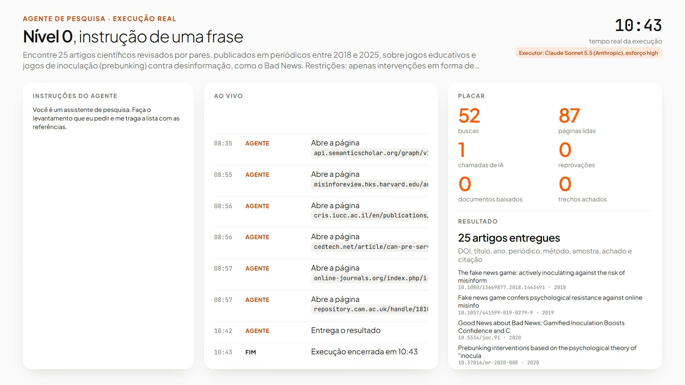

[Read in English](README.md)

# Nível 0: uma frase, e mais nada

**O que quase todo mundo escreve.** Um agente recebe uma instrução de uma frase e o pedido. Ele busca e lê sozinho,
sem nenhuma camada descrita. Ninguém confere o que ele entrega.

Este README tem duas partes. A parte 1 é para quem pesquisa. A parte 2, [Para agentes de IA](#parte-2-para-agentes-de-ia),
é para um agente de IA de programação que vai rodar, testar, depurar ou alterar este nível.

# Parte 1: para quem pesquisa

## O que é este nível

O Nível 0 é a primeira das quatro arquiteturas comparadas no benchmark da aula, e a linha de base das outras três. É
o jeito como a maioria das pessoas usa um agente de IA: uma instrução curta, o pedido, e confiança na resposta.

A instrução inteira (página 17 do deck):

> Você é um assistente de pesquisa. Faça o levantamento que eu pedir e me traga a lista com as referências.

O que essa frase deixa de fora (página 17 do deck): Onde buscar e como conferir? Como provar cada dado do artigo? E se
não houver 25 que atendam? O que fazer com o que não confere?

## Como funciona, passo a passo

1. O agente recebe a instrução de uma frase, o pedido e o formato padrão da resposta.
2. Decide sozinho o que buscar, onde, e quanto ler, usando busca na web e leitura de páginas.
3. Devolve a lista no formato padrão. Ninguém confere a lista.

Tudo isso acontece dentro de uma única chamada de IA. O agente tem o mesmo modelo e as mesmas ferramentas do Nível 1;
só a instrução é diferente.

Quem faz cada tarefa:

| Tarefa | Nível 0 |
| --- | --- |
| Decidir o que procurar | IA |
| Buscar os artigos | IA |
| Conferir DOI, ano e tipo | IA, se decidir conferir |
| Ver se o artigo atende ao pedido | IA |
| Extrair método, amostra e achado | IA |
| Conferir o trecho no resumo | Ninguém |
| Montar a referência | IA |

## As quatro camadas neste nível

Todo agente tem quatro camadas: perfil, memória, planejamento e ação (Wang et al. 2024). O Nível 0 não descreve
nenhuma delas:

| Camada | No Nível 0 |
| --- | --- |
| Perfil | Uma frase: "um assistente de pesquisa". Nenhuma prioridade declarada, por exemplo entre entregar menos artigos e entregar artigos errados. |
| Memória | Não descrita. |
| Planejamento | Não descrito. |
| Ação | As ferramentas estão lá (busca na web e leitura de páginas), sem nenhuma regra de uso. |

## O que recebe, como busca e lê, quem confere

- **Recebe:** só a frase de instrução e o pedido.
- **Busca e lê:** sozinho, sem nenhuma camada.
- **Quem confere:** ninguém confere o que ele entrega.

## Resultados

O benchmark da aula: 4 níveis x 6 temas x 2 repetições = 48 rodadas, 12 por nível. Cada rodada pede 25 artigos
empíricos de periódico, revisados por pares, publicados de 2018 a 2025, com 9 campos cada. O executor é o mesmo em
todos os níveis (Claude Sonnet 5.5); só muda a arquitetura.

**Precisão** é a métrica principal: dos artigos entregues, quantos estão 100% certos. Um campo errado e o artigo
inteiro conta como erro. Média dos 6 temas, com o intervalo de 95% (t de Student sobre os temas):

| Nível | Júri (principal) | Intervalo de 95% | Juiz único | Intervalo de 95% | Só checagens por código |
| --- | --- | --- | --- | --- | --- |
| **0** | **82%** | **68 a 97%** | **79%** | **66 a 92%** | **92%** |
| 1 | 89% | 83 a 96% | 86% | 77 a 94% | 95% |
| 2 | 90% | 78 a 100% | 86% | 77 a 95% | 98% |
| 3 | 97% | 94 a 100% | 94% | 88 a 100% | 99% |

O júri são três juízes de IA de três empresas (DeepSeek V4 Pro, Qwen3.7 Plus, Gemini 3.1 Flash-Lite), cegos ao
nível, que decidem por maioria em cada critério. O juiz único é o DeepSeek V4 Pro sozinho, nas mesmas rodadas.

**Custo e resultado**, média por rodada. Certos, errados e não entregues são parcelas dos 25 artigos pedidos, pelo júri; a precisão é a parcela dos artigos entregues que está 100% certa:

| Nível | Tempo | Chamadas de IA | Tokens | Custo por rodada | Certos | Errados | Não entregues | Precisão (dos entregues) | Rodadas pausadas |
| --- | --- | --- | --- | --- | --- | --- | --- | --- | --- |
| **0** | **10,2 min** | **1,0** | **2,2 mi** | **R$ 7,11** | **80%** | **17%** | **3%** | **82%** | **0 de 12** |
| 1 | 17,0 min | 1,0 | 4,2 mi | R$ 9,84 | 82% | 10% | 8% | 89% | 0 de 12 |
| 2 | 42,1 min | 9,9 | 5,9 mi | R$ 16,33 | 59% | 8% | 33% | 90% | 3 de 12 |
| 3 | 5,1 min | 7,0 | 146 mil | R$ 2,90 | 81% | 2% | 17% | 97% | 0 de 12 |

Custo por rodada: Claude Sonnet 5.5 a preço de API pública da Anthropic (tokens e buscas na web), convertido pela PTAX
de venda do Banco Central de 14/10/2026, US$ 1 = R$ 5,0441. O Nível 0 não tem verificador.

**Como se compara.** O Nível 0 tem a menor precisão e o maior número de artigos errados: 17% dos pedidos. Ele quase
sempre entrega a lista completa (3% não entregues). Como em todos os níveis, o dado duro (DOI, autor, ano, periódico)
sai quase sempre certo (92% de precisão só pelas checagens por código); os erros estão no recorte, no método e no
achado, o que exige ler o artigo. O Nível 1, com o mesmo modelo e as mesmas ferramentas, chega a 89% só por descrever
as quatro camadas; o Nível 3 chega a 97% e supera o Nível 0 com segurança estatística (p de Holm 0,001).

## Veja rodando

Uma rodada real do tema de exemplo (a04, jogos contra a desinformação, como o Bad News), repetição 1, reproduzida em
20x e terminando na entrega.

[](media/level-0.mp4)

Música: "Local Forecast: Elevator", Kevin MacLeod (incompetech.com), CC BY 4.0.

## Quando usar este nível

Use o Nível 0 como linha de base: ele mostra o que uma instrução de uma frase entrega, para você medir quanto cada
camada, verificador ou trecho de código acrescenta. Não use a lista dele numa revisão sem conferir cada artigo na fonte
original.

Aqui, mais do que em qualquer outro nível, vale o human in the loop: o agente acelera, quem pesquisa decide.

## Rodar só este nível

A preparação (Python, Claude Code) está no [README do repositório](../../README.pt-BR.md). Rodar o Nível 0 exige só o
Claude Code com login feito; avaliar exige `OPENROUTER_API_KEY` e `OPENALEX_API_KEY`. Na raiz do repositório, no
PowerShell:

```
python -m benchmark.run --level n0 --topic a04 --tag mytest --rep 1
```

A rodada fica em `agents/level_0/runs/mytest-n0-a04-r1/`. Para assistir, rode `python -m http.server 8000` e abra
`http://127.0.0.1:8000/viewer/index.html?run=mytest-n0-a04-r1&replay=1`.

## O que você pode editar

`prompts/level_0.md`, em português, em texto simples: a frase. Tudo o que você acrescentar aproxima o agente do Nível
1, e é isso que a comparação mede.

# Parte 2: para agentes de IA

## Arquivos deste nível

| Caminho | O que faz |
| --- | --- |
| `agent.py` | O agente do Nível 0. Ponto de entrada: `run(topic, run_dir, log)`, uma corrotina aguardada por `benchmark/run.py`. `topic` é uma entrada de `benchmark/topics.json`, `run_dir` a pasta da rodada, `log` o registro de eventos de `core/`. Uma chamada do executor: prompt de sistema `prompts/level_0.md`, prompt do usuário o pedido do tema mais o bloco de formato compartilhado, ferramentas `WebSearch` e `WebFetch`, saída estruturada no esquema final. |
| `prompts/level_0.md` | O prompt de sistema: uma frase. Em português. |
| `runs/class-n0-<topic>-r<rep>/` | As 12 rodadas da aula: `events.jsonl`, `final.json`, `meta.json`, `calls/`. |
| `evaluations/judge-deepseek/` | Um arquivo por rodada: checagens por código mais os pareceres do DeepSeek V4 Pro. |
| `evaluations/judge-qwen/` | O mesmo, Qwen3.7 Plus. |
| `evaluations/judge-gemini/` | O mesmo, Gemini 3.1 Flash-Lite. |
| `evaluations/jury/` | Maioria dos três juízes em cada critério; a medida principal. |
| `media/level-0.mp4`, `media/level-0.jpg` | Vídeo de `class-n0-a04-r1` reproduzido em 20x, e a capa. |

## Módulos compartilhados de que depende

| Módulo | Usado para |
| --- | --- |
| `benchmark/common.py` | O esquema final (o item de 9 campos mais `search_notes`), o bloco de formato acrescentado ao pedido, gravação do `final.json`. O mesmo esquema e o mesmo bloco servem ao Nível 1, então os dois níveis só diferem no prompt de sistema. |
| `core/` | Chamada do executor pelo Claude Agent SDK (Claude Sonnet 5.5, esforço alto, o `claude.exe` da extensão do Claude Code no VS Code), o registro de eventos, a configuração. |

O Nível 0 não usa `benchmark/qa.py`, `benchmark/verifier.py` nem `benchmark/scholar.py` durante a rodada. O avaliador
usa `benchmark/scholar.py` para conferir as referências dele.

## Esquema de saída

O executor responde `{"items": [...], "search_notes": "..."}`. O `final.json` contém `status`, `report.items` (ou
`null`), `notes` (as notas de busca) e `errors` (até 3). Cada item tem os 9 campos do pedido (tipo de estudo e método
são duas chaves), todos escritos pelo agente:

| Chave | Conteúdo |
| --- | --- |
| `doi` | Só o DOI, por exemplo `10.1000/xyz123` |
| `title` | Título |
| `authors` | Lista de nomes |
| `year` | Número inteiro |
| `venue` | Periódico |
| `study_type` | Tipo de estudo |
| `method` | Método |
| `sample_size` | Amostra como aparece no resumo, ou `não informado no resumo` |
| `main_finding` | Achado principal em uma frase |
| `abstract_quote` | Trecho literal do resumo |

## Ferramentas

`WebSearch` e `WebFetch` (Claude Agent SDK). O prompt não indica nenhuma fonte; o agente escolhe.

## Limites e constantes

- 25 artigos pedidos por rodada.
- Uma chamada de IA, no máximo 215 turnos (90 + 5 x 25) e 4.950 s (2.700 + 90 x 25).
- Sem verificador, sem checagem por código, sem novas tentativas.

## Status da rodada

| Status | Significado |
| --- | --- |
| `done` | O agente devolveu uma resposta estruturada válida; o `final.json` tem os itens. |
| `paused` | Não ocorre neste nível (não há verificador). |
| `failed` | Nenhuma resposta estruturada válida (limite de turnos, tempo esgotado ou saída malformada); o `final.json` tem `errors`. |
| `error` | Uma exceção; o `events.jsonl` termina com `run_error` e o `meta.json` registra `error`. |

## Como rodar

```
python -m benchmark.run --level n0 --topic a04 --tag mytest --rep 1
```

Ids dos temas: `a01` a `a06` (`a04` é o tema de exemplo). Id da rodada: `<tag>-n0-<topic>-r<rep>`.

## Como avaliar só as rodadas deste nível

```
python -m evaluation.evaluate --judge deepseek --prefix mytest-n0
python -m evaluation.evaluate --judge qwen --prefix mytest-n0
python -m evaluation.evaluate --judge gemini --prefix mytest-n0
python -m evaluation.jury mytest
python -m evaluation.report mytest
```

O prefixo seleciona as rodadas. `jury` e `report` recebem a tag e cobrem toda rodada dessa tag que tem avaliações; se
você rodou só o Nível 0, só o Nível 0 aparece. `python -m evaluation.report class` reproduz os números da aula a partir
das avaliações que vêm no repositório.

## Como depurar

1. Abra `runs/<run_id>/meta.json`: status, tempo total, chamadas de IA e tokens.
2. Leia `runs/<run_id>/events.jsonl` em ordem: `run_start`, `step_start`, `ai_call_start`, `ai_tool` (cada busca e
   página que o agente abriu), `ai_call_end` (tokens, erros), `step_end` (número de itens), `run_error`, `run_end`.
3. Abra `runs/<run_id>/calls/`: `.system.md` (o prompt), `.user.md` (pedido mais bloco de formato) e `.result.json`
   (resposta estruturada, uso, erros) da chamada única.
4. Reproduza a rodada: `python -m http.server 8000` e depois
   `http://127.0.0.1:8000/viewer/index.html?run=<run_id>&replay=1`.

## Checklist antes de alterar um prompt

- [ ] Mantenha o esquema de saída: o bloco de formato em `benchmark/common.py` pede o item de 9 campos; não o contradiga
      no prompt.
- [ ] Mantenha uma frase só, sem nenhuma camada descrita, senão o nível deixa de ser a linha de base que a aula mede.
- [ ] Rode de novo no tema de exemplo: `python -m benchmark.run --level n0 --topic a04 --tag mytest --rep 1` (e `--rep 2`).
- [ ] Avalie com os três juízes, depois `jury` e `report`.
- [ ] Compare com as rodadas da aula que vêm no repositório, `class-n0-a04-r1` e `class-n0-a04-r2`: precisão, certos,
      errados, não entregues, tempo e tokens.
