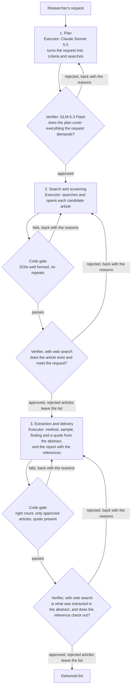

[Leia em português](README.pt-BR.md)

# Level 2: multi-agent, with checking

**A verifier checks every step.** The work is split into three steps (plan; search and screening; extraction and delivery), each
done by its own agent. A verifier from another company checks each step. Rejected, the step goes back with the
verifier's reasons, up to 5 attempts.

This README has two parts. Part 1 is for researchers. Part 2, [For AI agents](#part-2-for-ai-agents), is for an AI
coding agent that will run, test, debug or change this level.

# Part 1: for researchers

## What this level is

Level 2 is the third of the four architectures compared in the class benchmark. It starts from Level 1 (the four
layers described) and adds quality control at every step: **who does is not who checks**. The executor is Claude
Sonnet 5.5 (Anthropic); the verifier is GLM-5.3 Flash (Z.ai), a model from another company, with clean context and
written criteria.

The reason: without outside feedback, a model has trouble correcting its own reasoning (Huang et al. 2024), checking
step by step works better than checking only the final result (Lightman et al. 2024), and models tend to prefer their
own answers (Panickssery, Bowman and Feng 2024). Here every step is AI, and every step is checked by AI.

## How it works, step by step

| Step | Who executes | Who checks | What happens |
| --- | --- | --- | --- |
| 1. Plan | executor (AI) | verifier: does the plan cover everything the request demands? | Turns the request into inclusion criteria, queries and the way each criterion will be checked. No searching yet. |
| 2. Search and screening | executor (AI), with web search | code gate, then the verifier, with web search: does the article exist and meet the request? | Runs the queries, opens each candidate's official record and reads the abstract. |
| 3. Extraction and delivery | executor (AI), with web search | code gate, then the verifier, with web search: is what was extracted in the abstract, and does the reference check out? | Picks the articles from the approved list, extracts method, sample, finding and a literal quote from the abstract, and delivers the report with the references. |



Every step has up to 5 attempts. A rejected attempt goes back to the executor with the verifier's reasons. When the
verifier rejects one article, that article leaves the list and the step goes on with the others. If the fifth attempt
of a step is rejected, the run pauses and delivers no report.

Who does each task (deck page 22, Level 2 column):

| Task | Level 2 |
| --- | --- |
| Decide what to search for | AI + QA |
| Search the articles | AI + QA |
| Check DOI, year and type | AI + QA |
| See if the article meets the request | AI + QA |
| Extract method, sample and finding | AI + QA |
| Check the quote in the abstract | AI + QA |
| Build the reference | AI |

## The four layers in this level

Every agent has four layers: profile, memory, planning and action (Wang et al. 2024). Level 2 fills them like this:

| Layer | In Level 2 |
| --- | --- |
| Profile | One per agent (planner, searcher, extractor) and one per verifier. |
| Memory | The approved list and the history of rejections. |
| Planning | Predefined steps; up to 5 attempts; what is rejected leaves the list. |
| Action | Web search; the verifier also opens the pages. |

## What it receives, how it searches and reads, who checks

- **Receives:** each agent receives the instructions of its step and the request.
- **Searches and reads:** in three steps: plan, search and screening, extraction and delivery.
- **Who checks:** a verifier checks each step and returns what it rejects.

## Results

The class benchmark: 4 levels x 6 topics x 2 repetitions = 48 runs, 12 per level. Each run asks for 25 peer-reviewed
empirical journal articles published 2018 to 2025, with 9 fields each. The executor is the same at every level (Claude
Sonnet 5.5); only the architecture changes.

**Precision** is the main metric: of the articles delivered, how many are 100% correct. One wrong field and the whole
article counts as wrong. Mean over the 6 topics, with the 95% interval (Student t over the topics):

| Level | Jury (main) | 95% interval | Single judge | 95% interval | Code checks only |
| --- | --- | --- | --- | --- | --- |
| 0 | 82% | 68 to 97% | 79% | 66 to 92% | 92% |
| 1 | 89% | 83 to 96% | 86% | 77 to 94% | 95% |
| **2** | **90%** | **78 to 100%** | **86%** | **77 to 95%** | **98%** |
| 3 | 97% | 94 to 100% | 94% | 88 to 100% | 99% |

The jury is three AI judges from three companies (DeepSeek V4 Pro, Qwen3.7 Plus, Gemini 3.1 Flash-Lite), blind to the
level, deciding by majority per criterion. The single judge is DeepSeek V4 Pro alone, on the same runs.

**Cost and outcome**, mean per run. Right, wrong and not delivered are shares of the 25 articles requested, by the jury; precision is the share of the articles delivered that are 100% correct:

| Level | Time | AI calls | Tokens | Cost per run | Right | Wrong | Not delivered | Precision (of delivered) | Paused runs |
| --- | --- | --- | --- | --- | --- | --- | --- | --- | --- |
| 0 | 10.2 min | 1.0 | 2.2 M | R$ 7.11 | 80% | 17% | 3% | 82% | 0 of 12 |
| 1 | 17.0 min | 1.0 | 4.2 M | R$ 9.84 | 82% | 10% | 8% | 89% | 0 of 12 |
| **2** | **42.1 min** | **9.9** | **5.9 M** | **R$ 16.33** | **59%** | **8%** | **33%** | **90%** | **3 of 12** |
| 3 | 5.1 min | 7.0 | 146 k | R$ 2.90 | 81% | 2% | 17% | 97% | 0 of 12 |

Cost per run: Claude Sonnet 5.5 at Anthropic's public API price (tokens and web searches) plus the verifier at the
cost OpenRouter charged, converted at the Banco Central PTAX selling rate of 14/10/2026, US$ 1 = R$ 5.0441. A paused
run is one where the verifier refused the fifth attempt of a step, so the run delivered no report.

**How it compares.** AI checking AI equals a well-described agent: with today's models, Level 2 reaches the same
precision as Level 1 (90% against 89%), but it takes 42 min instead of 17 and costs R$ 16.33 instead of R$ 9.84. It
delivers the fewest articles (33% not delivered, 3 of 12 runs paused), and Level 3, which hands search, filtering and
references to code, beats it in precision, time and cost.

## Watch it run

A real run of the example topic (a04, games against misinformation, like Bad News), repetition 1, replayed at 20x and
ending with the delivery.

[](media/level-2.mp4)

Music: "Dispersion Relation", Kevin MacLeod (incompetech.com), CC BY 4.0.

## When to use this level

Use Level 2 when a task cannot be handed to code and you want an independent second reading of every step, with a
written record of what was checked and why each item was rejected. Expect more time and cost, and runs that pause
without a report. For a literature review where open databases cover your field, Level 3 does better on every measure
in the test.

Human in the loop still applies: the agent speeds up, the researcher decides. Check in the original source every
article you will cite.

## Run only this level

Setup (Python, Claude Code, keys) is in the [repository README](../../README.md). Level 2 needs `OPENROUTER_API_KEY`
(verifier) and `BRAVE_API_KEY` (the verifier's web search). From the repository root, in PowerShell:

```
python -m benchmark.run --level n2 --topic a04 --tag mytest --rep 1
```

The run lands in `agents/level_2/runs/mytest-n2-a04-r1/`. To watch it, run `python -m http.server 8000` and open
`http://127.0.0.1:8000/viewer/index.html?run=mytest-n2-a04-r1&replay=1`.

## What you can edit

The three instructions of this level, in Portuguese, plain text:

- `prompts/planner.md`: how the plan is built (criteria, 4 to 8 queries, how each criterion is checked).
- `prompts/searcher.md`: how candidates are searched and screened. It says, for example: "menos e certo vale mais que
  completar o número com artigo que não atende" (fewer and correct is worth more than filling the number with an
  article that does not qualify).
- `prompts/extractor.md`: how the data is extracted from each abstract.

The verifier's instructions are shared with Level 3, in `benchmark/prompts/verifier.md`. Changing them changes both
levels.

# Part 2: for AI agents

## Files of this level

| Path | What it does |
| --- | --- |
| `agent.py` | The Level 2 pipeline. Entry point: `run(topic, run_dir, log)`, a coroutine awaited by `benchmark/run.py`. `topic` is one entry of `benchmark/topics.json`, `run_dir` the run folder, `log` the event log from `core/`. Holds the plan and candidate schemas, the code gates and the three steps. |
| `prompts/planner.md` | System prompt of step 1 (plan). Portuguese. |
| `prompts/searcher.md` | System prompt of step 2 (search and screening). Portuguese. |
| `prompts/extractor.md` | System prompt of step 3 (extraction and delivery). Portuguese. |
| `runs/class-n2-<topic>-r<rep>/` | The 12 class runs: `events.jsonl`, `final.json`, `meta.json`, `calls/`. |
| `evaluations/judge-deepseek/` | One file per run: code checks plus the DeepSeek V4 Pro verdicts. |
| `evaluations/judge-qwen/` | Same, Qwen3.7 Plus. |
| `evaluations/judge-gemini/` | Same, Gemini 3.1 Flash-Lite. |
| `evaluations/jury/` | Majority of the three judges per criterion; the main measure. |
| `media/level-2.mp4`, `media/level-2.jpg` | Video of `class-n2-a04-r1` replayed at 20x, and its poster. |

## Shared modules it depends on

| Module | Used for |
| --- | --- |
| `benchmark/common.py` | Shared schemas (the 9-field item), the output format block appended to the extraction request, `final.json` writing, DOI checks. |
| `benchmark/qa.py` | The step loop: executor, deterministic gate, verifier, up to 5 attempts, rejection history sent back to the executor. |
| `benchmark/verifier.py` | The verifier: GLM-5.3 Flash (Z.ai) via OpenRouter (`z-ai/glm-5.3-flash`, effort high). In steps 2 and 3 it has two tools: `web_search` (Brave Search API, up to 8 results) and `open_page` (HTTP fetch, text cut at 9,000 characters), up to 10 tool rounds, then a final call that forces the verdict into a JSON schema. In step 1 it runs without tools. |
| `benchmark/scholar.py` | DOI normalization used by the gates. |
| `benchmark/prompts/verifier.md` | The verifier's instructions, one section per step. |
| `core/` | Executor call through the Claude Agent SDK (Claude Sonnet 5.5, effort high, the `claude.exe` of the Claude Code VS Code extension), the event log, configuration. |

## Output schema

`final.json` holds `status`, `report.items` (or `null` when the run did not deliver), `notes` (the extractor's search
notes) and `attempts` per step (`plan`, `search`, `extract`). Each item has the 9 fields of the request (study type
and method are two keys), all written by the extractor:

| Key | Content |
| --- | --- |
| `doi` | DOI only, for example `10.1000/xyz123` |
| `title` | Title |
| `authors` | List of names |
| `year` | Integer |
| `venue` | Journal |
| `study_type` | Study type |
| `method` | Method |
| `sample_size` | Sample as it appears in the abstract, or `não informado no resumo` |
| `main_finding` | Main finding in one sentence |
| `abstract_quote` | Literal quote from the abstract |

Intermediate outputs: the plan (`criteria`, `queries` with `query`, `language`, `database`, and `how_to_check`) and
the candidates (`doi`, `title`, `authors`, `year`, `venue`, `checked_url`, `criteria_met`, plus `notes`). Verifier
verdicts in steps 2 and 3 carry `approved`, `checked`, `per_item` (`doi`, `ok`, `problem`), `issues` and `feedback`.

## Tools

Executor: `WebSearch` and `WebFetch` (Claude Agent SDK) in steps 2 and 3; no tools in step 1. Verifier: `web_search`
and `open_page` in steps 2 and 3; no tools in step 1.

## Limits and constants

- 25 articles requested per run. The searcher prompt asks for up to one and a half times that number of candidates.
- Up to 5 attempts per step (in `benchmark/qa.py`).
- Step 1: at most 6 turns, 600 s.
- Steps 2 and 3: at most 205 turns and 4,650 s each (80 + 5 x 25 turns, 2,400 + 90 x 25 seconds).
- Step 2 gate: every DOI well formed, no repeated DOI, at least one candidate.
- Step 3 gate: exactly the smaller of 25 and the number of approved candidates; every DOI well formed, not repeated
  and in the approved list; every quote at least 40 characters.
- A verifier rejection that names articles removes those articles and keeps the step going; the step is rejected
  only for a problem that is not about one article, or if nothing is left.
- On a retry of step 2, the searcher receives the previous list with the verifier's verdict article by article.
- Verifier: if it fails to answer, it gets one more call; a rejection without a stated issue counts as approval.

## Run statuses

| Status | Meaning |
| --- | --- |
| `done` | All three steps approved; `final.json` has the items. |
| `paused` | The verifier or the gate rejected the fifth attempt of a step; `final.json` has `paused_at` (`plan`, `search` or `extract`) and no report. |
| `failed` | Not produced by this level: an executor with no valid answer counts as a rejected attempt. |
| `error` | An exception; `events.jsonl` ends with `run_error` and `meta.json` records `error`. |

## How to run

```
python -m benchmark.run --level n2 --topic a04 --tag mytest --rep 1
```

Topic ids: `a01` to `a06` (`a04` is the example topic). Run id: `<tag>-n2-<topic>-r<rep>`.

## How to evaluate only this level's runs

```
python -m evaluation.evaluate --judge deepseek --prefix mytest-n2
python -m evaluation.evaluate --judge qwen --prefix mytest-n2
python -m evaluation.evaluate --judge gemini --prefix mytest-n2
python -m evaluation.jury mytest
python -m evaluation.report mytest
```

The prefix selects the runs. `jury` and `report` take the tag and cover every run of that tag that has evaluations; if
you ran only Level 2, only Level 2 appears. A paused run counts as 25 articles not delivered.
`python -m evaluation.report class` reproduces the class numbers from the shipped evaluations.

## How to debug

1. Open `runs/<run_id>/meta.json`: status, wall time, AI calls and tokens per role and provider.
2. Read `runs/<run_id>/events.jsonl` in order. Useful kinds: `step_start`, `step_roles`, `step_attempt`, `qa_verdict`
   (who rejected, `gate` or `verifier`, what was checked and the issues), `ai_tool` (each search and page the executor
   or the verifier opened), `pause` (the step, the last issues and feedback), `run_error`, `run_end`.
3. Open `runs/<run_id>/calls/`: every AI call, numbered. Executor calls have `.system.md`, `.user.md` and
   `.result.json`; verifier calls have `.prompt.md` and `.result.json` (with its tool calls, tokens and cost).
4. Replay the run: `python -m http.server 8000`, then `http://127.0.0.1:8000/viewer/index.html?run=<run_id>&replay=1`.

## Checklist before changing a prompt

- [ ] Keep the output schema of the step: plan keys, candidate keys and the 9-field item.
- [ ] Keep the rules the code gates enforce: well-formed and unique DOIs, only approved articles in the extraction,
      a literal quote of at least 40 characters.
- [ ] Rerun on the example topic: `python -m benchmark.run --level n2 --topic a04 --tag mytest --rep 1` (and `--rep 2`).
- [ ] Evaluate with the three judges, then `jury` and `report`.
- [ ] Compare with the shipped class runs `class-n2-a04-r1` and `class-n2-a04-r2`: precision, right, wrong, not
      delivered, paused, time and AI calls.
