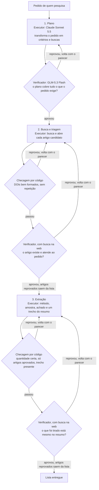
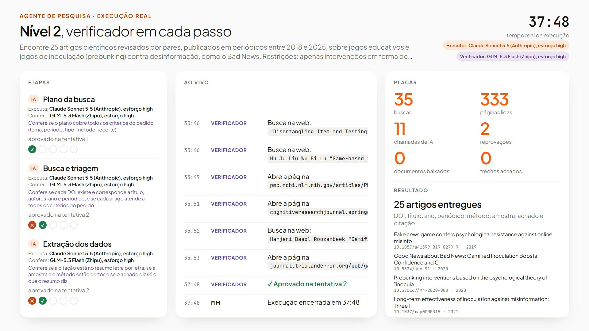

[Read in English](README.md)

# Nível 2: multiagente, com conferência

**Um verificador confere cada passo.** O trabalho é dividido em três passos (plano, busca e triagem, extração), cada
um feito pelo seu próprio agente. Um verificador de outra empresa confere cada passo. Reprovou, o passo volta com o
parecer do verificador, em até 5 tentativas.

Este README tem duas partes. A parte 1 é para quem pesquisa. A parte 2, [Para agentes de IA](#parte-2-para-agentes-de-ia),
é para um agente de IA de programação que vai rodar, testar, depurar ou alterar este nível.

# Parte 1: para quem pesquisa

## O que é este nível

O Nível 2 é a terceira das quatro arquiteturas comparadas no benchmark da aula. Ele parte do Nível 1 (as quatro
camadas descritas) e acrescenta controle de qualidade em cada passo: **quem faz não confere**. O executor é o Claude
Sonnet 5.5 (Anthropic); o verificador é o GLM-5.3 Flash (Z.ai), um modelo de outra empresa, com contexto limpo e
critérios escritos.

O motivo: sem retorno de fora, o modelo tem dificuldade em corrigir o próprio raciocínio (Huang et al. 2024), conferir
passo a passo funciona melhor do que conferir só o resultado final (Lightman et al. 2024), e os modelos tendem a
preferir as próprias respostas (Panickssery, Bowman e Feng 2024). Aqui todo passo é IA, e todo passo é conferido por IA.

## Como funciona, passo a passo

| Passo | Quem executa | Quem confere | O que acontece |
| --- | --- | --- | --- |
| 1. Plano | executor (IA) | verificador: o plano cobre tudo o que o pedido exige? | Transforma o pedido em critérios de inclusão, consultas e o jeito de conferir cada critério. Ainda sem buscar nada. |
| 2. Busca e triagem | executor (IA), com busca na web | checagem por código, depois o verificador, com busca na web: o artigo existe e atende ao pedido? | Roda as consultas, abre o registro oficial de cada candidato e lê o resumo. |
| 3. Extração | executor (IA), com busca na web | checagem por código, depois o verificador, com busca na web: o que foi tirado está mesmo no resumo? | Escolhe os artigos da lista aprovada e tira método, amostra, achado e um trecho literal do resumo. |



Cada passo tem até 5 tentativas. Uma tentativa reprovada volta para o executor com o parecer do verificador. Quando o
verificador reprova um artigo, esse artigo sai da lista e o passo segue com os outros. Se a quinta tentativa de um
passo for reprovada, a rodada é pausada e não entrega relatório.

Quem faz cada tarefa (página 22 do deck, coluna do Nível 2):

| Tarefa | Nível 2 |
| --- | --- |
| Decidir o que procurar | IA + QA |
| Buscar os artigos | IA + QA |
| Conferir DOI, ano e tipo | IA + QA |
| Ver se o artigo atende ao pedido | IA + QA |
| Extrair método, amostra e achado | IA + QA |
| Conferir o trecho no resumo | IA + QA |
| Montar a referência | IA |

## As quatro camadas neste nível

Todo agente tem quatro camadas: perfil, memória, planejamento e ação (Wang et al. 2024). O Nível 2 preenche assim:

| Camada | No Nível 2 |
| --- | --- |
| Perfil | Um por agente (planejador, buscador, extrator) e um por verificador. |
| Memória | A lista aprovada e o histórico das reprovações. |
| Planejamento | Passos fixos; até 5 tentativas; o que é reprovado sai da lista. |
| Ação | Busca na web; o verificador também abre as páginas. |

## O que recebe, como busca e lê, quem confere

- **Recebe:** cada agente recebe as instruções do seu passo e o pedido.
- **Busca e lê:** em três passos: plano, busca e extração.
- **Quem confere:** um verificador confere cada passo e devolve o que reprova.

## Resultados

O benchmark da aula: 4 níveis x 6 temas x 2 repetições = 48 rodadas, 12 por nível. Cada rodada pede 25 artigos
empíricos de periódico, revisados por pares, publicados de 2018 a 2025, com 9 campos cada. O executor é o mesmo em
todos os níveis (Claude Sonnet 5.5); só muda a arquitetura.

**Precisão** é a métrica principal: dos artigos entregues, quantos estão 100% certos. Um campo errado e o artigo
inteiro conta como erro. Média dos 6 temas, com o intervalo de 95% (t de Student sobre os temas):

| Nível | Júri (principal) | Intervalo de 95% | Juiz único | Intervalo de 95% | Só checagens por código |
| --- | --- | --- | --- | --- | --- |
| 0 | 82% | 68 a 97% | 79% | 66 a 92% | 92% |
| 1 | 89% | 83 a 96% | 86% | 77 a 94% | 95% |
| **2** | **90%** | **78 a 100%** | **86%** | **77 a 95%** | **98%** |
| 3 | 97% | 94 a 100% | 94% | 88 a 100% | 99% |

O júri são três juízes de IA de três empresas (DeepSeek V4 Pro, Qwen3.7 Plus, Gemini 3.1 Flash-Lite), cegos ao
nível, que decidem por maioria em cada critério. O juiz único é o DeepSeek V4 Pro sozinho, nas mesmas rodadas.

**Custo e resultado**, média por rodada. Certos, errados e não entregues são parcelas dos 25 artigos pedidos, pelo júri:

| Nível | Tempo | Chamadas de IA | Tokens | Custo por rodada | Certos | Errados | Não entregues | Rodadas pausadas |
| --- | --- | --- | --- | --- | --- | --- | --- | --- |
| 0 | 10,2 min | 1,0 | 2,2 mi | R$ 7,11 | 80% | 17% | 3% | 0 de 12 |
| 1 | 17,0 min | 1,0 | 4,2 mi | R$ 9,84 | 82% | 10% | 8% | 0 de 12 |
| **2** | **42,1 min** | **9,9** | **5,9 mi** | **R$ 16,33** | **59%** | **8%** | **33%** | **3 de 12** |
| 3 | 5,1 min | 7,0 | 146 mil | R$ 2,90 | 81% | 2% | 17% | 0 de 12 |

Custo por rodada: Claude Sonnet 5.5 a preço de API pública da Anthropic (tokens e buscas na web) mais o verificador
pelo valor cobrado pela OpenRouter, convertidos pela PTAX de venda do Banco Central de 14/10/2026, US$ 1 = R$ 5,0441.
Rodada pausada é aquela em que o verificador recusou a quinta tentativa de um passo, e por isso a rodada não entregou
relatório.

**Como se compara.** IA conferindo IA equivale a um agente bem descrito: com os modelos de hoje, o Nível 2 chega à
mesma precisão do Nível 1 (90% contra 89%), só que leva 42 min, não 17, e custa R$ 16,33, não R$ 9,84. É o que menos
entrega (33% não entregues, 3 de 12 rodadas pausadas), e o Nível 3, que passa busca, filtro e referências para o
código, o supera em precisão, tempo e custo.

## Veja rodando

Uma rodada real do tema de exemplo (a04, jogos contra a desinformação, como o Bad News), repetição 1, reproduzida em
20x e terminando na entrega.

[](media/level-2.mp4)

Música: "Dispersion Relation", Kevin MacLeod (incompetech.com), CC BY 4.0.

## Quando usar este nível

Use o Nível 2 quando uma tarefa não pode ir para o código e você quer uma segunda leitura independente de cada passo,
com registro escrito do que foi conferido e do motivo de cada reprovação. Conte com mais tempo e custo, e com rodadas
que pausam sem relatório. Para uma revisão de literatura em que as bases acadêmicas abertas cobrem a sua área, o Nível
3 vai melhor em todas as medidas do teste.

O human in the loop continua valendo: o agente acelera, quem pesquisa decide. Confira na fonte original cada artigo
que você vai citar.

## Rodar só este nível

A preparação (Python, Claude Code, chaves) está no [README do repositório](../../README.pt-BR.md). O Nível 2 precisa de
`OPENROUTER_API_KEY` (verificador) e `BRAVE_API_KEY` (busca na web do verificador). Na raiz do repositório, no
PowerShell:

```
python -m benchmark.run --level n2 --topic a04 --tag mytest --rep 1
```

A rodada fica em `agents/level_2/runs/mytest-n2-a04-r1/`. Para assistir, rode `python -m http.server 8000` e abra
`http://127.0.0.1:8000/viewer/index.html?run=mytest-n2-a04-r1&replay=1`.

## O que você pode editar

As três instruções deste nível, em português, em texto simples:

- `prompts/planner.md`: como o plano é montado (critérios, de 4 a 8 consultas, como cada critério é conferido).
- `prompts/searcher.md`: como os candidatos são buscados e triados. Ele diz, por exemplo: "menos e certo vale mais que
  completar o número com artigo que não atende".
- `prompts/extractor.md`: como os dados são tirados de cada resumo.

As instruções do verificador são compartilhadas com o Nível 3, em `benchmark/prompts/verifier.md`. Alterá-las altera
os dois níveis.

# Parte 2: para agentes de IA

## Arquivos deste nível

| Caminho | O que faz |
| --- | --- |
| `agent.py` | O pipeline do Nível 2. Ponto de entrada: `run(topic, run_dir, log)`, uma corrotina aguardada por `benchmark/run.py`. `topic` é uma entrada de `benchmark/topics.json`, `run_dir` a pasta da rodada, `log` o registro de eventos de `core/`. Contém os esquemas do plano e dos candidatos, as checagens por código e os três passos. |
| `prompts/planner.md` | Prompt de sistema do passo 1 (plano). Em português. |
| `prompts/searcher.md` | Prompt de sistema do passo 2 (busca e triagem). Em português. |
| `prompts/extractor.md` | Prompt de sistema do passo 3 (extração). Em português. |
| `runs/class-n2-<topic>-r<rep>/` | As 12 rodadas da aula: `events.jsonl`, `final.json`, `meta.json`, `calls/`. |
| `evaluations/judge-deepseek/` | Um arquivo por rodada: checagens por código mais os pareceres do DeepSeek V4 Pro. |
| `evaluations/judge-qwen/` | O mesmo, Qwen3.7 Plus. |
| `evaluations/judge-gemini/` | O mesmo, Gemini 3.1 Flash-Lite. |
| `evaluations/jury/` | Maioria dos três juízes em cada critério; a medida principal. |
| `media/level-2.mp4`, `media/level-2.jpg` | Vídeo de `class-n2-a04-r1` reproduzido em 20x, e a capa. |

## Módulos compartilhados de que depende

| Módulo | Usado para |
| --- | --- |
| `benchmark/common.py` | Esquemas compartilhados (o item de 9 campos), o bloco de formato da resposta acrescentado ao pedido de extração, gravação do `final.json`, checagens de DOI. |
| `benchmark/qa.py` | O laço do passo: executor, checagem determinística, verificador, até 5 tentativas, histórico de reprovações devolvido ao executor. |
| `benchmark/verifier.py` | O verificador: GLM-5.3 Flash (Z.ai) via OpenRouter (`z-ai/glm-5.3-flash`, esforço alto). Nos passos 2 e 3 ele tem duas ferramentas: `web_search` (API do Brave Search, até 8 resultados) e `open_page` (busca HTTP da página, texto cortado em 9.000 caracteres), em até 10 rodadas de ferramentas, e depois uma chamada final que força o parecer num esquema JSON. No passo 1 ele roda sem ferramentas. |
| `benchmark/scholar.py` | Normalização de DOI usada pelas checagens. |
| `benchmark/prompts/verifier.md` | As instruções do verificador, uma seção por passo. |
| `core/` | Chamada do executor pelo Claude Agent SDK (Claude Sonnet 5.5, esforço alto, o `claude.exe` da extensão do Claude Code no VS Code), o registro de eventos, a configuração. |

## Esquema de saída

O `final.json` contém `status`, `report.items` (ou `null` quando a rodada não entregou), `notes` (as notas de busca do
extrator) e `attempts` por passo (`plan`, `search`, `extract`). Cada item tem os 9 campos do pedido (tipo de estudo e
método são duas chaves), todos escritos pelo extrator:

| Chave | Conteúdo |
| --- | --- |
| `doi` | Só o DOI, por exemplo `10.1000/xyz123` |
| `title` | Título |
| `authors` | Lista de nomes |
| `year` | Número inteiro |
| `venue` | Periódico |
| `study_type` | Tipo de estudo |
| `method` | Método |
| `sample_size` | Amostra como aparece no resumo, ou `não informado no resumo` |
| `main_finding` | Achado principal em uma frase |
| `abstract_quote` | Trecho literal do resumo |

Saídas intermediárias: o plano (`criteria`, `queries` com `query`, `language`, `database`, e `how_to_check`) e os
candidatos (`doi`, `title`, `authors`, `year`, `venue`, `checked_url`, `criteria_met`, mais `notes`). Os pareceres do
verificador nos passos 2 e 3 trazem `approved`, `checked`, `per_item` (`doi`, `ok`, `problem`), `issues` e `feedback`.

## Ferramentas

Executor: `WebSearch` e `WebFetch` (Claude Agent SDK) nos passos 2 e 3; sem ferramentas no passo 1. Verificador:
`web_search` e `open_page` nos passos 2 e 3; sem ferramentas no passo 1.

## Limites e constantes

- 25 artigos pedidos por rodada. O prompt do buscador pede até uma vez e meia esse número de candidatos.
- Até 5 tentativas por passo (em `benchmark/qa.py`).
- Passo 1: no máximo 6 turnos, 600 s.
- Passos 2 e 3: no máximo 205 turnos e 4.650 s cada (80 + 5 x 25 turnos, 2.400 + 90 x 25 segundos).
- Checagem do passo 2: todo DOI bem formado, nenhum DOI repetido, pelo menos um candidato.
- Checagem do passo 3: exatamente o menor entre 25 e o número de candidatos aprovados; todo DOI bem formado, sem
  repetição e da lista aprovada; todo trecho com pelo menos 40 caracteres.
- Uma reprovação do verificador que aponta artigos retira esses artigos e deixa o passo seguir; o passo só é
  reprovado por um problema que não é de um artigo, ou se nada sobrar.
- Numa nova tentativa do passo 2, o buscador recebe a lista anterior com o parecer do verificador artigo por artigo.
- Verificador: se não responde, recebe mais uma chamada; uma reprovação sem problema declarado conta como aprovação.

## Status da rodada

| Status | Significado |
| --- | --- |
| `done` | Os três passos aprovados; o `final.json` tem os itens. |
| `paused` | O verificador ou a checagem reprovou a quinta tentativa de um passo; o `final.json` tem `paused_at` (`plan`, `search` ou `extract`) e nenhum relatório. |
| `failed` | Não ocorre neste nível: um executor sem resposta válida conta como tentativa reprovada. |
| `error` | Uma exceção; o `events.jsonl` termina com `run_error` e o `meta.json` registra `error`. |

## Como rodar

```
python -m benchmark.run --level n2 --topic a04 --tag mytest --rep 1
```

Ids dos temas: `a01` a `a06` (`a04` é o tema de exemplo). Id da rodada: `<tag>-n2-<topic>-r<rep>`.

## Como avaliar só as rodadas deste nível

```
python -m evaluation.evaluate --judge deepseek --prefix mytest-n2
python -m evaluation.evaluate --judge qwen --prefix mytest-n2
python -m evaluation.evaluate --judge gemini --prefix mytest-n2
python -m evaluation.jury mytest
python -m evaluation.report mytest
```

O prefixo seleciona as rodadas. `jury` e `report` recebem a tag e cobrem toda rodada dessa tag que tem avaliações; se
você rodou só o Nível 2, só o Nível 2 aparece. Uma rodada pausada conta como 25 artigos não entregues.
`python -m evaluation.report class` reproduz os números da aula a partir das avaliações que vêm no repositório.

## Como depurar

1. Abra `runs/<run_id>/meta.json`: status, tempo total, chamadas de IA e tokens por papel e por provedor.
2. Leia `runs/<run_id>/events.jsonl` em ordem. Tipos úteis: `step_start`, `step_roles`, `step_attempt`, `qa_verdict`
   (quem reprovou, `gate` ou `verifier`, o que foi conferido e os problemas), `ai_tool` (cada busca e página que o
   executor ou o verificador abriu), `pause` (o passo, os últimos problemas e o retorno), `run_error`, `run_end`.
3. Abra `runs/<run_id>/calls/`: cada chamada de IA, numerada. Chamadas do executor têm `.system.md`, `.user.md` e
   `.result.json`; chamadas do verificador têm `.prompt.md` e `.result.json` (com as chamadas de ferramenta, tokens e
   custo).
4. Reproduza a rodada: `python -m http.server 8000` e depois
   `http://127.0.0.1:8000/viewer/index.html?run=<run_id>&replay=1`.

## Checklist antes de alterar um prompt

- [ ] Mantenha o esquema de saída do passo: as chaves do plano, as chaves dos candidatos e o item de 9 campos.
- [ ] Mantenha as regras que as checagens por código cobram: DOIs bem formados e únicos, só artigos aprovados na
      extração, trecho literal com pelo menos 40 caracteres.
- [ ] Rode de novo no tema de exemplo: `python -m benchmark.run --level n2 --topic a04 --tag mytest --rep 1` (e `--rep 2`).
- [ ] Avalie com os três juízes, depois `jury` e `report`.
- [ ] Compare com as rodadas da aula que vêm no repositório, `class-n2-a04-r1` e `class-n2-a04-r2`: precisão, certos,
      errados, não entregues, pausas, tempo e chamadas de IA.
