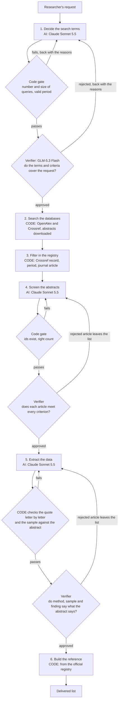
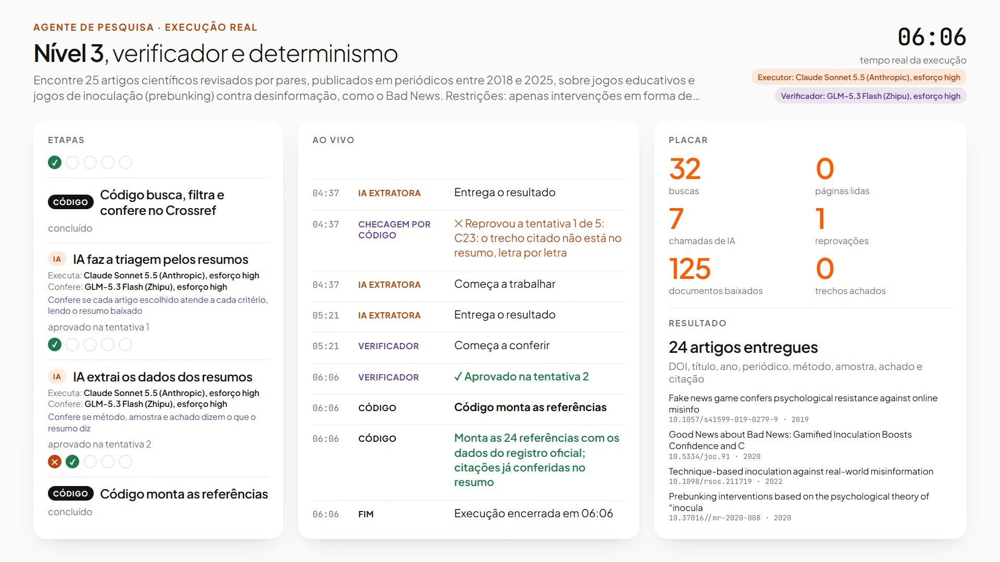

[Leia em português](README.pt-BR.md)

# Level 3: multi-agent with checking, plus code

**Code where it can, AI with checking where it must.** The AI decides the search terms, screens the abstracts and
extracts the data, and a verifier checks each of those steps. Code does everything else: it searches the academic
databases, filters by period and publication type, checks every quote letter by letter and builds every reference
from the official registry.

This README has two parts. Part 1 is for researchers. Part 2, [For AI agents](#part-2-for-ai-agents), is for an AI
coding agent that will run, test, debug or change this level.

# Part 1: for researchers

## What this level is

Level 3 is the fourth of the four architectures compared in the class benchmark. It keeps everything Level 2 has (one
agent per step, a verifier from another company checking each step) and adds one idea: **anything that does not need
judgment is done by code, not by AI**. Code does not invent. When it fails, it fails in plain sight and can be checked.

The AI is left with the three tasks that really need reading and judgment: choosing the words to search with, deciding
whether an abstract meets the request, and extracting method, sample and finding.

## How it works, step by step

Six steps. Three are AI with a verifier (QA), three are code.

| Step | Who executes | Who checks | What happens |
| --- | --- | --- | --- |
| 1. Decide the search terms | AI + QA | code gate, then the verifier | The AI turns the request into short queries in English and Portuguese, the period and the inclusion and exclusion criteria. |
| 2. Search the databases | code | | Code runs every query on OpenAlex and Crossref and downloads the abstracts. |
| 3. Filter in the registry | code | | Code looks up each DOI in the official registry (Crossref) and drops what is outside the period or is not a journal article. |
| 4. Screen the abstracts | AI + QA | code gate, then the verifier | The AI reads each abstract and keeps only what meets every criterion. |
| 5. Extract the data | AI + QA | code checks the quote letter by letter, then the verifier | The AI extracts study type, method, sample and finding, with a literal quote from the abstract. |
| 6. Build the reference | code | | Code writes DOI, title, authors, year and journal from the official registry. |



Every AI step has up to 5 attempts. A rejected attempt goes back to the AI with the reasons. When the verifier rejects
one article, that article leaves the list and the step goes on with the others. If the fifth attempt of a step is
rejected, the run pauses and delivers no report.

Who does each task (deck page 22, Level 3 column):

| Task | Level 3 |
| --- | --- |
| Decide what to search for | AI + QA |
| Search the articles | Code |
| Check DOI, year and type | Code |
| See if the article meets the request | AI + QA |
| Extract method, sample and finding | AI + QA |
| Check the quote in the abstract | Code |
| Build the reference | Code |

## The four layers in this level

Every agent has four layers: profile, memory, planning and action (Wang et al. 2024). Level 3 fills them like this:

| Layer | In Level 3 |
| --- | --- |
| Profile | AI only in the judgment steps. One profile per AI step (terms, screening, extraction) and one per verifier. |
| Memory | The candidates, each with its official registry record and the abstract code downloaded. |
| Planning | Automatic quality controls by code and up to 5 attempts per AI step. |
| Action | Search, filter, checking and assembly by code. The AI steps use no tools. |

## What it receives, how it searches and reads, who checks

- **Receives:** each agent receives the instructions of its step and the request.
- **Searches and reads:** code searches and checks; the AI only reads and extracts.
- **Who checks:** the verifier checks the AI; code checks each quote.

## Results

The class benchmark: 4 levels x 6 topics x 2 repetitions = 48 runs, 12 per level. Each run asks for 25 peer-reviewed
empirical journal articles published 2018 to 2025, with 9 fields each. The executor is the same at every level (Claude
Sonnet 5.5); only the architecture changes.

**Precision** is the main metric: of the articles delivered, how many are 100% correct. One wrong field and the whole
article counts as wrong. Mean over the 6 topics, with the 95% interval (Student t over the topics):

| Level | Jury (main) | 95% interval | Single judge | 95% interval | Code checks only |
| --- | --- | --- | --- | --- | --- |
| 0 | 82% | 68 to 97% | 79% | 66 to 92% | 92% |
| 1 | 89% | 83 to 96% | 86% | 77 to 94% | 95% |
| 2 | 90% | 78 to 100% | 86% | 77 to 95% | 98% |
| **3** | **97%** | **94 to 100%** | **94%** | **88 to 100%** | **99%** |

The jury is three AI judges from three companies (DeepSeek V4 Pro, Qwen3.7 Plus, Gemini 3.1 Flash-Lite), blind to the
level, deciding by majority per criterion. The single judge is DeepSeek V4 Pro alone, on the same runs.

**Cost and outcome**, mean per run. Right, wrong and not delivered are shares of the 25 articles requested, by the jury; precision is the share of the articles delivered that are 100% correct:

| Level | Time | AI calls | Tokens | Cost per run | Right | Wrong | Not delivered | Precision (of delivered) | Paused runs |
| --- | --- | --- | --- | --- | --- | --- | --- | --- | --- |
| 0 | 10.2 min | 1.0 | 2.2 M | R$ 7.11 | 80% | 17% | 3% | 82% | 0 of 12 |
| 1 | 17.0 min | 1.0 | 4.2 M | R$ 9.84 | 82% | 10% | 8% | 89% | 0 of 12 |
| 2 | 42.1 min | 9.9 | 5.9 M | R$ 16.33 | 59% | 8% | 33% | 90% | 3 of 12 |
| **3** | **5.1 min** | **7.0** | **146 k** | **R$ 2.90** | **81%** | **2%** | **17%** | **97%** | **0 of 12** |

Cost per run: Claude Sonnet 5.5 at Anthropic's public API price (tokens and web searches) plus the verifier at the
cost OpenRouter charged, converted at the Banco Central PTAX selling rate of 14/10/2026, US$ 1 = R$ 5.0441.

**How it compares.** Level 3 is the best approach in the test: the fewest wrong articles (2% of those requested), the
fastest (5 min) and the cheapest (R$ 2.90). By the jury, it beats Level 0 with statistical confidence (Holm p 0.001)
and beats Levels 1 and 2 with a weaker signal (Holm p about 0.06, just above the usual 5% cutoff). It still errs: of
100 articles requested, 81 right, 2 wrong and 17 not delivered, and the agent does not say which are the 2.

## Watch it run

A real run of the example topic (a04, games against misinformation, like Bad News), repetition 1, replayed at 20x and
ending with the delivery.

[](media/level-3.mp4)

Music: "Thinking Music", Kevin MacLeod (incompetech.com), CC BY 4.0.

## When to use this level

Use Level 3 as the default for a literature review when open academic databases cover your field. It is the most
precise, the fastest and the cheapest level in the test, and every hard datum (DOI, title, author, year, journal) comes
from the official registry.

It decides from the abstract, not from the full text, and it searches two general databases. Human in the loop
still applies: the agent speeds up, the researcher decides. Check in the original source every article you will cite,
and judge method and finding yourself.

## Run only this level

Setup (Python, Claude Code, keys) is in the [repository README](../../README.md). Level 3 needs `OPENROUTER_API_KEY`
(verifier) and `OPENALEX_API_KEY` (free OpenAlex key). From the repository root, in PowerShell:

```
python -m benchmark.run --level n3 --topic a04 --tag mytest --rep 1
```

The run lands in `agents/level_3/runs/mytest-n3-a04-r1/`. To watch it, run `python -m http.server 8000` and open
`http://127.0.0.1:8000/viewer/index.html?run=mytest-n3-a04-r1&replay=1`.

What to expect, from an end-to-end check on a fresh clone: about 5 to 8 minutes (7.1 in that check), 6 AI calls, a
`final.json` with `"status": "done"` and around 20 articles (20 in that check), all judged correct by the jury. Step by
step, including the evaluation, in [Run the benchmark](../../docs/run-the-benchmark.md#what-a-first-run-looks-like).

## What you can edit

The three instructions of this level, in Portuguese, plain text:

- `prompts/terms.md`: how the AI chooses the queries and the criteria.
- `prompts/screener.md`: how the AI screens the abstracts.
- `prompts/extractor.md`: how the AI extracts study type, method, sample, finding and the quote.

The verifier's instructions are shared with Level 2, in `benchmark/prompts/verifier.md`. Changing them changes both
levels.

# Part 2: for AI agents

## Files of this level

| Path | What it does |
| --- | --- |
| `agent.py` | The Level 3 pipeline. Entry point: `run(topic, run_dir, log)`, a coroutine awaited by `benchmark/run.py`. `topic` is one entry of `benchmark/topics.json`, `run_dir` the run folder, `log` the event log from `core/`. Holds the step schemas, the code gates, the retrieval and filter code and the reference assembly. |
| `prompts/terms.md` | System prompt of step 1 (terms and criteria). Portuguese. |
| `prompts/screener.md` | System prompt of step 4 (screening by abstract). Portuguese. |
| `prompts/extractor.md` | System prompt of step 5 (extraction from the abstract). Portuguese. |
| `runs/class-n3-<topic>-r<rep>/` | The 12 class runs: `events.jsonl`, `final.json`, `meta.json`, `calls/`, plus `candidates.json` (the candidates after step 3). |
| `evaluations/judge-deepseek/` | One file per run: code checks plus the DeepSeek V4 Pro verdicts. |
| `evaluations/judge-qwen/` | Same, Qwen3.7 Plus. |
| `evaluations/judge-gemini/` | Same, Gemini 3.1 Flash-Lite. |
| `evaluations/jury/` | Majority of the three judges per criterion; the main measure. |
| `media/level-3.mp4`, `media/level-3.jpg` | Video of `class-n3-a04-r1` replayed at 20x, and its poster. |

## Shared modules it depends on

| Module | Used for |
| --- | --- |
| `benchmark/common.py` | Shared schemas (the 9-field item), the output format block, `final.json` writing, DOI checks. |
| `benchmark/qa.py` | The step loop: executor, deterministic gate, verifier, up to 5 attempts, rejection history sent back to the executor. |
| `benchmark/verifier.py` | The verifier: GLM-5.3 Flash (Z.ai) via OpenRouter (`z-ai/glm-5.3-flash`, effort high). Level 3 calls it without web tools: it judges only the abstracts code downloaded. |
| `benchmark/scholar.py` | OpenAlex search, Crossref search and Crossref lookup by DOI, cached on disk. |
| `benchmark/prompts/verifier.md` | The verifier's instructions, one section per step. |
| `core/` | Executor call through the Claude Agent SDK (Claude Sonnet 5.5, effort high, the `claude.exe` of the Claude Code VS Code extension), the event log, configuration. |

## Output schema

`final.json` holds `status`, `report.items` (or `null` when the run did not deliver) and `attempts` per AI step
(`terms`, `screen`, `extract`). Each item has the 9 fields of the request (study type and method are two keys):

| Key | Content | Filled by |
| --- | --- | --- |
| `doi` | DOI only, for example `10.1000/xyz123` | code (registry) |
| `title` | Title | code (Crossref) |
| `authors` | List of names | code (Crossref) |
| `year` | Integer | code: the earliest Crossref year inside the requested period |
| `venue` | Journal | code (Crossref) |
| `study_type` | Study type | AI |
| `method` | Method | AI |
| `sample_size` | Sample as it appears in the abstract, or `não informado no resumo` | AI, checked by code |
| `main_finding` | Main finding in one sentence | AI |
| `abstract_quote` | Literal quote from the abstract | AI, checked by code |

## Tools

The three AI steps run with no tools. All external access is code in `benchmark/scholar.py`: OpenAlex `/works` search
(25 results per query, filtered by period, type article, with abstract and DOI) and Crossref `/works` search (25 rows
per query, journal articles with abstract in the period), then a Crossref lookup by DOI for each candidate. The
verifier runs without web search in this level.

## Limits and constants

- 25 articles requested per run.
- Up to 5 attempts per AI step (in `benchmark/qa.py`).
- Step 1 gate: 4 to 10 queries in English and 2 to 6 in Portuguese, each 2 to 8 words; period between 1990 and 2026,
  start not after end.
- Step 2: a hit needs a DOI and an abstract of at least 200 characters; duplicates merge by DOI and keep the longer
  abstract; candidates are ranked by how many queries found them, then by database relevance.
- Step 3: at most 125 candidates are kept (the larger of 60 and 5 times the number requested). A candidate is dropped
  when Crossref has no record, the type is not `journal-article`, or no Crossref year falls in the period.
- Step 4: the screener sees each abstract cut at 1,800 characters; the verifier sees the full abstract. Gate: selected
  ids exist, were included, and their count equals the smaller of 25 and the number included.
- Step 5 gate: the quote, normalized, has at least 40 characters and is a substring of the normalized abstract; the
  sample is literal in the abstract, or all its numbers appear in it, or it is `não informado no resumo`. From the third
  attempt on, code drops the articles that still fail instead of rejecting the step.
- AI steps: at most 6 turns each; 600 s for terms, 1,200 s for screening and extraction.
- Verifier: if it fails to answer, it gets one more call; a rejection without a stated issue counts as approval.

## Run statuses

| Status | Meaning |
| --- | --- |
| `done` | The pipeline reached step 6; `final.json` has the items. |
| `paused` | The verifier or the gate rejected the fifth attempt of an AI step; `final.json` has `paused_at` (`terms`, `screen` or `extract`) and no report. |
| `failed` | No candidate left after steps 2 and 3. |
| `error` | An exception; `events.jsonl` ends with `run_error` and `meta.json` records `error`. |

## How to run

```
python -m benchmark.run --level n3 --topic a04 --tag mytest --rep 1
```

Topic ids: `a01` to `a06` (`a04` is the example topic). Run id: `<tag>-n3-<topic>-r<rep>`.

## How to evaluate only this level's runs

```
python -m evaluation.evaluate --judge deepseek --prefix mytest-n3
python -m evaluation.evaluate --judge qwen --prefix mytest-n3
python -m evaluation.evaluate --judge gemini --prefix mytest-n3
python -m evaluation.jury mytest
python -m evaluation.report mytest
```

The prefix selects the runs. `jury` and `report` take the tag and cover every run of that tag that has evaluations; if
you ran only Level 3, only Level 3 appears. `python -m evaluation.report class` reproduces the class numbers from the
shipped evaluations.

## How to debug

1. Open `runs/<run_id>/meta.json`: status, wall time, AI calls and tokens per role and provider.
2. Read `runs/<run_id>/events.jsonl` in order. Useful kinds: `step_start`, `step_roles`, `step_attempt`, `qa_verdict`
   (who rejected, `gate` or `verifier`, what was checked and the issues), `det_search` (one per query and database, with
   the hit count), `det_filter` (unique hits, kept, and dropped by reason), `det_drop` (articles code removed in step 5),
   `det_validate`, `pause`, `run_error`, `run_end`.
3. Open `runs/<run_id>/calls/`: every AI call, numbered. Executor calls have `.system.md`, `.user.md` and
   `.result.json`; verifier calls have `.prompt.md` and `.result.json`.
4. Open `runs/<run_id>/candidates.json` to see what code found and kept before screening.
5. Replay the run: `python -m http.server 8000`, then `http://127.0.0.1:8000/viewer/index.html?run=<run_id>&replay=1`.

## Checklist before changing a prompt

- [ ] Keep the output schema of the step: the keys of the terms, screening and extraction answers, and the 9-field item.
- [ ] Keep the rules the code gates enforce: query counts and length, ids from the list only, literal quote, sample as
      in the abstract or `não informado no resumo`.
- [ ] Rerun on the example topic: `python -m benchmark.run --level n3 --topic a04 --tag mytest --rep 1` (and `--rep 2`).
- [ ] Evaluate with the three judges, then `jury` and `report`.
- [ ] Compare with the shipped class runs `class-n3-a04-r1` and `class-n3-a04-r2`: precision, right, wrong, not
      delivered, time and AI calls.
