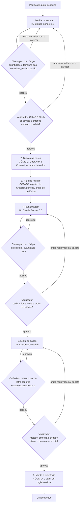

[Read in English](README.md)

# Nível 3: multiagente com conferência, mais código

**Código onde dá, IA com conferência onde precisa.** A IA decide os termos de busca, faz a triagem dos resumos e
extrai os dados, e um verificador confere cada um desses passos. O código faz todo o resto: busca nas bases
acadêmicas, filtra por período e tipo de publicação, confere cada trecho letra por letra e monta cada referência a
partir do registro oficial.

Este README tem duas partes. A parte 1 é para quem pesquisa. A parte 2, [Para agentes de IA](#parte-2-para-agentes-de-ia),
é para um agente de IA de programação que vai rodar, testar, depurar ou alterar este nível.

# Parte 1: para quem pesquisa

## O que é este nível

O Nível 3 é a quarta das quatro arquiteturas comparadas no benchmark da aula. Ele mantém tudo o que o Nível 2 tem (um
agente por passo, um verificador de outra empresa conferindo cada passo) e acrescenta uma ideia: **tudo o que não
precisa de julgamento é feito por código, não por IA**. Código não inventa. Quando falha, falha à vista e pode ser
conferido.

Para a IA ficam as três tarefas que exigem leitura e julgamento de verdade: escolher as palavras da busca, decidir se
um resumo atende ao pedido e extrair método, amostra e achado.

## Como funciona, passo a passo

Seis passos. Três são IA com verificador (QA), três são código.

| Passo | Quem executa | Quem confere | O que acontece |
| --- | --- | --- | --- |
| 1. Decide os termos | IA + QA | checagem por código, depois o verificador | A IA transforma o pedido em consultas curtas em inglês e em português, no período e nos critérios de inclusão e exclusão. |
| 2. Busca nas bases | código | | O código roda cada consulta no OpenAlex e no Crossref e baixa os resumos. |
| 3. Filtra no registro | código | | O código consulta cada DOI no registro oficial (Crossref) e descarta o que está fora do período ou não é artigo de periódico. |
| 4. Faz a triagem | IA + QA | checagem por código, depois o verificador | A IA lê cada resumo e fica só com o que atende a todos os critérios. |
| 5. Extrai os dados | IA + QA | o código confere o trecho letra por letra, depois o verificador | A IA extrai tipo de estudo, método, amostra e achado, com um trecho literal do resumo. |
| 6. Monta a referência | código | | O código escreve DOI, título, autores, ano e periódico a partir do registro oficial. |



Cada passo de IA tem até 5 tentativas. Uma tentativa reprovada volta para a IA com o parecer. Quando o verificador
reprova um artigo, esse artigo sai da lista e o passo segue com os outros. Se a quinta tentativa de um passo for
reprovada, a rodada é pausada e não entrega relatório.

Quem faz cada tarefa (página 22 do deck, coluna do Nível 3):

| Tarefa | Nível 3 |
| --- | --- |
| Decidir o que procurar | IA + QA |
| Buscar os artigos | Código |
| Conferir DOI, ano e tipo | Código |
| Ver se o artigo atende ao pedido | IA + QA |
| Extrair método, amostra e achado | IA + QA |
| Conferir o trecho no resumo | Código |
| Montar a referência | Código |

## As quatro camadas neste nível

Todo agente tem quatro camadas: perfil, memória, planejamento e ação (Wang et al. 2024). O Nível 3 preenche assim:

| Camada | No Nível 3 |
| --- | --- |
| Perfil | IA só nos passos de julgamento. Um perfil por passo de IA (termos, triagem, extração) e um por verificador. |
| Memória | Os candidatos, cada um com o registro oficial e o resumo que o código baixou. |
| Planejamento | Controles de qualidade automáticos, por código, e até 5 tentativas por passo de IA. |
| Ação | Busca, filtro, conferência e montagem por código. Os passos de IA não usam ferramentas. |

## O que recebe, como busca e lê, quem confere

- **Recebe:** cada agente recebe as instruções do seu passo e o pedido.
- **Busca e lê:** o código busca e confere; a IA só lê e extrai.
- **Quem confere:** o verificador confere a IA; o código confere cada trecho.

## Resultados

O benchmark da aula: 4 níveis x 6 temas x 2 repetições = 48 rodadas, 12 por nível. Cada rodada pede 25 artigos
empíricos de periódico, revisados por pares, publicados de 2018 a 2025, com 9 campos cada. O executor é o mesmo em
todos os níveis (Claude Sonnet 5.5); só muda a arquitetura.

**Precisão** é a métrica principal: dos artigos entregues, quantos estão 100% certos. Um campo errado e o artigo
inteiro conta como erro. Média dos 6 temas, com o intervalo de 95% (t de Student sobre os temas):

| Nível | Júri (principal) | Intervalo de 95% | Juiz único | Intervalo de 95% | Só checagens por código |
| --- | --- | --- | --- | --- | --- |
| 0 | 82% | 68 a 97% | 79% | 66 a 92% | 92% |
| 1 | 89% | 83 a 96% | 86% | 77 a 94% | 95% |
| 2 | 90% | 78 a 100% | 86% | 77 a 95% | 98% |
| **3** | **97%** | **94 a 100%** | **94%** | **88 a 100%** | **99%** |

O júri são três juízes de IA de três empresas (DeepSeek V4 Pro, Qwen3.7 Plus, Gemini 3.1 Flash-Lite), cegos ao
nível, que decidem por maioria em cada critério. O juiz único é o DeepSeek V4 Pro sozinho, nas mesmas rodadas.

**Custo e resultado**, média por rodada. Certos, errados e não entregues são parcelas dos 25 artigos pedidos, pelo júri; a precisão é a parcela dos artigos entregues que está 100% certa:

| Nível | Tempo | Chamadas de IA | Tokens | Custo por rodada | Certos | Errados | Não entregues | Precisão (dos entregues) | Rodadas pausadas |
| --- | --- | --- | --- | --- | --- | --- | --- | --- | --- |
| 0 | 10,2 min | 1,0 | 2,2 mi | R$ 7,11 | 80% | 17% | 3% | 82% | 0 de 12 |
| 1 | 17,0 min | 1,0 | 4,2 mi | R$ 9,84 | 82% | 10% | 8% | 89% | 0 de 12 |
| 2 | 42,1 min | 9,9 | 5,9 mi | R$ 16,33 | 59% | 8% | 33% | 90% | 3 de 12 |
| **3** | **5,1 min** | **7,0** | **146 mil** | **R$ 2,90** | **81%** | **2%** | **17%** | **97%** | **0 de 12** |

Custo por rodada: Claude Sonnet 5.5 a preço de API pública da Anthropic (tokens e buscas na web) mais o verificador
pelo valor cobrado pela OpenRouter, convertidos pela PTAX de venda do Banco Central de 14/10/2026, US$ 1 = R$ 5,0441.

**Como se compara.** O Nível 3 é a melhor abordagem do teste: o menor número de artigos errados (2% dos pedidos), o
mais rápido (5 min) e o mais barato (R$ 2,90). Pelo júri, supera o Nível 0 com segurança estatística (p de Holm 0,001)
e supera os Níveis 1 e 2 com sinal mais tímido (p de Holm por volta de 0,06, pouco acima do corte usual de 5%). Ainda
assim erra: de 100 artigos pedidos, 81 certos, 2 errados e 17 não entregues, e o agente não diz quais são os 2.

## Veja rodando

Uma rodada real do tema de exemplo (a04, jogos contra a desinformação, como o Bad News), repetição 1, reproduzida em
20x e terminando na entrega.

[](media/level-3.mp4)

Música: "Thinking Music", Kevin MacLeod (incompetech.com), CC BY 4.0.

## Quando usar este nível

Use o Nível 3 como padrão numa revisão de literatura quando as bases acadêmicas abertas cobrem a sua área. É o nível
mais preciso, mais rápido e mais barato do teste, e todo dado duro (DOI, título, autor, ano, periódico) vem do registro
oficial.

Ele decide pelo resumo, não pelo texto completo, e busca em duas bases gerais. O human in the loop continua valendo: o
agente acelera, quem pesquisa decide. Confira na fonte original cada artigo que você vai citar e julgue você mesmo o
método e o achado.

## Rodar só este nível

A preparação (Python, Claude Code, chaves) está no [README do repositório](../../README.pt-BR.md). O Nível 3 precisa de
`OPENROUTER_API_KEY` (verificador) e `OPENALEX_API_KEY` (chave gratuita do OpenAlex). Na raiz do repositório, no
PowerShell:

```
python -m benchmark.run --level n3 --topic a04 --tag mytest --rep 1
```

A rodada fica em `agents/level_3/runs/mytest-n3-a04-r1/`. Para assistir, rode `python -m http.server 8000` e abra
`http://127.0.0.1:8000/viewer/index.html?run=mytest-n3-a04-r1&replay=1`.

O que esperar, segundo uma conferência de ponta a ponta num clone novo: de 5 a 8 minutos (7,1 nessa conferência), 6
chamadas de IA, um `final.json` com `"status": "done"` e cerca de 20 artigos (20 nessa conferência), todos julgados
corretos pelo júri. O passo a passo, com a avaliação, está em [Rodar o benchmark](../../docs/run-the-benchmark.pt-BR.md#como-é-uma-primeira-rodada).

## O que você pode editar

As três instruções deste nível, em português, em texto simples:

- `prompts/terms.md`: como a IA escolhe as consultas e os critérios.
- `prompts/screener.md`: como a IA faz a triagem dos resumos.
- `prompts/extractor.md`: como a IA extrai tipo de estudo, método, amostra, achado e o trecho.

As instruções do verificador são compartilhadas com o Nível 2, em `benchmark/prompts/verifier.md`. Alterá-las altera
os dois níveis.

# Parte 2: para agentes de IA

## Arquivos deste nível

| Caminho | O que faz |
| --- | --- |
| `agent.py` | O pipeline do Nível 3. Ponto de entrada: `run(topic, run_dir, log)`, uma corrotina aguardada por `benchmark/run.py`. `topic` é uma entrada de `benchmark/topics.json`, `run_dir` a pasta da rodada, `log` o registro de eventos de `core/`. Contém os esquemas dos passos, as checagens por código, o código de busca e filtro e a montagem das referências. |
| `prompts/terms.md` | Prompt de sistema do passo 1 (termos e critérios). Em português. |
| `prompts/screener.md` | Prompt de sistema do passo 4 (triagem pelo resumo). Em português. |
| `prompts/extractor.md` | Prompt de sistema do passo 5 (extração a partir do resumo). Em português. |
| `runs/class-n3-<topic>-r<rep>/` | As 12 rodadas da aula: `events.jsonl`, `final.json`, `meta.json`, `calls/`, mais `candidates.json` (os candidatos depois do passo 3). |
| `evaluations/judge-deepseek/` | Um arquivo por rodada: checagens por código mais os pareceres do DeepSeek V4 Pro. |
| `evaluations/judge-qwen/` | O mesmo, Qwen3.7 Plus. |
| `evaluations/judge-gemini/` | O mesmo, Gemini 3.1 Flash-Lite. |
| `evaluations/jury/` | Maioria dos três juízes em cada critério; a medida principal. |
| `media/level-3.mp4`, `media/level-3.jpg` | Vídeo de `class-n3-a04-r1` reproduzido em 20x, e a capa. |

## Módulos compartilhados de que depende

| Módulo | Usado para |
| --- | --- |
| `benchmark/common.py` | Esquemas compartilhados (o item de 9 campos), o bloco de formato da resposta, gravação do `final.json`, checagens de DOI. |
| `benchmark/qa.py` | O laço do passo: executor, checagem determinística, verificador, até 5 tentativas, histórico de reprovações devolvido ao executor. |
| `benchmark/verifier.py` | O verificador: GLM-5.3 Flash (Z.ai) via OpenRouter (`z-ai/glm-5.3-flash`, esforço alto). O Nível 3 o chama sem ferramentas de web: ele julga só os resumos que o código baixou. |
| `benchmark/scholar.py` | Busca no OpenAlex, busca no Crossref e consulta ao Crossref por DOI, com cache em disco. |
| `benchmark/prompts/verifier.md` | As instruções do verificador, uma seção por passo. |
| `core/` | Chamada do executor pelo Claude Agent SDK (Claude Sonnet 5.5, esforço alto, o `claude.exe` da extensão do Claude Code no VS Code), o registro de eventos, a configuração. |

## Esquema de saída

O `final.json` contém `status`, `report.items` (ou `null` quando a rodada não entregou) e `attempts` por passo de IA
(`terms`, `screen`, `extract`). Cada item tem os 9 campos do pedido (tipo de estudo e método são duas chaves):

| Chave | Conteúdo | Quem preenche |
| --- | --- | --- |
| `doi` | Só o DOI, por exemplo `10.1000/xyz123` | código (registro) |
| `title` | Título | código (Crossref) |
| `authors` | Lista de nomes | código (Crossref) |
| `year` | Número inteiro | código: o ano mais antigo do Crossref dentro do período pedido |
| `venue` | Periódico | código (Crossref) |
| `study_type` | Tipo de estudo | IA |
| `method` | Método | IA |
| `sample_size` | Amostra como aparece no resumo, ou `não informado no resumo` | IA, conferida por código |
| `main_finding` | Achado principal em uma frase | IA |
| `abstract_quote` | Trecho literal do resumo | IA, conferido por código |

## Ferramentas

Os três passos de IA rodam sem ferramentas. Todo acesso externo é código, em `benchmark/scholar.py`: busca `/works` do
OpenAlex (25 resultados por consulta, filtrados por período, tipo artigo, com resumo e DOI) e busca `/works` do
Crossref (25 linhas por consulta, artigos de periódico com resumo no período), depois uma consulta ao Crossref por DOI
para cada candidato. Neste nível o verificador roda sem busca na web.

## Limites e constantes

- 25 artigos pedidos por rodada.
- Até 5 tentativas por passo de IA (em `benchmark/qa.py`).
- Checagem do passo 1: de 4 a 10 consultas em inglês e de 2 a 6 em português, cada uma com 2 a 8 palavras; período
  entre 1990 e 2026, com o início não posterior ao fim.
- Passo 2: um resultado precisa de DOI e de resumo com pelo menos 200 caracteres; repetidos se juntam pelo DOI e
  ficam com o resumo mais longo; os candidatos são ordenados por quantas consultas os encontraram e depois pela
  relevância da base.
- Passo 3: ficam no máximo 125 candidatos (o maior entre 60 e 5 vezes o número pedido). Um candidato é descartado
  quando o Crossref não tem registro, quando o tipo não é `journal-article` ou quando nenhum ano do Crossref cai no
  período.
- Passo 4: a triagem vê cada resumo cortado em 1.800 caracteres; o verificador vê o resumo inteiro. Checagem: os ids
  escolhidos existem, foram incluídos, e a quantidade é igual ao menor entre 25 e o número de incluídos.
- Checagem do passo 5: o trecho, normalizado, tem pelo menos 40 caracteres e está contido no resumo normalizado; a
  amostra está literal no resumo, ou todos os seus números aparecem nele, ou é `não informado no resumo`. A partir da
  terceira tentativa, o código retira os artigos que ainda falham, em vez de reprovar o passo.
- Passos de IA: no máximo 6 turnos cada; 600 s para os termos, 1.200 s para a triagem e para a extração.
- Verificador: se não responde, recebe mais uma chamada; uma reprovação sem problema declarado conta como aprovação.

## Status da rodada

| Status | Significado |
| --- | --- |
| `done` | O pipeline chegou ao passo 6; o `final.json` tem os itens. |
| `paused` | O verificador ou a checagem reprovou a quinta tentativa de um passo de IA; o `final.json` tem `paused_at` (`terms`, `screen` ou `extract`) e nenhum relatório. |
| `failed` | Nenhum candidato sobrou depois dos passos 2 e 3. |
| `error` | Uma exceção; o `events.jsonl` termina com `run_error` e o `meta.json` registra `error`. |

## Como rodar

```
python -m benchmark.run --level n3 --topic a04 --tag mytest --rep 1
```

Ids dos temas: `a01` a `a06` (`a04` é o tema de exemplo). Id da rodada: `<tag>-n3-<topic>-r<rep>`.

## Como avaliar só as rodadas deste nível

```
python -m evaluation.evaluate --judge deepseek --prefix mytest-n3
python -m evaluation.evaluate --judge qwen --prefix mytest-n3
python -m evaluation.evaluate --judge gemini --prefix mytest-n3
python -m evaluation.jury mytest
python -m evaluation.report mytest
```

O prefixo seleciona as rodadas. `jury` e `report` recebem a tag e cobrem toda rodada dessa tag que tem avaliações; se
você rodou só o Nível 3, só o Nível 3 aparece. `python -m evaluation.report class` reproduz os números da aula a partir
das avaliações que vêm no repositório.

## Como depurar

1. Abra `runs/<run_id>/meta.json`: status, tempo total, chamadas de IA e tokens por papel e por provedor.
2. Leia `runs/<run_id>/events.jsonl` em ordem. Tipos úteis: `step_start`, `step_roles`, `step_attempt`, `qa_verdict`
   (quem reprovou, `gate` ou `verifier`, o que foi conferido e os problemas), `det_search` (um por consulta e base, com
   o número de resultados), `det_filter` (resultados únicos, mantidos e descartados por motivo), `det_drop` (artigos
   que o código retirou no passo 5), `det_validate`, `pause`, `run_error`, `run_end`.
3. Abra `runs/<run_id>/calls/`: cada chamada de IA, numerada. Chamadas do executor têm `.system.md`, `.user.md` e
   `.result.json`; chamadas do verificador têm `.prompt.md` e `.result.json`.
4. Abra `runs/<run_id>/candidates.json` para ver o que o código encontrou e manteve antes da triagem.
5. Reproduza a rodada: `python -m http.server 8000` e depois
   `http://127.0.0.1:8000/viewer/index.html?run=<run_id>&replay=1`.

## Checklist antes de alterar um prompt

- [ ] Mantenha o esquema de saída do passo: as chaves das respostas de termos, triagem e extração, e o item de 9 campos.
- [ ] Mantenha as regras que as checagens por código cobram: quantidade e tamanho das consultas, só ids da lista,
      trecho literal, amostra como no resumo ou `não informado no resumo`.
- [ ] Rode de novo no tema de exemplo: `python -m benchmark.run --level n3 --topic a04 --tag mytest --rep 1` (e `--rep 2`).
- [ ] Avalie com os três juízes, depois `jury` e `report`.
- [ ] Compare com as rodadas da aula que vêm no repositório, `class-n3-a04-r1` e `class-n3-a04-r2`: precisão, certos,
      errados, não entregues, tempo e chamadas de IA.
