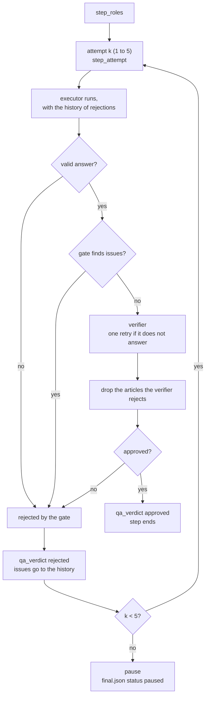
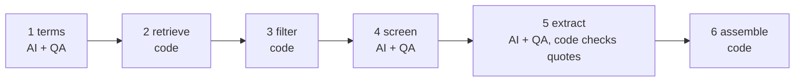

[Leia em português](architecture.pt-BR.md)

# Architecture

The technical documentation of the repository: how the code is organized, what each module does, what every file a run writes contains, and how to extend and debug it. For the method and the results, see [evaluation.md](evaluation.md), [statistics.md](statistics.md) and [results.md](results.md).

## Contents

1. [Overview](#overview)
2. [Modules](#modules)
3. [The event log](#the-event-log)
4. [File formats](#file-formats)
5. [The QA loop](#the-qa-loop)
6. [Level 2 and Level 3 pipelines](#level-2-and-level-3-pipelines)
7. [Caching](#caching)
8. [Cost accounting](#cost-accounting)
9. [Extending: a new level or a new judge](#extending-a-new-level-or-a-new-judge)
10. [Testing and debugging](#testing-and-debugging)
11. [Stack and versions](#stack-and-versions)
12. [Security of keys](#security-of-keys)

## Overview

Three layers of code and one layer of data. `core/` calls the executor and logs events. `benchmark/` runs a level on a topic and holds what the levels share. `agents/level_N/` holds each level, isolated, with its own runs and evaluations. `evaluation/` judges every run the same way, whatever its level.

```mermaid
flowchart TB
    subgraph EXT["External services"]
        CC["Claude Code binary<br/>Claude Sonnet 5.5"]
        OR["OpenRouter<br/>GLM-5.3 Flash, DeepSeek V4 Pro,<br/>Qwen3.7 Plus, Gemini 3.1 Flash-Lite"]
        SCH["OpenAlex, Crossref,<br/>Semantic Scholar, publisher pages"]
        BR["Brave Search"]
    end
    subgraph CORE["core/"]
        LLM["llm.py<br/>run_agent"]
        EVT["events.py<br/>EventLog"]
        CFG["config.py"]
    end
    subgraph BENCH["benchmark/"]
        RUN["run.py / bench.py"]
        QA["qa.py<br/>qa_step"]
        VER["verifier.py<br/>run_verifier"]
        SCHO["scholar.py"]
        COM["common.py"]
    end
    subgraph AGENTS["agents/"]
        L0["level_0"]
        L1["level_1"]
        L2["level_2"]
        L3["level_3"]
    end
    subgraph EVAL["evaluation/"]
        EV["evaluate.py"]
        JL["judge_llm.py"]
        VF["verify.py"]
        JU["jury.py"]
        RS["report.py / stats.py"]
    end
    VIEW["viewer/index.html"]

    RUN --> L0 & L1 & L2 & L3
    L0 & L1 --> COM
    L2 & L3 --> QA
    QA --> VER
    COM & L2 & L3 --> LLM
    L3 --> SCHO
    LLM --> CC
    LLM --> EVT
    VER --> OR
    VER --> BR
    SCHO --> SCH
    EV --> SCHO
    EV --> VF
    EV --> JL --> OR
    EV --> JU --> RS
    EVT -. events.jsonl .-> VIEW
```

## Modules

### `core/`

| Module | Responsibility |
| --- | --- |
| `config.py` | Shared configuration: the executor model (`claude-sonnet-5-5`) and effort (`high`), the same for every AI call of every level; the cache root (`.cache/`); the HTTP user agent; `find_claude_exe()`, which finds the newest `claude.exe` shipped with the Claude Code extension for VS Code; `brave_api_key()`. |
| `llm.py` | `run_agent()`: one isolated executor call through the Claude Agent SDK. It writes the system and user prompts to `calls/`, starts Claude Code with no user settings (`setting_sources=[]`), no MCP servers (`strict_mcp_config`, `mcp_servers={}`), no saved session (`no-session-persistence`), only the tools the step allows, a turn limit, a timeout and, when the step has one, a JSON schema for structured output. It streams every message into the event log, keeps the latest quota reading, raises `RateLimited` when the quota is rejected, and on timeout stops the `claude.exe` processes of that call. If the structured output is missing, it extracts the last JSON object from the text. |
| `events.py` | `EventLog`: an append-only JSON Lines file per run (`events.jsonl`), thread-safe, one event per line. `clip()` shortens long text for the log. |
| `sources.py` | HTTP helpers shared by the evaluation and the verifier: request headers, page download with size limit, PDF and HTML text extraction, and a Brave Search client. |

### `benchmark/`

| Module | Responsibility |
| --- | --- |
| `run.py` | `python -m benchmark.run --level n3 --topic a04 --tag mytest --rep 1`. Loads the topic, creates the run folder, logs `run_start`, imports `agents.level_N.agent` and awaits its `run()`, then logs `run_end` and writes `meta.json`. |
| `bench.py` | `python -m benchmark.bench ...`. A batch of runs with a pool of workers, each run in its own process. The longest levels start first (Level 2, then 3, 1 and 0). A run that ends in `error` is retried once; a run already `done`, `paused` or `failed` is kept. `--skip-started` skips runs another dispatcher started. Progress goes to `benchmark/progress/<tag>.jsonl`. |
| `common.py` | What the four agents share: the 10-key article schema (`FINAL_SCHEMA`), the answer format appended to every request, the per-article verdict schema, `run_single_agent()` (Levels 0 and 1), `write_final()`, `drop_rejected()`, DOI checks, and `verifier_text()`, which reads one step's section of `prompts/verifier.md`. |
| `qa.py` | `qa_step()`: the step loop of Levels 2 and 3 (see [The QA loop](#the-qa-loop)). `verify_step()` calls the verifier with the step's instructions and the common answering rules. `history_block()` turns earlier rejections into text for the next attempt. |
| `verifier.py` | `run_verifier()`: the verifier, GLM-5.3 Flash through the OpenRouter chat completions API, effort `high`. With web access it can call two tools of ours, `web_search` (Brave Search, 8 results) and `open_page` (our HTTP fetch, text clipped to 9,000 characters), for up to 10 rounds; a final call forces the verdict into a strict JSON schema. Every search, page, token and dollar goes to the event log and to `calls/`. |
| `scholar.py` | Deterministic scholarly access, with a disk cache: OpenAlex and Crossref search with period and type filters, OpenAlex, Crossref and Semantic Scholar lookup by DOI, and the publisher page opened in headless Chrome through Playwright (abstract and titles from the page's meta tags). `abstracts_for()` gathers every abstract the sources hold for a DOI. |
| `paths.py` | Where each run and evaluation lives. A run id is `<tag>-<level>-<topic>-r<rep>`. |
| `record_replay.py` | Serves the repository locally, opens the viewer in replay mode in headless Chrome at 1920x1080, records it, and converts it with ffmpeg to `agents/level_N/media/<run_id>.mp4` plus a poster `.jpg` taken 3 seconds before the end. |
| `topics.json` | The six topics. Each has `id`, `topic_pt`, `request_pt` (the request every level receives), `constraints` (`year_from`, `year_to`, `type`, `empirical`, `other_pt`), `n_wanted` (25), `reference_set` (articles checked by hand), `traps_pt` and `feasibility`. |
| `prompts/verifier.md` | The verifier's instructions, one `## <step>` section per step. |

### `agents/level_N/`

Each level is one module, `agent.py`, exposing `async def run(topic: dict, run_dir: Path, log: EventLog) -> None`. It must write `final.json` before returning.

| Level | `agent.py` | Prompts |
| --- | --- | --- |
| Level 0 | `run_single_agent()` with a one-sentence instruction. | `level_0.md` |
| Level 1 | `run_single_agent()` with the instruction written in four layers. | `level_1.md` |
| Level 2 | Three `qa_step()` calls: plan, search and screening, extraction. | `planner.md`, `searcher.md`, `extractor.md` |
| Level 3 | Six steps: three `qa_step()` calls (terms, screening, extraction) and three code steps (retrieve, filter, assemble). | `terms.md`, `screener.md`, `extractor.md` |

Executor limits per call (n = 25 articles requested):

| Level and step | Tools | Max turns | Timeout |
| --- | --- | --- | --- |
| Levels 0 and 1, single agent | WebSearch, WebFetch | 90 + 5n = 215 | 2,700 + 90n = 4,950 s |
| Level 2, plan | none | 6 | 600 s |
| Level 2, search and extraction | WebSearch, WebFetch | 80 + 5n = 205 | 2,400 + 90n = 4,650 s |
| Level 3, terms | none | 6 | 600 s |
| Level 3, screening and extraction | none | 6 | 1,200 s |

Level 3 executors have no tools: everything they read was downloaded by code.

### `evaluation/`

| Module | Responsibility |
| --- | --- |
| `evaluate.py` | `python -m evaluation.evaluate --judge deepseek --prefix mytest`. For every finished run whose id starts with the prefix, checks every delivered article by code and asks one judge about it, then writes `agents/level_N/evaluations/judge-<name>/<run_id>.json`. Runs whose evaluation is newer than their `meta.json` are skipped. |
| `judge_llm.py` | `judge()`: one judge call through OpenRouter, effort `high`, temperature 0, strict JSON schema, cached by the SHA-256 of the full request. |
| `verify.py` | Page fetch with cache (HTML through trafilatura and BeautifulSoup, PDF through PyMuPDF), text normalization (`norm()`: Unicode NFKC, quote marks and dashes unified, case folded, spaces collapsed) and literal quote matching (`find_quote()`: `exact` when every segment is a substring, `near` when every segment aligns at 90 or more, else `not_found`; segments split at ellipses and line breaks). |
| `jury.py` | `python -m evaluation.jury mytest`. For every run judged by all three judges, the majority vote per criterion, written as `evaluations/jury/<run_id>.json` in the same format as a judge's file. |
| `report.py` | `python -m evaluation.report mytest`. Precision, intervals, cost and outcome per level, written to `evaluation/REPORT.md`. |
| `stats.py` | `python -m evaluation.stats mytest`. The per-article test with Holm correction, written to `evaluation/STATISTICS.md`. |

### `viewer/index.html`

A static page, served by any HTTP server from the repository root. `?run=<run_id>` follows a run live, reading `events.jsonl` every 400 ms. `?run=<run_id>&replay=1` replays a finished run: each event at its real time divided by `speed` (default 10), with gaps capped at `cap` seconds (default 1.2) and a pause of `hold` seconds after each verdict (default 7). When the replay ends, it sets `document.body.dataset.replayDone = "1"`, which `record_replay.py` waits for.

### `bibcheck/`

`python -m bibcheck.run` applies the Level 3 method to a bibliography: code finds each work in the official records and downloads its abstract, full text or page, looks for the claim's numbers and phrases, and a jury of three models decides by majority whether the source supports the claim. See [bibliography-check.md](bibliography-check.md).

## The event log

`agents/level_N/runs/<run_id>/events.jsonl` has one JSON object per line. Every event has:

| Field | Meaning |
| --- | --- |
| `ts` | Unix time, in seconds, 3 decimals |
| `t` | seconds since the run started |
| `kind` | the event type, below |

| `kind` | Emitted by | Fields |
| --- | --- | --- |
| `run_start` | `run.py` | `run_id`, `level`, `item` (topic id), `title`, `request` |
| `step_start` | agents | `step`, `label`, `mode` (`ai` or `det`) |
| `step_roles` | `qa.py` | `step`, `label`, `executor`, `verifier` (or null), `checks` (what the verifier checks), `gate` (what code checks) |
| `step_attempt` | `qa.py` | `step`, `label`, `attempt`, `max_attempts` |
| `ai_call_start` | `llm.py`, `verifier.py` | `call` (call id), `name`, `role` (`single`, `executor` or `verifier`), `tools`, and `step` when the call belongs to a QA step; the verifier adds `provider`, `model`, `effort` |
| `ai_text` | `llm.py` | `call`, `name`, `role`, `text` (clipped) |
| `ai_tool` | `llm.py`, `verifier.py` | `call`, `name`, `role`, `tool` (`WebSearch` or `WebFetch`), `input` (`query` or `url`) |
| `ai_tool_result` | `llm.py` | `call`, `name`, `role`, `is_error`, `preview` |
| `quota` | `llm.py` | `status`, `utilization`, `limit_type`, `resets_at` |
| `ai_call_error` | `llm.py` | `call`, `name`, `role`, `message` |
| `ai_call_end` | `llm.py`, `verifier.py` | `call`, `name`, `role`, `duration_s`, `is_error`, `errors`, `input_tokens`, `output_tokens`; the executor adds `turns`, `cache_read`, `cache_write`; the verifier adds `provider`, `model`, `effort`, `web_searches`, `pages`, `cost_usd` |
| `qa_verdict` | `qa.py` | `step`, `label`, `attempt`, `approved`, `by` (`gate` or `verifier`), `checked`, `issues`, `feedback` |
| `pause` | `qa.py` | `step`, `label`, `attempts`, `reason`, `last_issues`, `last_feedback` |
| `det_search` | Level 3 | `connector` (`openalex` or `crossref`), `query`, `results` |
| `det_filter` | Level 3 | `unique`, `kept`, `dropped` (`not_journal`, `out_of_period`, `no_crossref`) |
| `det_drop` | Level 3 | `step`, `ids`, `reason` |
| `det_validate` | Level 3 | `items`, `quotes_checked` |
| `step_end` | agents | `step`, and `items` (single agent) or `candidates` (Level 3 retrieval) |
| `run_error` | `run.py` | `message` |
| `run_end` | `run.py` | `status`, `wall_seconds` |

## File formats

### A run: `agents/level_N/runs/<run_id>/`

| File | Content |
| --- | --- |
| `events.jsonl` | the event log, above |
| `final.json` | the delivery |
| `meta.json` | the summary |
| `calls/` | every prompt and every answer |
| `candidates.json` | Level 3 only: the candidates kept after the code filters |
| `work/` | the executor's working folder |

**`final.json`**

| Field | Meaning |
| --- | --- |
| `status` | `done`, `paused` (the verifier refused the fifth attempt of a step) or `failed` |
| `report` | `{"items": [...]}`, or null when the run delivered nothing |
| `notes` | Levels 0 to 2: what the agent says it did and left out |
| `attempts` | Levels 2 and 3: attempts per step, for example `{"plan": 1, "search": 2, "extract": 2}` |
| `paused_at` | the step where the run paused |
| `errors` | up to three error messages |

Each item has the 10 keys of `FINAL_SCHEMA`: `doi`, `title`, `authors` (list), `year` (integer), `venue`, `study_type`, `method`, `sample_size` (as in the abstract, or `não informado no resumo`), `main_finding`, `abstract_quote`.

**`meta.json`**

| Field | Meaning |
| --- | --- |
| `run_id`, `level`, `item`, `rep` | identity of the run |
| `status` | as in `final.json`, or `error` when the run raised an exception |
| `wall_seconds` | wall time |
| `calls` | AI calls per `role:provider`, for example `{"executor:anthropic": 4, "verifier:zhipu": 3}` |
| `tokens` | tokens per `provider:kind` (`input_tokens`, `output_tokens`, `cache_read`, `cache_write`) |
| `calls_total` | all AI calls |

**`calls/`**. Each executor call writes `NNN-<name>.system.md`, `NNN-<name>.user.md` and `NNN-<name>.result.json` (`structured`, `text`, `usage`, `num_turns`, `duration_s`, `is_error`, `errors`, `tool_calls`). Each verifier call writes `NNN-<name>.prompt.md` and `NNN-<name>.result.json` (`structured`, `text`, `usage` with `input_tokens`, `output_tokens` and `cost_usd`, `duration_s`, `errors`, `tool_calls`, `model`, `effort`).

### An evaluation: `agents/level_N/evaluations/<judge>/<run_id>.json`

`<judge>` is `judge-deepseek`, `judge-qwen`, `judge-gemini` or `jury`. The four have the same format.

| Field | Meaning |
| --- | --- |
| `run_id`, `level`, `item`, `status` | the run |
| `delivered` | articles delivered |
| `correct` | articles 100% correct |
| `requested` | articles requested (25) |
| `precision` | `correct / delivered`, or null when nothing was delivered |
| `yield` | `correct / requested` |
| `not_found` | DOI not found anywhere, and no real article with that title |
| `wrong_doi` | DOI not found, but a real article with that title exists |
| `metadata_errors` | title, year, first author or journal does not match the registry |
| `quote_fail` | quote not found in any abstract or in the article page |
| `no_abstract` | no source holds an abstract, so nobody can check it |
| `wall_seconds`, `calls` | from `meta.json` |
| `judge` | who judged (a label) |
| `items` | one record per delivered article, below |

Each item:

| Field | Meaning |
| --- | --- |
| `doi`, `title` | as delivered |
| `checks` | code checks: `doi_exists`, `title_ok`, `year_ok`, `author_ok`, `venue_ok`, `in_period`, `journal_article`, `quote_ok`, `sample_ok` (null when the sample is reported as absent or no text is available) |
| `abstract_sources` | how many sources held an abstract |
| `judge` | the judge's answer: `evidence_topic`, `on_topic`, `evidence_empirical`, `empirical`, `method_ok`, `finding` (`supported`, `partial` or `unsupported`), `reason`. In the jury file: the majority, `on_topic`, `empirical`, `method_ok`, `finding` (`supported` or `partial`) |
| `metadata_ok` | title, year, author and journal all match |
| `correct` | the article is 100% correct |
| `error_class` | when present: `not_found`, `wrong_doi_real_article`, `metadata_error` or `no_abstract` |

An article is **correct** when the DOI exists; title, year, first author and journal match; it is in the period and is a journal article; the quote is found; the sample is not contradicted; and the judge (or the jury) says on topic, empirical, method as stated and finding supported. The jury takes the majority of the three judges per criterion (two of three); an article that one of the three judges could not judge is not correct.

The code checks, in detail: title matches at fuzzy score 85 or more against any title the registry, OpenAlex, Semantic Scholar or the publisher page declares; first author matches in any citation style; journal matches at 80 or more; year is any year the registries give; the quote is searched in every abstract (OpenAlex, Crossref, Semantic Scholar, publisher page) and in the article page; the sample is a literal phrase of the text, or every number it gives is in the text. Semantic Scholar and the publisher page are sources Level 3 never uses.

## The QA loop

Levels 2 and 3 run every AI step through `qa_step()` in `benchmark/qa.py`. Each step has an executor, an optional deterministic gate and an optional verifier.



Rules, as the code applies them:

1. **The gate runs first.** It is code and costs nothing. If it finds issues, the verifier is not called and the attempt counts as rejected.
2. **An answer that does not parse is a rejection** by the gate.
3. **The verifier gets one retry** when it does not answer (network or provider). If it still does not answer, the attempt is rejected.
4. **Rejected articles leave the list.** `drop_rejected()` removes every article the verifier marks as not ok, and the step goes on with the rest. The step is rejected only for a problem that is not about one article, or when nothing is left. An article the verifier does not mention is not rejected.
5. **A rejection must give a reason.** A verdict with `approved: false` and no issue counts as approved.
6. **The next attempt sees the history.** Every earlier rejection, with who rejected it (gate or verifier), its issues and its feedback, is added to the executor's prompt.
7. **Five attempts at most.** After the fifth rejection the loop logs `pause`, and the agent writes `final.json` with status `paused` and no report.

## Level 2 and Level 3 pipelines

### Level 2

| Step | Executor output | Gate (code) | Verifier |
| --- | --- | --- | --- |
| `plan` | criteria, queries (query, language, database), how to check | none | checks that the plan covers every criterion of the request; no web |
| `search` | candidates (DOI, title, authors, year, venue, checked URL, criteria met) | DOIs well formed, no repeats, at least one candidate | checks, article by article, that each DOI exists and matches, and that each article meets every criterion; with web search and page fetch |
| `extract` | the final items | the requested number, all from the approved list, each with a quote of 40 characters or more | checks, article by article, quote, sample, method and finding; with web search and page fetch |

On a new search attempt the executor also receives the previous list with the verifier's verdict on each article.

### Level 3



1. **Terms (AI + QA).** The executor returns `year_from`, `year_to`, 4 to 10 queries in English, 2 to 6 in Portuguese, and the inclusion and exclusion criteria. The gate checks the counts, that every query has 2 to 8 words, and that the period is valid. The verifier checks coverage and period, with no web.
2. **Retrieve (code).** Every query goes to OpenAlex (`type:article`, with abstract and DOI, in the period) and to Crossref (`journal-article`, with abstract, in the period), 25 results each. Works with a DOI and an abstract of 200 characters or more are merged by DOI, keeping the longer abstract and counting how many searches found each one.
3. **Filter (code).** Candidates are ranked by that count, then by relevance score. Walking down the ranking, each DOI is looked up in Crossref and kept only if Crossref has it, its type is `journal-article` and one of its years is in the period. The walk stops at `max(60, 5 x 25) = 125` candidates. Ids are `C01`, `C02` and so on. The list goes to `candidates.json` and the counts to `det_filter`.
4. **Screen (AI + QA).** The executor reads each candidate (title, year, journal, abstract up to 1,800 characters), decides include or exclude with a reason, and selects up to 25. The gate checks that every id exists, that every selected id was included, and the count. The verifier reads each selected abstract against the criteria, with no web, and the articles it rejects leave the list.
5. **Extract (AI + QA).** The executor returns `study_type`, `method`, `sample_size`, `main_finding` and `abstract_quote` per article. The gate checks, letter by letter after normalization, that the quote (40 characters or more) is in the downloaded abstract, and that the sample is a phrase of the abstract or that its numbers are in it. From the third attempt on, the gate drops the articles that still fail (`det_drop`) instead of rejecting the step. The verifier checks method, sample and finding against the abstract, with no web.
6. **Assemble (code).** Each reference is built from the Crossref record: DOI, title, authors and journal, and the first registry year inside the period. The AI never types a DOI, a title or an author.

## Caching

All caches live under `.cache/` at the repository root.

| Cache | Key | What is cached | What is not |
| --- | --- | --- | --- |
| `.cache/scholar/<sha1>.json` | SHA-1 of URL and parameters | OpenAlex, Crossref and Semantic Scholar responses, status 200 and 404 | 429 and 5xx responses (retried) |
| `.cache/scholar/pub-<sha1 of DOI>.json` | DOI | the publisher page's abstract and titles | navigation errors and timeouts (retried next time) |
| `.cache/pages/<sha1>.json` | SHA-1 of URL | fetched pages: status, final URL, title, extracted text, raw text | 5xx and dropped connections are fetched again |
| `.cache/judge/<sha256>.json` | SHA-256 of the full request (model, prompts, schema, effort, temperature) | the parsed judgment, its usage and the model | failed calls |

Effects: a second evaluation of the same runs costs nothing and gives the same answer; a repeated DOI check gives the same answer; changing a judge's prompt, schema or model creates a new key, so the old judgments are never reused by mistake. `evaluate.py` also skips a run whose evaluation file is newer than its `meta.json`. To force a new judgment, delete the evaluation file (and, to pay for a new answer, the matching judge cache).

## Cost accounting

The cost per run in the results is computed by `evaluation/report.py` from the files of each run:

| Part | Source | Price |
| --- | --- | --- |
| Executor tokens | `usage` in each executor `calls/*.result.json` | Claude Sonnet 5.5 at Anthropic's public API price, in US$ per million tokens: input 2.00, cache write 5 min 2.50, cache write 1 h 4.00, cache read 0.10, output 10.00 |
| Executor web searches | `ai_tool` events with `tool = WebSearch` and a role other than verifier | US$ 10 per 1,000 searches |
| Verifier | `cost_usd` in the verifier's `ai_call_end` events | the cost OpenRouter charged for each call |
| Conversion | constants in `report.py` | Banco Central PTAX selling rate of 14/10/2026, US$ 1 = R$ 5.0441 |

The judges are not part of the cost of a run: they are the cost of measuring. Their usage is stored next to each judgment in `.cache/judge/`. The full benchmark (48 runs, the verifier and three judges) cost about R$ 170 in OpenRouter tokens (US$ 33.38), plus the Claude subscription that ran the executor.

## Extending: a new level or a new judge

### A new level

1. Create `agents/level_4/` with `__init__.py`, `agent.py` and `prompts/`. `agent.py` exposes `async def run(topic, run_dir, log)`. Call the executor with `core.llm.run_agent()`, wrap any step you want checked in `benchmark.qa.qa_step()`, and finish with `benchmark.common.write_final(run_dir, items, status)`, each item with the 10 keys of `FINAL_SCHEMA`. Log `step_start` and `step_end` for the viewer.
2. Register the level id `n4`: add it to `LEVELS` and widen the `RUN_ID` pattern in `benchmark/paths.py`; add a title to `TITLES` in `benchmark/run.py`; add a start order to `ORDER` in `benchmark/bench.py`; add it to the level lists in `evaluation/report.py` and `evaluation/stats.py`.
3. Run it with `python -m benchmark.run --level n4 ...`. The evaluation does not change: it judges `final.json`, whatever produced it.

### A new judge

1. Add an entry to `JUDGES` in `evaluation/evaluate.py`: a short name, the OpenRouter model id and a label.
2. Add `judge-<name>` to `JUDGES` in `benchmark/paths.py`. The jury reads every judge listed there.
3. The jury's majority is two votes, a strict majority of three. With a different number of judges, set the threshold in `majority()` in `evaluation/jury.py` to more than half.
4. Run `python -m evaluation.evaluate --judge <name> --prefix <tag>`, then the jury.

To swap the verifier, change `VERIFIER_MODEL` in `benchmark/verifier.py`. Keep it from a company other than the executor's and the judges'.

## Testing and debugging

There is no unit test suite. The checks are these:

| Check | Command | What it proves |
| --- | --- | --- |
| Reproduce the class numbers | `python -m evaluation.report class` | the report reads the shipped evaluations and gives the published numbers |
| Verifier, live | `python -m benchmark.verifier` | one verifier call with web search reaches OpenRouter and Brave and rejects a wrong DOI (a few cents) |
| Judge, live | `python -m evaluation.judge_llm` | one judge call returns a valid structured answer |
| One run | `python -m benchmark.run --level n3 --topic a04 --tag debug --rep 1` | the whole chain, on a scratch tag |

When a run goes wrong:

- **Follow it live**: serve the repository (`python -m http.server 8000`) and open `viewer/index.html?run=<run_id>`.
- **Read what each call saw and answered**: the files in `calls/`, numbered in order.
- **Find why a step was rejected**: the `qa_verdict` events, with `by`, `checked`, `issues` and `feedback`.
- **Paused run**: the `pause` event names the step and the last issues; `final.json` has `paused_at`.
- **Run ended in `error`**: the `run_error` event has the exception; in a batch, `benchmark/progress/<tag>.jsonl` has the last lines of stderr.
- **Quota**: `quota` events show the subscription's usage; a rejected quota stops the run with `RateLimited`.
- **Timeout**: the call is logged with `is_error` and the `claude.exe` processes of that call are stopped.
- **Evaluate again**: delete the run's evaluation file; the cached judgments make it free unless the prompt changed.

## Stack and versions

From `requirements.txt`:

| Package | Version | Used for |
| --- | --- | --- |
| claude-agent-sdk | 0.2.163 | the executor call, driving the Claude Code binary |
| httpx | 0.28.1 | every HTTP call: OpenRouter, OpenAlex, Crossref, Semantic Scholar, Brave, pages |
| playwright | 1.64.0 | publisher pages in headless Chrome, video recording |
| trafilatura | 2.3.1 | main text of HTML pages |
| beautifulsoup4 | 4.15.0 | page title and raw text |
| lxml | 6.1.3 | HTML parser for BeautifulSoup |
| pymupdf | 1.28.2 | text of PDF files |
| rapidfuzz | 3.14.6 | fuzzy matching of titles, authors, journals, quotes |
| pandas | 3.0.6 | data frames for the report and the statistics |
| numpy | 2.5.4 | numeric support |
| statsmodels | 0.15.0 | logistic regression with errors clustered by run |
| scipy | 1.18.1 | Student t intervals |

Outside Python: Windows 11 (the only system tested; the executor binary is found in the VS Code extension folder for `win32-x64`, and stopping a call's processes uses PowerShell), Claude Code installed as the VS Code extension and logged in, Google Chrome, and ffmpeg for videos.

## Security of keys

| Key | Read from | Sent to |
| --- | --- | --- |
| `OPENROUTER_API_KEY` | the process environment; on Windows, also the user environment | OpenRouter only, in the `Authorization` header |
| `OPENALEX_API_KEY` | the process environment; on Windows, also the user environment | OpenAlex only, in the `Authorization` header, never in the URL or in a cache key |
| `BRAVE_API_KEY` | the process environment; when empty, the Brave Search entry of the Claude Code MCP configuration (`~/.claude.json`) | Brave Search only, in the `X-Subscription-Token` header |

Every key is read at run time. None is written to disk, to the event log, to `calls/` or to the caches. The code does not load `.env` by itself (`.env.example` only lists the names), and `.env` is ignored by git. The executor uses the logged-in Claude Code session: the repository holds no Anthropic key.
