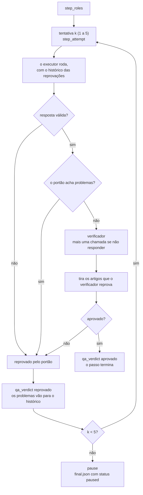
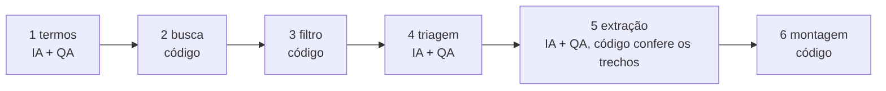

[Read in English](architecture.md)

# Arquitetura

A documentação técnica do repositório: como o código se organiza, o que cada módulo faz, o que contém cada arquivo que uma rodada grava, e como estender e depurar. Para o método e os resultados, veja [evaluation.pt-BR.md](evaluation.pt-BR.md), [statistics.pt-BR.md](statistics.pt-BR.md) e [results.pt-BR.md](results.pt-BR.md).

## Sumário

1. [Visão geral](#visão-geral)
2. [Módulos](#módulos)
3. [O registro de eventos](#o-registro-de-eventos)
4. [Formatos de arquivo](#formatos-de-arquivo)
5. [O laço de QA](#o-laço-de-qa)
6. [Fluxos do Nível 2 e do Nível 3](#fluxos-do-nível-2-e-do-nível-3)
7. [Cache](#cache)
8. [Contabilidade de custo](#contabilidade-de-custo)
9. [Como estender: um nível novo ou um juiz novo](#como-estender-um-nível-novo-ou-um-juiz-novo)
10. [Testes e depuração](#testes-e-depuração)
11. [Stack e versões](#stack-e-versões)
12. [Segurança das chaves](#segurança-das-chaves)

## Visão geral

Três camadas de código e uma de dados. O `core/` chama o executor e registra os eventos. O `benchmark/` roda um nível em um tema e guarda o que os níveis compartilham. O `agents/level_N/` guarda cada nível, isolado, com as próprias rodadas e avaliações. O `evaluation/` julga toda rodada do mesmo jeito, qualquer que seja o nível.

```mermaid
flowchart TB
    subgraph EXT["Serviços externos"]
        CC["Binário do Claude Code<br/>Claude Sonnet 5.5"]
        OR["OpenRouter<br/>GLM-5.3 Flash, DeepSeek V4 Pro,<br/>Qwen3.7 Plus, Gemini 3.1 Flash-Lite"]
        SCH["OpenAlex, Crossref,<br/>Semantic Scholar, páginas das editoras"]
        BR["Brave Search"]
    end
    subgraph CORE["core/"]
        LLM["llm.py<br/>run_agent"]
        EVT["events.py<br/>EventLog"]
        CFG["config.py"]
    end
    subgraph BENCH["benchmark/"]
        RUN["run.py / bench.py"]
        QA["qa.py<br/>qa_step"]
        VER["verifier.py<br/>run_verifier"]
        SCHO["scholar.py"]
        COM["common.py"]
    end
    subgraph AGENTS["agents/"]
        L0["level_0"]
        L1["level_1"]
        L2["level_2"]
        L3["level_3"]
    end
    subgraph EVAL["evaluation/"]
        EV["evaluate.py"]
        JL["judge_llm.py"]
        VF["verify.py"]
        JU["jury.py"]
        RS["report.py / stats.py"]
    end
    VIEW["viewer/index.html"]

    RUN --> L0 & L1 & L2 & L3
    L0 & L1 --> COM
    L2 & L3 --> QA
    QA --> VER
    COM & L2 & L3 --> LLM
    L3 --> SCHO
    LLM --> CC
    LLM --> EVT
    VER --> OR
    VER --> BR
    SCHO --> SCH
    EV --> SCHO
    EV --> VF
    EV --> JL --> OR
    EV --> JU --> RS
    EVT -. events.jsonl .-> VIEW
```

## Módulos

### `core/`

| Módulo | Responsabilidade |
| --- | --- |
| `config.py` | Configuração comum: o modelo executor (`claude-sonnet-5-5`) e o esforço (`high`), os mesmos em toda chamada de IA de todo nível; a raiz do cache (`.cache/`); o user agent HTTP; `find_claude_exe()`, que acha o `claude.exe` mais novo que vem com a extensão do Claude Code para o VS Code; `brave_api_key()`. |
| `llm.py` | `run_agent()`: uma chamada isolada do executor pelo Claude Agent SDK. Grava as instruções de sistema e de usuário em `calls/`, inicia o Claude Code sem configurações do usuário (`setting_sources=[]`), sem servidores MCP (`strict_mcp_config`, `mcp_servers={}`), sem sessão salva (`no-session-persistence`), só com as ferramentas que o passo permite, um limite de turnos, um tempo máximo e, quando o passo tem um, um esquema JSON para a saída estruturada. Transmite cada mensagem para o registro de eventos, guarda a última leitura de cota, levanta `RateLimited` quando a cota é recusada, e, no estouro de tempo, encerra os processos `claude.exe` daquela chamada. Se a saída estruturada faltar, extrai o último objeto JSON do texto. |
| `events.py` | `EventLog`: um arquivo JSON Lines só de acréscimo por rodada (`events.jsonl`), seguro entre threads, um evento por linha. `clip()` encurta textos longos para o registro. |
| `sources.py` | Funções HTTP comuns à avaliação e ao verificador: cabeçalhos das requisições, download de página com limite de tamanho, extração de texto de PDF e HTML, e um cliente do Brave Search. |

### `benchmark/`

| Módulo | Responsabilidade |
| --- | --- |
| `run.py` | `python -m benchmark.run --level n3 --topic a04 --tag mytest --rep 1`. Carrega o tema, cria a pasta da rodada, registra `run_start`, importa `agents.level_N.agent` e aguarda o `run()` dele, depois registra `run_end` e grava o `meta.json`. |
| `bench.py` | `python -m benchmark.bench ...`. Um lote de rodadas com um conjunto de trabalhadores, cada rodada no próprio processo. Os níveis mais longos começam primeiro (Nível 2, depois 3, 1 e 0). Uma rodada que termina em `error` é refeita uma vez; uma rodada já `done`, `paused` ou `failed` é mantida. `--skip-started` pula rodadas que outro despachante já começou. O andamento vai para `benchmark/progress/<tag>.jsonl`. |
| `common.py` | O que os quatro agentes compartilham: o esquema de artigo com 10 chaves (`FINAL_SCHEMA`), o formato de resposta acrescentado a todo pedido, o esquema de parecer por artigo, `run_single_agent()` (níveis 0 e 1), `write_final()`, `drop_rejected()`, checagens de DOI, e `verifier_text()`, que lê a seção de um passo em `prompts/verifier.md`. |
| `qa.py` | `qa_step()`: o laço de passos dos níveis 2 e 3 (veja [O laço de QA](#o-laço-de-qa)). `verify_step()` chama o verificador com as instruções do passo e as regras comuns de resposta. `history_block()` transforma as reprovações anteriores em texto para a próxima tentativa. |
| `verifier.py` | `run_verifier()`: o verificador, GLM-5.3 Flash pela API de chat completions da OpenRouter, esforço `high`. Com acesso à web, ele pode chamar duas ferramentas nossas, `web_search` (Brave Search, 8 resultados) e `open_page` (nossa leitura HTTP, texto cortado em 9.000 caracteres), por até 10 rodadas; uma chamada final força o parecer num esquema JSON estrito. Cada busca, página, token e dólar vai para o registro de eventos e para `calls/`. |
| `scholar.py` | Acesso determinístico às bases acadêmicas, com cache em disco: busca no OpenAlex e no Crossref com filtros de período e tipo, consulta por DOI no OpenAlex, no Crossref e no Semantic Scholar, e a página da editora aberta no Chrome sem janela pelo Playwright (resumo e títulos das meta tags da página). `abstracts_for()` reúne todo resumo que as fontes guardam para um DOI. |
| `paths.py` | Onde fica cada rodada e cada avaliação. O id de uma rodada é `<tag>-<level>-<topic>-r<rep>`. |
| `record_replay.py` | Serve o repositório localmente, abre o visualizador em modo de reprodução no Chrome sem janela em 1920x1080, grava, e converte com o ffmpeg para `agents/level_N/media/<run_id>.mp4`, mais uma capa `.jpg` tirada 3 segundos antes do fim. |
| `topics.json` | Os seis temas. Cada um tem `id`, `topic_pt`, `request_pt` (o pedido que todo nível recebe), `constraints` (`year_from`, `year_to`, `type`, `empirical`, `other_pt`), `n_wanted` (25), `reference_set` (artigos conferidos à mão), `traps_pt` e `feasibility`. |
| `prompts/verifier.md` | As instruções do verificador, uma seção `## <passo>` por passo. |

### `agents/level_N/`

Cada nível é um módulo, `agent.py`, que expõe `async def run(topic: dict, run_dir: Path, log: EventLog) -> None`. Ele precisa gravar o `final.json` antes de retornar.

| Nível | `agent.py` | Instruções |
| --- | --- | --- |
| Nível 0 | `run_single_agent()` com uma instrução de uma frase. | `level_0.md` |
| Nível 1 | `run_single_agent()` com a instrução escrita em quatro camadas. | `level_1.md` |
| Nível 2 | Três chamadas de `qa_step()`: plano, busca e triagem, extração. | `planner.md`, `searcher.md`, `extractor.md` |
| Nível 3 | Seis passos: três chamadas de `qa_step()` (termos, triagem, extração) e três passos de código (busca, filtro, montagem). | `terms.md`, `screener.md`, `extractor.md` |

Limites do executor por chamada (n = 25 artigos pedidos):

| Nível e passo | Ferramentas | Máximo de turnos | Tempo máximo |
| --- | --- | --- | --- |
| Níveis 0 e 1, agente único | WebSearch, WebFetch | 90 + 5n = 215 | 2.700 + 90n = 4.950 s |
| Nível 2, plano | nenhuma | 6 | 600 s |
| Nível 2, busca e extração | WebSearch, WebFetch | 80 + 5n = 205 | 2.400 + 90n = 4.650 s |
| Nível 3, termos | nenhuma | 6 | 600 s |
| Nível 3, triagem e extração | nenhuma | 6 | 1.200 s |

Os executores do Nível 3 não têm ferramentas: tudo o que eles leem foi baixado por código.

### `evaluation/`

| Módulo | Responsabilidade |
| --- | --- |
| `evaluate.py` | `python -m evaluation.evaluate --judge deepseek --prefix mytest`. Para cada rodada terminada cujo id começa com o prefixo, confere por código cada artigo entregue e pergunta a um juiz sobre ele, depois grava `agents/level_N/evaluations/judge-<nome>/<run_id>.json`. Rodadas cuja avaliação é mais nova que o `meta.json` são puladas. |
| `judge_llm.py` | `judge()`: uma chamada de juiz pela OpenRouter, esforço `high`, temperatura 0, esquema JSON estrito, em cache pelo SHA-256 da requisição inteira. |
| `verify.py` | Leitura de páginas com cache (HTML pelo trafilatura e pelo BeautifulSoup, PDF pelo PyMuPDF), normalização de texto (`norm()`: Unicode NFKC, aspas e traços unificados, caixa baixa, espaços colapsados) e conferência literal do trecho (`find_quote()`: `exact` quando cada segmento é uma substring, `near` quando cada segmento se alinha com 90 ou mais, senão `not_found`; os segmentos se separam em reticências e quebras de linha). |
| `jury.py` | `python -m evaluation.jury mytest`. Para cada rodada julgada pelos três juízes, o voto da maioria por critério, gravado como `evaluations/jury/<run_id>.json` no mesmo formato do arquivo de um juiz. |
| `report.py` | `python -m evaluation.report mytest`. Precisão, intervalos, custo e desfecho por nível, gravados em `evaluation/REPORT.md`. |
| `stats.py` | `python -m evaluation.stats mytest`. O teste por artigo com correção de Holm, gravado em `evaluation/STATISTICS.md`. |

### `viewer/index.html`

Uma página estática, servida por qualquer servidor HTTP a partir da raiz do repositório. `?run=<run_id>` acompanha uma rodada ao vivo, lendo o `events.jsonl` a cada 400 ms. `?run=<run_id>&replay=1` reproduz uma rodada terminada: cada evento no tempo real dividido por `speed` (padrão 10), com intervalos limitados a `cap` segundos (padrão 1,2) e uma pausa de `hold` segundos depois de cada parecer (padrão 7). Quando a reprodução termina, a página marca `document.body.dataset.replayDone = "1"`, que o `record_replay.py` espera.

### `bibcheck/`

`python -m bibcheck.run` aplica o método do Nível 3 a uma bibliografia: o código acha cada obra nos registros oficiais e baixa o resumo, o texto completo ou a página, procura os números e as frases da afirmação, e um júri de três modelos decide por maioria se a fonte sustenta a afirmação. Veja [bibliography-check.pt-BR.md](bibliography-check.pt-BR.md).

## O registro de eventos

`agents/level_N/runs/<run_id>/events.jsonl` tem um objeto JSON por linha. Todo evento tem:

| Campo | Significado |
| --- | --- |
| `ts` | horário Unix, em segundos, com 3 casas decimais |
| `t` | segundos desde o início da rodada |
| `kind` | o tipo do evento, abaixo |

| `kind` | Quem emite | Campos |
| --- | --- | --- |
| `run_start` | `run.py` | `run_id`, `level`, `item` (id do tema), `title`, `request` |
| `step_start` | agentes | `step`, `label`, `mode` (`ai` ou `det`) |
| `step_roles` | `qa.py` | `step`, `label`, `executor`, `verifier` (ou nulo), `checks` (o que o verificador confere), `gate` (o que o código confere) |
| `step_attempt` | `qa.py` | `step`, `label`, `attempt`, `max_attempts` |
| `ai_call_start` | `llm.py`, `verifier.py` | `call` (id da chamada), `name`, `role` (`single`, `executor` ou `verifier`), `tools`, e `step` quando a chamada pertence a um passo de QA; o verificador acrescenta `provider`, `model`, `effort` |
| `ai_text` | `llm.py` | `call`, `name`, `role`, `text` (cortado) |
| `ai_tool` | `llm.py`, `verifier.py` | `call`, `name`, `role`, `tool` (`WebSearch` ou `WebFetch`), `input` (`query` ou `url`) |
| `ai_tool_result` | `llm.py` | `call`, `name`, `role`, `is_error`, `preview` |
| `quota` | `llm.py` | `status`, `utilization`, `limit_type`, `resets_at` |
| `ai_call_error` | `llm.py` | `call`, `name`, `role`, `message` |
| `ai_call_end` | `llm.py`, `verifier.py` | `call`, `name`, `role`, `duration_s`, `is_error`, `errors`, `input_tokens`, `output_tokens`; o executor acrescenta `turns`, `cache_read`, `cache_write`; o verificador acrescenta `provider`, `model`, `effort`, `web_searches`, `pages`, `cost_usd` |
| `qa_verdict` | `qa.py` | `step`, `label`, `attempt`, `approved`, `by` (`gate` ou `verifier`), `checked`, `issues`, `feedback` |
| `pause` | `qa.py` | `step`, `label`, `attempts`, `reason`, `last_issues`, `last_feedback` |
| `det_search` | Nível 3 | `connector` (`openalex` ou `crossref`), `query`, `results` |
| `det_filter` | Nível 3 | `unique`, `kept`, `dropped` (`not_journal`, `out_of_period`, `no_crossref`) |
| `det_drop` | Nível 3 | `step`, `ids`, `reason` |
| `det_validate` | Nível 3 | `items`, `quotes_checked` |
| `step_end` | agentes | `step`, e `items` (agente único) ou `candidates` (busca do Nível 3) |
| `run_error` | `run.py` | `message` |
| `run_end` | `run.py` | `status`, `wall_seconds` |

## Formatos de arquivo

### Uma rodada: `agents/level_N/runs/<run_id>/`

| Arquivo | Conteúdo |
| --- | --- |
| `events.jsonl` | o registro de eventos, acima |
| `final.json` | a entrega |
| `meta.json` | o resumo |
| `calls/` | cada instrução e cada resposta |
| `candidates.json` | só no Nível 3: os candidatos que sobraram depois dos filtros de código |
| `work/` | a pasta de trabalho do executor |

**`final.json`**

| Campo | Significado |
| --- | --- |
| `status` | `done`, `paused` (o verificador recusou a quinta tentativa de um passo) ou `failed` |
| `report` | `{"items": [...]}`, ou nulo quando a rodada não entregou nada |
| `notes` | níveis 0 a 2: o que o agente diz que fez e o que deixou de fora |
| `attempts` | níveis 2 e 3: tentativas por passo, por exemplo `{"plan": 1, "search": 2, "extract": 2}` |
| `paused_at` | o passo em que a rodada pausou |
| `errors` | até três mensagens de erro |

Cada item tem as 10 chaves do `FINAL_SCHEMA`: `doi`, `title`, `authors` (lista), `year` (inteiro), `venue`, `study_type`, `method`, `sample_size` (como no resumo, ou `não informado no resumo`), `main_finding`, `abstract_quote`.

**`meta.json`**

| Campo | Significado |
| --- | --- |
| `run_id`, `level`, `item`, `rep` | identidade da rodada |
| `status` | como no `final.json`, ou `error` quando a rodada levantou uma exceção |
| `wall_seconds` | tempo de relógio |
| `calls` | chamadas de IA por `papel:provedor`, por exemplo `{"executor:anthropic": 4, "verifier:zhipu": 3}` |
| `tokens` | tokens por `provedor:tipo` (`input_tokens`, `output_tokens`, `cache_read`, `cache_write`) |
| `calls_total` | todas as chamadas de IA |

**`calls/`**. Cada chamada do executor grava `NNN-<nome>.system.md`, `NNN-<nome>.user.md` e `NNN-<nome>.result.json` (`structured`, `text`, `usage`, `num_turns`, `duration_s`, `is_error`, `errors`, `tool_calls`). Cada chamada do verificador grava `NNN-<nome>.prompt.md` e `NNN-<nome>.result.json` (`structured`, `text`, `usage` com `input_tokens`, `output_tokens` e `cost_usd`, `duration_s`, `errors`, `tool_calls`, `model`, `effort`).

### Uma avaliação: `agents/level_N/evaluations/<juiz>/<run_id>.json`

`<juiz>` é `judge-deepseek`, `judge-qwen`, `judge-gemini` ou `jury`. Os quatro têm o mesmo formato.

| Campo | Significado |
| --- | --- |
| `run_id`, `level`, `item`, `status` | a rodada |
| `delivered` | artigos entregues |
| `correct` | artigos 100% certos |
| `requested` | artigos pedidos (25) |
| `precision` | `correct / delivered`, ou nulo quando nada foi entregue |
| `yield` | `correct / requested` |
| `not_found` | DOI não encontrado em lugar nenhum, e nenhum artigo real com aquele título |
| `wrong_doi` | DOI não encontrado, mas existe um artigo real com aquele título |
| `metadata_errors` | título, ano, primeiro autor ou periódico não batem com o registro |
| `quote_fail` | trecho não encontrado em nenhum resumo nem na página do artigo |
| `no_abstract` | nenhuma fonte guarda um resumo, e por isso ninguém consegue conferir |
| `wall_seconds`, `calls` | do `meta.json` |
| `judge` | quem julgou (um rótulo) |
| `items` | um registro por artigo entregue, abaixo |

Cada item:

| Campo | Significado |
| --- | --- |
| `doi`, `title` | como entregues |
| `checks` | checagens por código: `doi_exists`, `title_ok`, `year_ok`, `author_ok`, `venue_ok`, `in_period`, `journal_article`, `quote_ok`, `sample_ok` (nulo quando a amostra é informada como ausente ou não há texto disponível) |
| `abstract_sources` | quantas fontes tinham um resumo |
| `judge` | a resposta do juiz: `evidence_topic`, `on_topic`, `evidence_empirical`, `empirical`, `method_ok`, `finding` (`supported`, `partial` ou `unsupported`), `reason`. No arquivo do júri: a maioria, `on_topic`, `empirical`, `method_ok`, `finding` (`supported` ou `partial`) |
| `metadata_ok` | título, ano, autor e periódico batem |
| `correct` | o artigo está 100% certo |
| `error_class` | quando presente: `not_found`, `wrong_doi_real_article`, `metadata_error` ou `no_abstract` |

Um artigo está **certo** quando o DOI existe; título, ano, primeiro autor e periódico batem; está no período e é artigo de periódico; o trecho é encontrado; a amostra não é contrariada; e o juiz (ou o júri) diz que é do tema, empírico, com o método dito e o achado sustentado. O júri toma a maioria dos três juízes por critério (dois de três); um artigo que um dos três juízes não conseguiu julgar não está certo.

As checagens por código, em detalhe: o título bate com nota aproximada de 85 ou mais contra qualquer título que o registro, o OpenAlex, o Semantic Scholar ou a página da editora declarem; o primeiro autor bate em qualquer estilo de citação; o periódico bate com 80 ou mais; o ano é qualquer ano que os registros deem; o trecho é procurado em cada resumo (OpenAlex, Crossref, Semantic Scholar, página da editora) e na página do artigo; a amostra é uma frase literal do texto, ou cada número que ela dá está no texto. O Semantic Scholar e a página da editora são fontes que o Nível 3 nunca usa.

## O laço de QA

Os níveis 2 e 3 passam cada passo de IA pelo `qa_step()`, em `benchmark/qa.py`. Cada passo tem um executor, um portão determinístico opcional e um verificador opcional.



As regras, como o código as aplica:

1. **O portão roda primeiro.** É código e não custa nada. Se ele acha problemas, o verificador não é chamado e a tentativa conta como reprovada.
2. **Uma resposta que não se lê é uma reprovação** do portão.
3. **O verificador ganha mais uma chamada** quando não responde (rede ou provedor). Se ainda assim não responde, a tentativa é reprovada.
4. **Os artigos reprovados saem da lista.** O `drop_rejected()` tira cada artigo que o verificador marca como não ok, e o passo segue com o resto. O passo só é reprovado por um problema que não é de um artigo, ou quando não sobra nada. Um artigo que o verificador não menciona não é reprovado.
5. **Uma reprovação precisa dar um motivo.** Um parecer com `approved: false` e nenhum problema conta como aprovado.
6. **A tentativa seguinte vê o histórico.** Cada reprovação anterior, com quem reprovou (portão ou verificador), os problemas e o retorno, entra na instrução do executor.
7. **Cinco tentativas no máximo.** Depois da quinta reprovação, o laço registra `pause`, e o agente grava o `final.json` com status `paused` e sem relatório.

## Fluxos do Nível 2 e do Nível 3

### Nível 2

| Passo | Saída do executor | Portão (código) | Verificador |
| --- | --- | --- | --- |
| `plan` | critérios, consultas (consulta, idioma, base), como conferir | nenhum | confere se o plano cobre cada critério do pedido; sem web |
| `search` | candidatos (DOI, título, autores, ano, periódico, endereço conferido, critérios atendidos) | DOIs bem formados, sem repetição, pelo menos um candidato | confere, artigo a artigo, se cada DOI existe e corresponde, e se cada artigo atende a cada critério; com busca na web e leitura de páginas |
| `extract` | os itens finais | a quantidade pedida, todos da lista aprovada, cada um com um trecho de 40 caracteres ou mais | confere, artigo a artigo, trecho, amostra, método e achado; com busca na web e leitura de páginas |

Numa nova tentativa de busca, o executor recebe também a lista anterior com o parecer do verificador sobre cada artigo.

### Nível 3



1. **Termos (IA + QA).** O executor devolve `year_from`, `year_to`, de 4 a 10 consultas em inglês, de 2 a 6 em português, e os critérios de inclusão e exclusão. O portão confere as quantidades, se cada consulta tem de 2 a 8 palavras e se o período é válido. O verificador confere a cobertura e o período, sem web.
2. **Busca (código).** Cada consulta vai para o OpenAlex (`type:article`, com resumo e DOI, no período) e para o Crossref (`journal-article`, com resumo, no período), 25 resultados em cada. As obras com DOI e resumo de 200 caracteres ou mais se juntam por DOI, ficando o resumo mais longo e a contagem de quantas buscas acharam cada uma.
3. **Filtro (código).** Os candidatos são ordenados por essa contagem e depois pela nota de relevância. Descendo a ordem, cada DOI é consultado no Crossref e só fica se o Crossref o tem, se o tipo é `journal-article` e se um dos anos está no período. A descida para em `max(60, 5 x 25) = 125` candidatos. Os ids são `C01`, `C02` e assim por diante. A lista vai para o `candidates.json` e as contagens para o `det_filter`.
4. **Triagem (IA + QA).** O executor lê cada candidato (título, ano, periódico, resumo de até 1.800 caracteres), decide incluir ou excluir com um motivo, e escolhe até 25. O portão confere se cada id existe, se cada escolhido foi incluído e a quantidade. O verificador lê cada resumo escolhido diante dos critérios, sem web, e os artigos que ele reprova saem da lista.
5. **Extração (IA + QA).** O executor devolve `study_type`, `method`, `sample_size`, `main_finding` e `abstract_quote` por artigo. O portão confere, letra por letra depois da normalização, se o trecho (de 40 caracteres ou mais) está no resumo baixado, e se a amostra é uma frase do resumo ou se os números dela estão nele. Da terceira tentativa em diante, o portão tira os artigos que ainda falham (`det_drop`) em vez de reprovar o passo. O verificador confere método, amostra e achado diante do resumo, sem web.
6. **Montagem (código).** Cada referência é montada a partir do registro do Crossref: DOI, título, autores e periódico, e o primeiro ano do registro dentro do período. A IA nunca digita um DOI, um título ou um autor.

## Cache

Todo cache fica em `.cache/`, na raiz do repositório.

| Cache | Chave | O que guarda | O que não guarda |
| --- | --- | --- | --- |
| `.cache/scholar/<sha1>.json` | SHA-1 do endereço e dos parâmetros | respostas do OpenAlex, do Crossref e do Semantic Scholar, status 200 e 404 | respostas 429 e 5xx (refeitas) |
| `.cache/scholar/pub-<sha1 do DOI>.json` | DOI | o resumo e os títulos da página da editora | erros de navegação e estouros de tempo (refeitos na vez seguinte) |
| `.cache/pages/<sha1>.json` | SHA-1 do endereço | páginas baixadas: status, endereço final, título, texto extraído, texto bruto | 5xx e conexões caídas são baixadas de novo |
| `.cache/judge/<sha256>.json` | SHA-256 da requisição inteira (modelo, instruções, esquema, esforço, temperatura) | o julgamento lido, o uso e o modelo | chamadas que falharam |

Efeitos: uma segunda avaliação das mesmas rodadas não custa nada e dá a mesma resposta; a mesma conferência de DOI dá a mesma resposta; mudar a instrução, o esquema ou o modelo de um juiz cria uma chave nova, e assim os julgamentos antigos nunca são reaproveitados por engano. O `evaluate.py` também pula uma rodada cujo arquivo de avaliação é mais novo que o `meta.json`. Para forçar um novo julgamento, apague o arquivo de avaliação (e, para pagar por uma resposta nova, o cache do juiz correspondente).

## Contabilidade de custo

O custo por rodada nos resultados é calculado pelo `evaluation/report.py` a partir dos arquivos de cada rodada:

| Parte | Fonte | Preço |
| --- | --- | --- |
| Tokens do executor | `usage` em cada `calls/*.result.json` do executor | Claude Sonnet 5.5 a preço público de API da Anthropic, em US$ por milhão de tokens: entrada 2,00, escrita de cache de 5 min 2,50, escrita de cache de 1 h 4,00, leitura de cache 0,10, saída 10,00 |
| Buscas na web do executor | eventos `ai_tool` com `tool = WebSearch` e papel diferente de verificador | US$ 10 por 1.000 buscas |
| Verificador | `cost_usd` nos eventos `ai_call_end` do verificador | o custo que a OpenRouter cobrou por chamada |
| Conversão | constantes em `report.py` | PTAX de venda do Banco Central de 14/10/2026, US$ 1 = R$ 5,0441 |

Os juízes não entram no custo de uma rodada: são o custo de medir. O uso deles fica guardado ao lado de cada julgamento, em `.cache/judge/`. O benchmark completo (48 rodadas, o verificador e três juízes) custou cerca de R$ 170 em tokens na OpenRouter (US$ 33,38), mais a assinatura do Claude que rodou o executor.

## Como estender: um nível novo ou um juiz novo

### Um nível novo

1. Crie `agents/level_4/` com `__init__.py`, `agent.py` e `prompts/`. O `agent.py` expõe `async def run(topic, run_dir, log)`. Chame o executor com `core.llm.run_agent()`, envolva em `benchmark.qa.qa_step()` cada passo que você quer conferido, e termine com `benchmark.common.write_final(run_dir, items, status)`, cada item com as 10 chaves do `FINAL_SCHEMA`. Registre `step_start` e `step_end` para o visualizador.
2. Cadastre o id de nível `n4`: acrescente-o em `LEVELS` e amplie o padrão `RUN_ID` em `benchmark/paths.py`; dê um título em `TITLES` no `benchmark/run.py`; dê uma ordem de início em `ORDER` no `benchmark/bench.py`; acrescente-o às listas de níveis do `evaluation/report.py` e do `evaluation/stats.py`.
3. Rode com `python -m benchmark.run --level n4 ...`. A avaliação não muda: ela julga o `final.json`, seja quem for que o produziu.

### Um juiz novo

1. Acrescente uma entrada em `JUDGES` no `evaluation/evaluate.py`: um nome curto, o id do modelo na OpenRouter e um rótulo.
2. Acrescente `judge-<nome>` em `JUDGES` no `benchmark/paths.py`. O júri lê cada juiz listado ali.
3. A maioria do júri é de dois votos, a maioria estrita de três. Com outro número de juízes, ajuste o limiar em `majority()`, no `evaluation/jury.py`, para mais da metade.
4. Rode `python -m evaluation.evaluate --judge <nome> --prefix <tag>`, depois o júri.

Para trocar o verificador, mude o `VERIFIER_MODEL` no `benchmark/verifier.py`. Mantenha-o de uma empresa diferente da do executor e da dos juízes.

## Testes e depuração

Não há uma suíte de testes unitários. As conferências são estas:

| Conferência | Comando | O que prova |
| --- | --- | --- |
| Reproduzir os números da aula | `python -m evaluation.report class` | o relatório lê as avaliações que vêm no repositório e dá os números publicados |
| Verificador, ao vivo | `python -m benchmark.verifier` | uma chamada do verificador com busca na web chega à OpenRouter e ao Brave e reprova um DOI errado (alguns centavos) |
| Juiz, ao vivo | `python -m evaluation.judge_llm` | uma chamada de juiz devolve uma resposta estruturada válida |
| Uma rodada | `python -m benchmark.run --level n3 --topic a04 --tag debug --rep 1` | a cadeia inteira, numa tag de rascunho |

Quando uma rodada dá errado:

- **Acompanhe ao vivo**: sirva o repositório (`python -m http.server 8000`) e abra `viewer/index.html?run=<run_id>`.
- **Leia o que cada chamada viu e respondeu**: os arquivos em `calls/`, numerados em ordem.
- **Descubra por que um passo foi reprovado**: os eventos `qa_verdict`, com `by`, `checked`, `issues` e `feedback`.
- **Rodada pausada**: o evento `pause` diz o passo e os últimos problemas; o `final.json` tem `paused_at`.
- **Rodada terminou em `error`**: o evento `run_error` tem a exceção; num lote, o `benchmark/progress/<tag>.jsonl` tem as últimas linhas do stderr.
- **Cota**: os eventos `quota` mostram o uso da assinatura; uma cota recusada para a rodada com `RateLimited`.
- **Estouro de tempo**: a chamada é registrada com `is_error`, e os processos `claude.exe` daquela chamada são encerrados.
- **Avaliar de novo**: apague o arquivo de avaliação da rodada; os julgamentos em cache deixam isso de graça, a menos que a instrução tenha mudado.

## Stack e versões

Do `requirements.txt`:

| Pacote | Versão | Uso |
| --- | --- | --- |
| claude-agent-sdk | 0.2.163 | a chamada do executor, conduzindo o binário do Claude Code |
| httpx | 0.28.1 | toda chamada HTTP: OpenRouter, OpenAlex, Crossref, Semantic Scholar, Brave, páginas |
| playwright | 1.64.0 | páginas das editoras no Chrome sem janela, gravação dos vídeos |
| trafilatura | 2.3.1 | texto principal das páginas HTML |
| beautifulsoup4 | 4.15.0 | título da página e texto bruto |
| lxml | 6.1.3 | leitor de HTML para o BeautifulSoup |
| pymupdf | 1.28.2 | texto de arquivos PDF |
| rapidfuzz | 3.14.6 | comparação aproximada de títulos, autores, periódicos e trechos |
| pandas | 3.0.6 | tabelas de dados para o relatório e a estatística |
| numpy | 2.5.4 | suporte numérico |
| statsmodels | 0.15.0 | regressão logística com erros agrupados por rodada |
| scipy | 1.18.1 | intervalos pelo t de Student |

Fora do Python: Windows 11 (o único sistema testado; o binário do executor é procurado na pasta da extensão do VS Code para `win32-x64`, e o encerramento dos processos de uma chamada usa o PowerShell), Claude Code instalado como extensão do VS Code e com login feito, Google Chrome, e ffmpeg para os vídeos.

## Segurança das chaves

| Chave | Lida de | Enviada para |
| --- | --- | --- |
| `OPENROUTER_API_KEY` | o ambiente do processo; no Windows, também o ambiente do usuário | só a OpenRouter, no cabeçalho `Authorization` |
| `OPENALEX_API_KEY` | o ambiente do processo; no Windows, também o ambiente do usuário | só o OpenAlex, no cabeçalho `Authorization`, nunca no endereço nem numa chave de cache |
| `BRAVE_API_KEY` | o ambiente do processo; quando vazia, a entrada do Brave Search na configuração de MCP do Claude Code (`~/.claude.json`) | só o Brave Search, no cabeçalho `X-Subscription-Token` |

Toda chave é lida na hora da execução. Nenhuma é gravada em disco, no registro de eventos, em `calls/` ou nos caches. O código não carrega o `.env` sozinho (o `.env.example` só lista os nomes), e o `.env` é ignorado pelo git. O executor usa a sessão do Claude Code com login feito: o repositório não guarda nenhuma chave da Anthropic.
